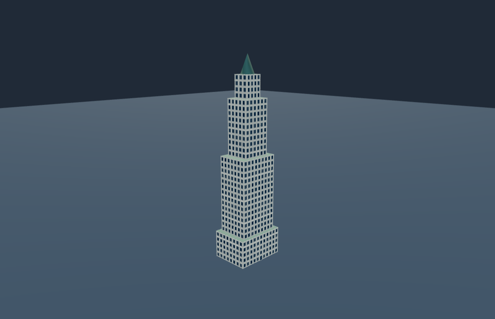
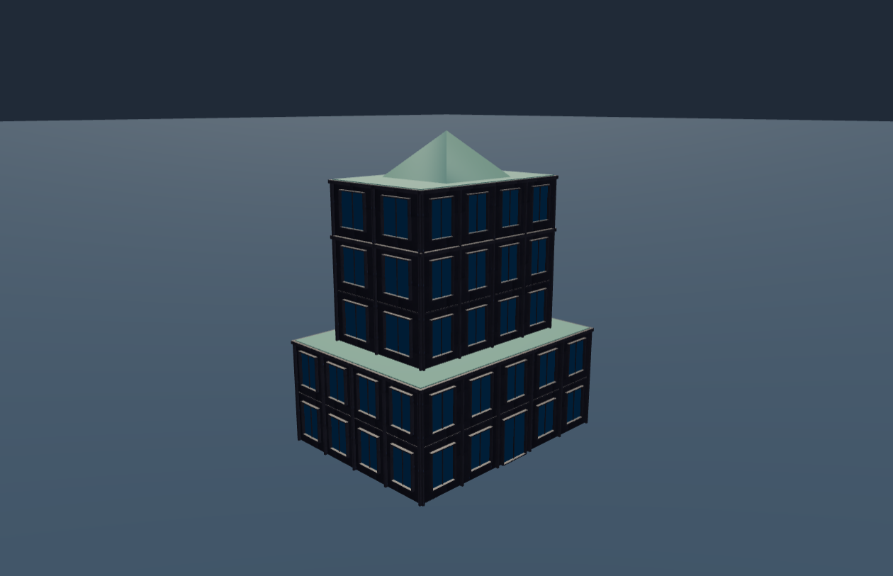

# Architecture moderne et contemporaine

Ces exemples sont des bases éditables pour l’atelier **Bâtiment depuis une référence**. Dans cet atelier, utiliser « Ouvrir un projet JSON » ; chaque image provient du rendu de la recette correspondante.

| Gratte-ciel — 33 étages | Immeuble contemporain — 5 étages |
| --- | --- |
|  [Recette JSON](gratte-ciel-1/recette.json) |  [Recette JSON](immeuble-contemporain-1/recette.json) |

Les deux fichiers portent le même `id` interne `tour_reference_01` : utiliser leur chemin et leur nom pour les distinguer ; ne pas les indexer comme deux identités uniques sans correction et migration explicites.

Format `uo.reference-building/v1`, distinct de HouseBlueprint. Ces fichiers restent hors du catalogue du registre : aucun adaptateur HouseBlueprint, chargement serveur, rendu Godot ou VR n’est établi par ces images. Leurs copies historiques restent accessibles à l’ancien emplacement.

[Architecture classique](../../../templates/architecture-editor/GALERIE.md) · [Pièces de base](../parts/base-modulaire-v1/README.md) · [Guide de réutilisation](../../../docs/editor-reuse.md) · [Accueil](../../../README.md)
