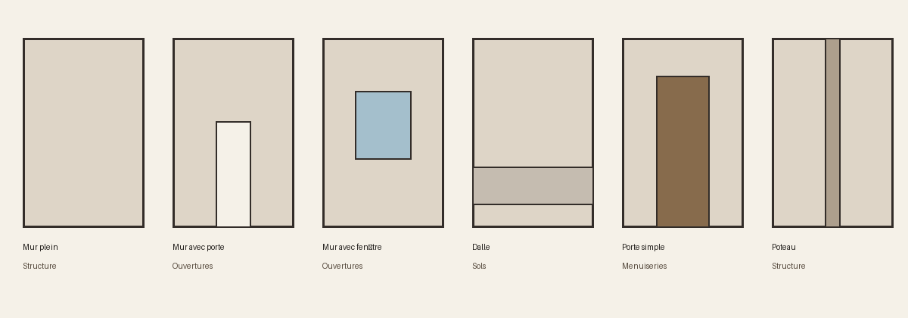

# Pièces d’architecture — kit de base modulaire v1

L’image est un **schéma**, pas une capture 3D. Six GLB originaux en volumes simples : bases de travail et de comparaison, sans texture, rig ni collisions livrées. La géométrie a été construite par assemblage de boîtes pour ce kit ; elle ne provient pas des GLB privés de l’éditeur.

| Catégorie | Pièce | Fichier |
| --- | --- | --- |
| Structure | Mur plein, 2 × 3 × 0,2 m | [GLB](mur-plein.glb) |
| Ouvertures | Mur avec porte | [GLB](mur-porte.glb) |
| Ouvertures | Mur avec fenêtre | [GLB](mur-fenetre.glb) |
| Sols | Dalle, 2 × 0,2 × 2 m | [GLB](dalle.glb) |
| Menuiseries | Porte simple, 0,9 × 2,1 m | [GLB](porte.glb) |
| Structure | Poteau, 0,2 × 3 × 0,2 m | [GLB](poteau.glb) |

Repère : mètres, Y vertical, mur centré en X/Z et pied à Y=0. La dalle repose sur Y=0. Les parties d’un même GLB peuvent se toucher sans constituer une surface soudée. [Manifeste et empreintes SHA-256](manifest.json).

**Statut : proxy de création.** En revue locale isolée, les six GLB ont été chargés par le chargeur de l’éditeur avec un manifeste de substitution temporaire. Un aperçu de plan a utilisé le mur plein et la dalle ; cet essai ne valide pas les quatre autres pièces en situation, ni un mapping permanent. Les lambrequins étaient désactivés : activés, l’aperçu a échoué sur `pignonXSet` non défini. Le chargement serveur, les collisions et le comportement en jeu ne sont pas vérifiés. Ne pas remplacer les assets existants automatiquement. Vérifier dimensions, orientation, matériaux, raccords, droits des ajouts et performance avant usage.

Licence des fichiers originaux de ce kit : Apache-2.0, comme le dépôt. [Guide de réutilisation](../../../../docs/editor-reuse.md) · [Architecture moderne](../../architecture-moderne-contemporaine/README.md) · [Accueil](../../../../README.md)
