# Galerie des créatures originales

Recettes de l’éditeur, captures réelles et états de revue — mise à jour du 2026-11-05.

Les images montrent des prototypes locaux et les variantes précisées dans chaque fiche. Les JSON conservent les paramètres et les références de dépendances ; les générateurs, pièces et modèles ne sont pas distribués dans ce dépôt. Aucun modèle présenté ici n’est déclaré prêt pour le jeu ni photoréaliste final.

[Index des recettes](README.md) · [Index lisible par les outils](gallery-index.json)

## Araignée géante — huit pattes

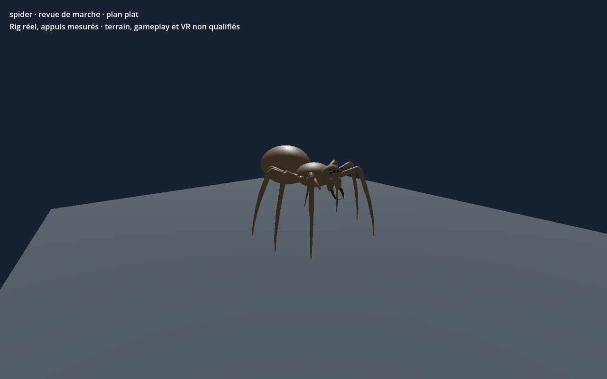

[Fiche 0.1.0](spider-original/v0.1.0/README.md) · [Recette JSON](spider-original/v0.1.0/recipe.json)

Génome natif de revue : 8 pattes locomotrices et tête crânienne dédiée, sans torse dupliqué. Orientation locale du composant de tête : 90° autour de Y. Le lien de marche référence un clip précalculé lié au SHA du modèle ; les modifications de forme demandent une nouvelle revue.

CPU, éditeur central et Godot Compatibility/Forward+ : quatre cycles rectilignes sur sol plat, au moins 4 appuis. Terrain, virages, forces, collisions complètes, gameplay, VR et finition artistique non qualifiés.

## Chauve-souris géante

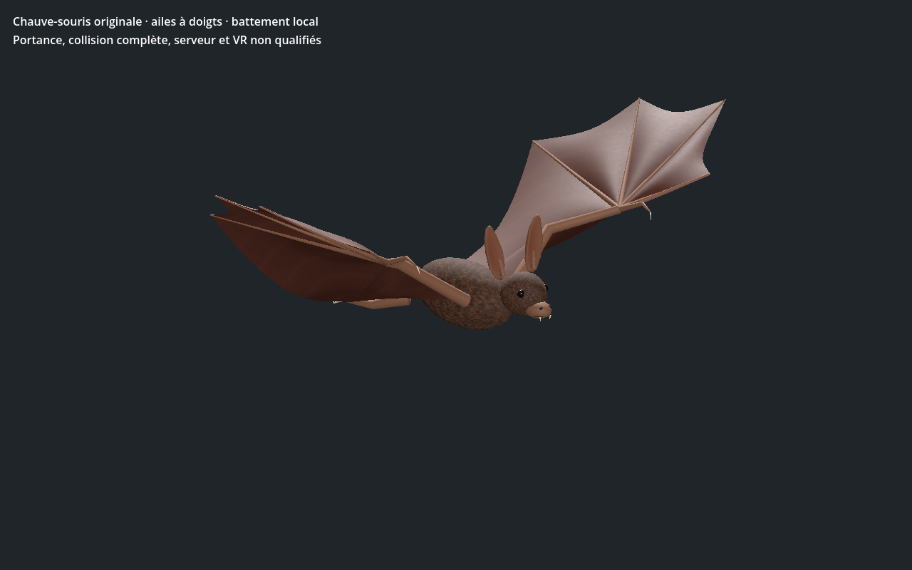

[Fiche 0.1.0](bat-original/v0.1.0/README.md) · [Recette JSON](bat-original/v0.1.0/recipe.json)

Recette exportée et capture de sa reconstruction, conservées sans réécriture.

Instantané historique de revue ; consulter la fiche pour la portée exacte des contrôles.

## Crocodilien — nuque affinée, yeux et UV régularisés

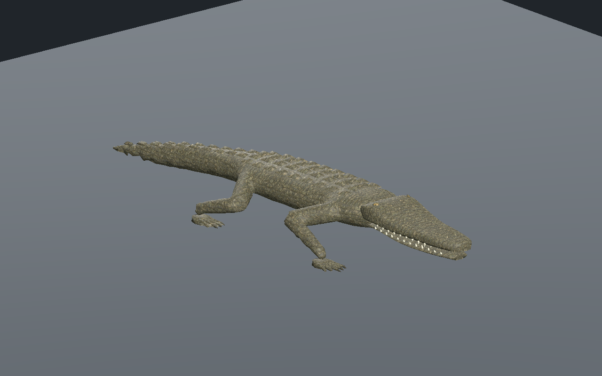

[Fiche 0.10.0](crocodile-original/v0.10.0/README.md) · [Recette JSON](crocodile-original/v0.10.0/recipe.json)

Arrière du crâne affiné, yeux plus fins et iris ambrés. Écarts de densité UV réduits sans ajout de triangles ni textures ; recette téléchargée, reconstruite et marche vérifiées dans l’éditeur et Godot.

Revue locale sur sol plat dans l’éditeur et Godot isolé. Coutures du corps, raccord tête/cou, dentition finale, intersections exhaustives, terrain, virages, nage, forces, foule, monde principal, réseau, VR et FPS non qualifiés. Finition photoréaliste non approuvée.

## Cheval brun — silhouette et marche

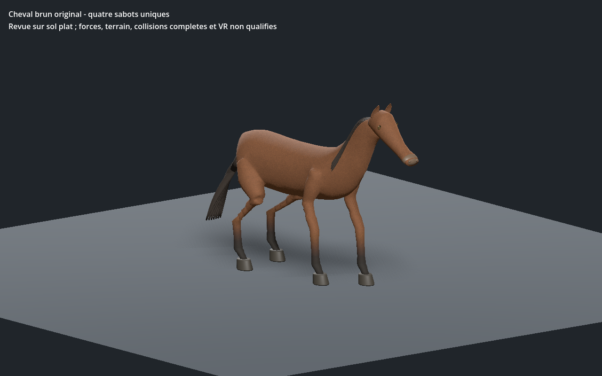

[Fiche 0.1.0](horse-original/v0.1.0/README.md) · [Recette JSON](horse-original/v0.1.0/recipe.json)

Première revue équine : pièces originales de l’éditeur, oreilles raccordées, crinière visible et membres reconstruits avec sections mesurées. Recette reconstruite, appuis et coût de 64 instances contrôlés ; finition encore stylisée.

Première revue équine encore stylisée sur sol plat, dans l’éditeur et Godot isolés. Tête, naseaux, crinière et queue restent à affiner. Aucun photoréalisme final, terrain, virage, force, collision exhaustive, monde principal, réseau ou VR qualifié.

## Rapace — peau continue et écailles

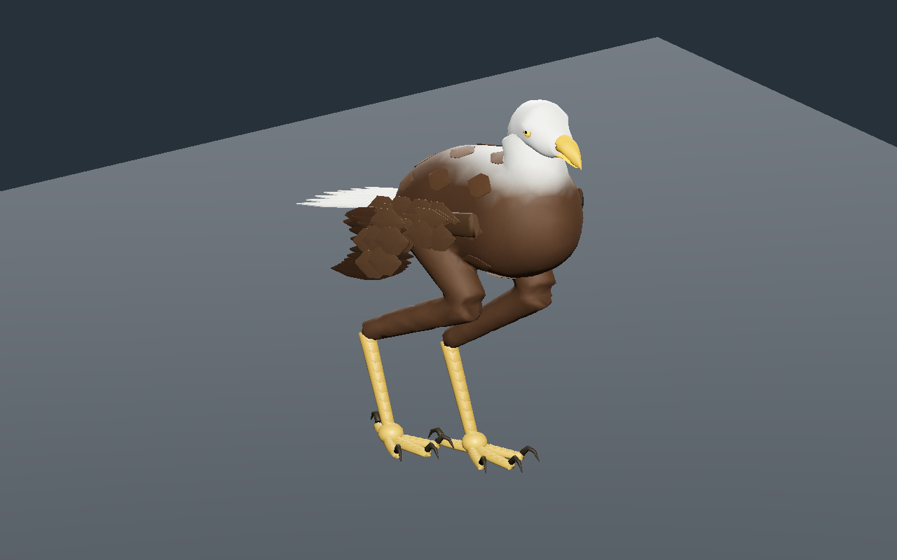

[Fiche 0.2.0](raptor-original/v0.2.0/README.md) · [Recette JSON](raptor-original/v0.2.0/recipe.json)

Torse, cou et haut des pattes réunis, écailles originales sur les pieds, déformations et appuis contrôlés. Recettes v1/v2 conservées ; nouvelle recette téléchargée puis reconstruite. Finition encore stylisée.

Revue locale encore stylisée : torse, cou et haut des pattes réunis en une surface fermée ; marche rectiligne sur plan plat contrôlée au CPU, dans l’éditeur et Godot isolés. Tête, ailes, bas des pattes, doigts et plumes restent des pièces séparées. Sculpture, plumage, intersections exhaustives, forces, terrain, vol, monde principal, réseau, VR et photoréalisme final non qualifiés.

## Lapin — museau, paupières et oreilles

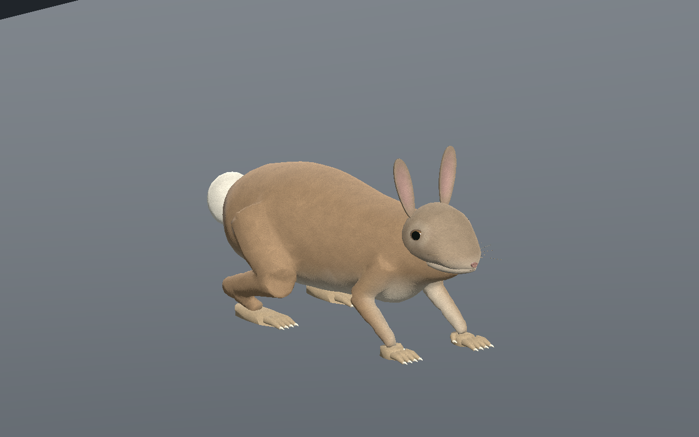

[Fiche 0.2.0](rabbit-original/v0.2.0/README.md) · [Recette JSON](rabbit-original/v0.2.0/recipe.json)

Tête affinée encore stylisée : joues et arête nasale sculptées, contours de paupière fermés, oreilles plus courtes et épaisses, mâchoire moins contrastée. Recette téléchargée puis reconstruite, déformations et appuis contrôlés dans l’éditeur et les deux modes Godot.

Revue locale encore stylisée : tête sculptée, contours de paupière fermés et oreilles épaissies ; marche lente rectiligne sur sol plat dans l’éditeur et Godot isolés. Raccords de composants, queue, silhouette du pelage et détails du LOD2 restent ouverts. Bonds, forces/masse, terrain, collisions exhaustives, monde principal, serveur, réseau, VR et photoréalisme final non qualifiés.

## Grenouille géante — peau et doigts palmés

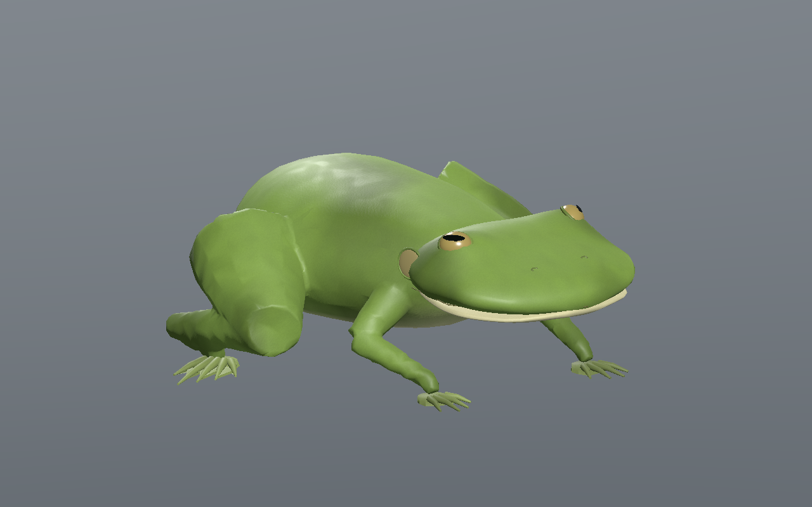

[Fiche 0.1.0](frog-original/v0.1.0/README.md) · [Recette JSON](frog-original/v0.1.0/recipe.json)

Tête dédiée, yeux dorsaux, tympans, quatre doigts avant et cinq doigts palmés arrière. Pigment original continu, recette téléchargée puis reconstruite et déplacement lent contrôlé dans l’éditeur et les deux modes Godot. Finition encore stylisée.

Première revue locale encore stylisée : déplacement lent sur sol plat dans l’éditeur et Godot isolés. Sculpture, iris, raccords de composants et silhouette du LOD2 restent à affiner. Centre de masse, forces, bonds, nage, terrain, collisions exhaustives, monde principal, réseau, VR et photoréalisme final non qualifiés.

## Biche — silhouette et marche

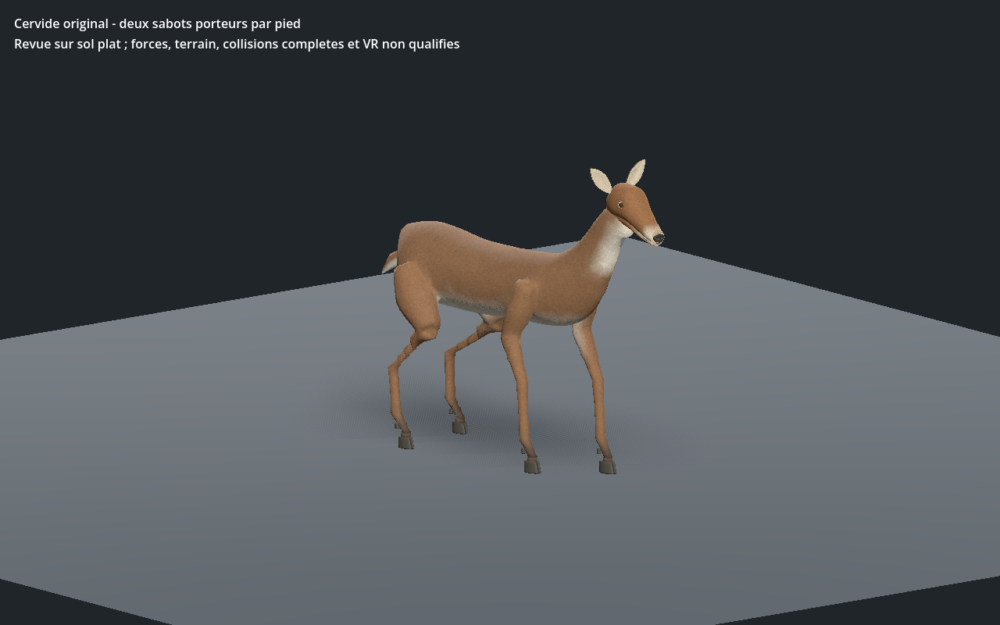

[Fiche 0.1.0](deer-doe-original/v0.1.0/README.md) · [Recette JSON](deer-doe-original/v0.1.0/recipe.json)

Première revue cervidée : tête originale dédiée, grandes oreilles, pelage nuancé et deux sabots pointus par pied. Recette téléchargée et reconstruite, appuis vérifiés dans l’éditeur et Godot ; finition encore stylisée.

Première revue cervidée encore stylisée : CPU, éditeur réel et Godot isolé sur sol plat. Visage, poils, raccords et dimorphisme du corps restent à affiner. Terrain, virages, forces, intersections exhaustives, monde principal, réseau et VR non qualifiés.

## Cerf à bois — silhouette et marche

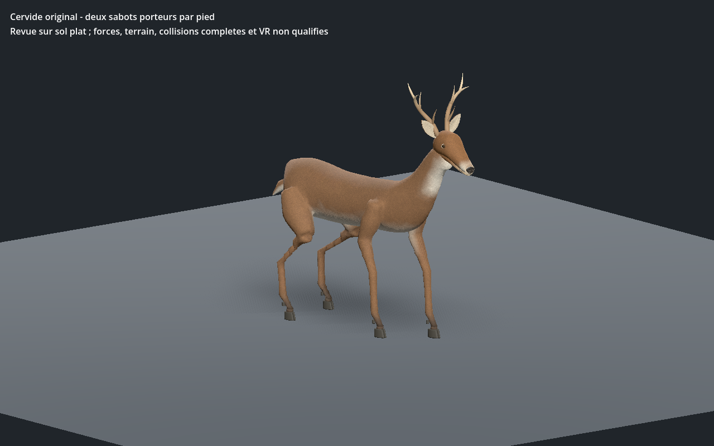

[Fiche 0.1.0](deer-stag-original/v0.1.0/README.md) · [Recette JSON](deer-stag-original/v0.1.0/recipe.json)

Première revue cervidée : tête originale dédiée, grandes oreilles, pelage nuancé et deux sabots pointus par pied. Recette téléchargée et reconstruite, appuis vérifiés dans l’éditeur et Godot ; finition encore stylisée.

Première revue cervidée encore stylisée : CPU, éditeur réel et Godot isolé sur sol plat. Visage, poils, raccords et dimorphisme du corps restent à affiner. Terrain, virages, forces, intersections exhaustives, monde principal, réseau et VR non qualifiés.

## Vache brune — crâne, oreilles et fanon

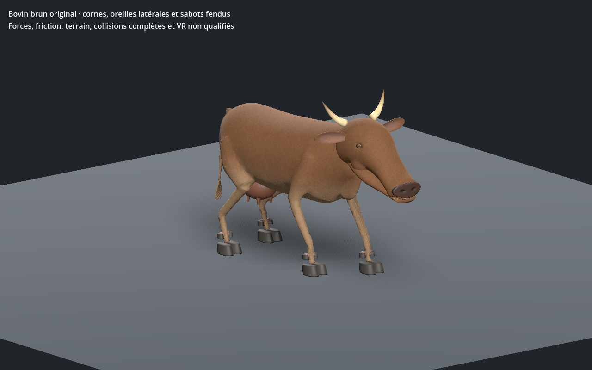

[Fiche 0.2.0](bovine-original/v0.2.0/README.md) · [Recette JSON](bovine-original/v0.2.0/recipe.json)

Crâne continu avec orbites creusées, oreilles en coupe, pupille horizontale, fanon et sabots biseautés. Recette reconstruite, contrôles de compression et levée ; coût natif borné de 64 instances mesuré.

Revue anatomique encore stylisée sur sol plat, éditeur réel et Godot isolé. Aucun photoréalisme final, terrain, virage, forces, collisions exhaustives, monde principal, réseau ou VR qualifié.

## Gazer

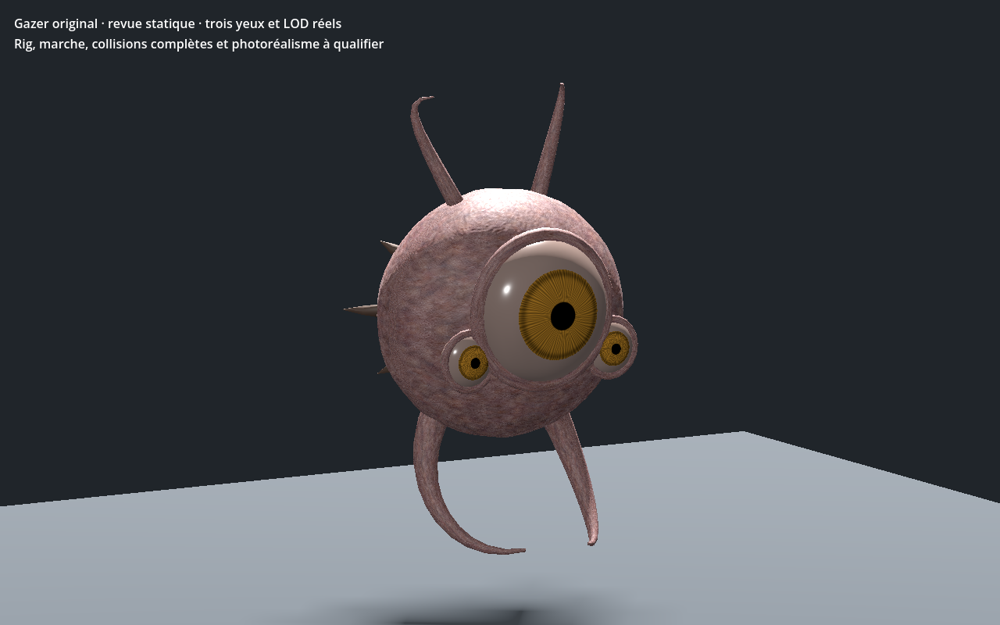

[Fiche 0.1.0](gazer-original/v0.1.0/README.md) · [Recette JSON](gazer-original/v0.1.0/recipe.json)

Recette exportée et capture de sa reconstruction, conservées sans réécriture.

Instantané historique de revue ; consulter la fiche pour la portée exacte des contrôles.

## Golem

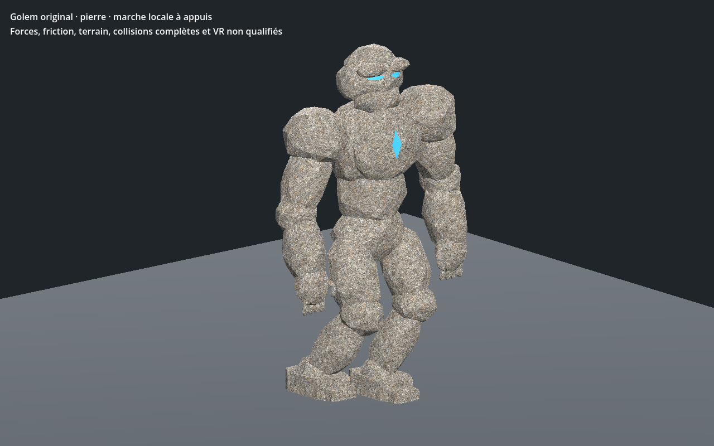

[Fiche 0.1.0](golem-original/v0.1.0/README.md) · [Recette JSON](golem-original/v0.1.0/recipe.json)

Recette exportée et capture de sa reconstruction, conservées sans réécriture.

Instantané historique de revue ; consulter la fiche pour la portée exacte des contrôles.

## Loup — oreilles et marche

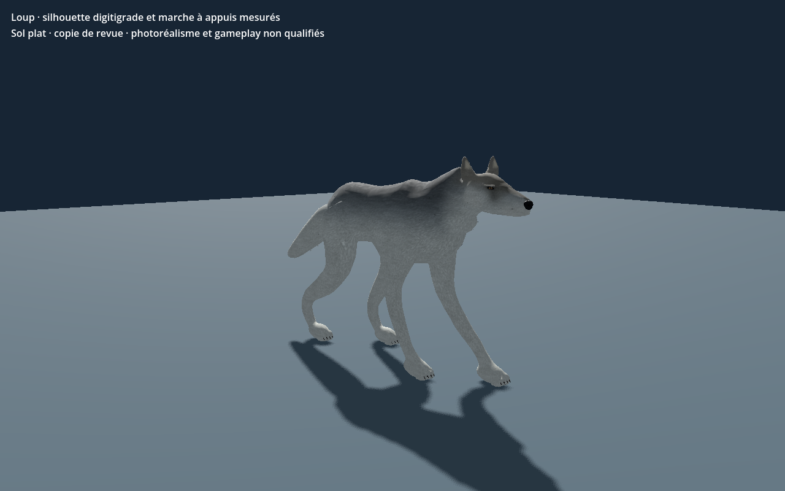

[Fiche 0.1.0](wolf-original/v0.1.0/README.md) · [Recette JSON](wolf-original/v0.1.0/recipe.json)

Variante reconstruite de la recette exportée : oreilles affinées, pointes relevées de 15 mm, profondeur de 3 mm et détail de fourrure partagé. La révision locale sélectionnée conserve une profondeur de 4 mm ; cette image montre bien la variante de preuve à 3 mm.

Reconstruction de la recette téléchargée et revue Godot sur sol plat ; trois LOD de 15 978 / 5 074 / 1 400 triangles. Aucune preuve de terrain, monde réseau, VR, collisions exhaustives ou photoréalisme final.

## Ours brun — plantigradie et marche

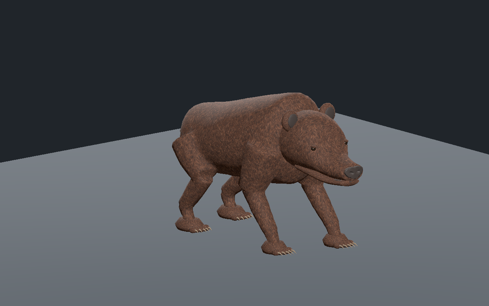

[Fiche 0.1.0](bear-original/v0.1.0/README.md) · [Recette JSON](bear-original/v0.1.0/recipe.json)

Première base originale d’ours brun : épaules hautes, tête abaissée, oreilles rondes, pieds plantigrades à cinq doigts et griffes. Recette téléchargée puis reconstruite, avec captures Godot.

Appuis et déformations mesurés sur sol plat dans l’éditeur et Godot isolés ; sculpture et fourrure encore en revue. Autres espèces d’ours, terrain, forces, gameplay et VR non qualifiés.

## Puma — tête continue et pelage nuancé

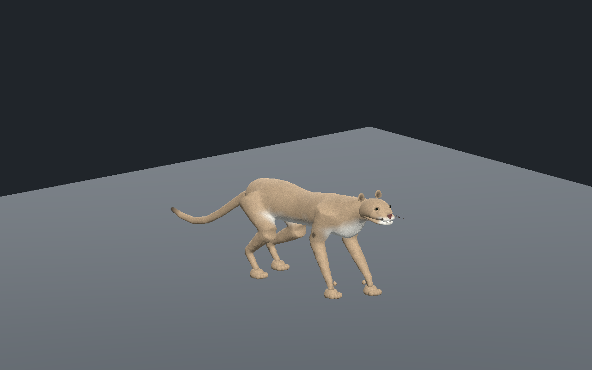

[Fiche 0.2.0](cougar-original/v0.2.0/README.md) · [Recette JSON](cougar-original/v0.2.0/recipe.json)

Crâne et museau continus, orbites creusées, paupières en amande et pigment fauve/crème progressif. Matériaux optiques synchronisés dans l’éditeur et Godot ; recette téléchargée et reconstruite.

Revue originale du puma sur sol plat dans l’éditeur et Godot isolés. La sculpture reste stylisée : aucune approbation photoréaliste finale, terrain, virage, forces, collisions exhaustives, gameplay réseau ou VR.

## Rat géant

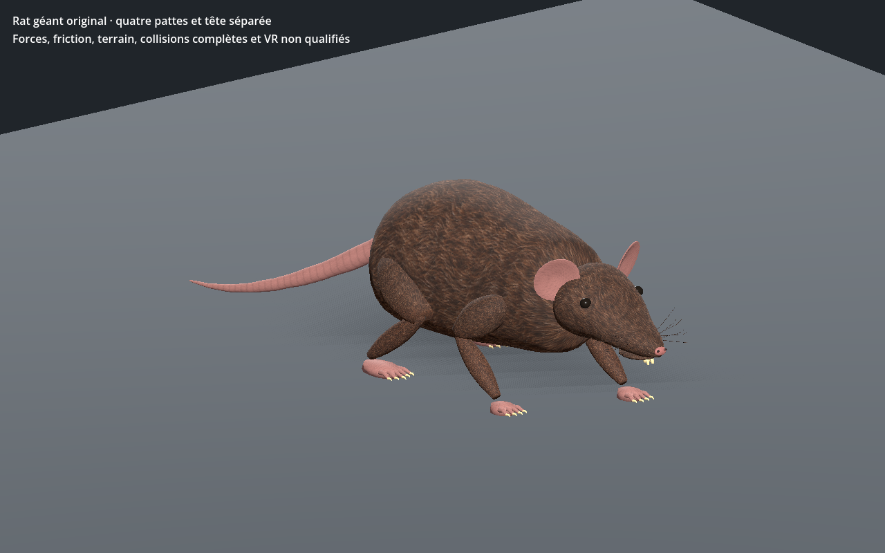

[Fiche 0.1.0](rat-original/v0.1.0/README.md) · [Recette JSON](rat-original/v0.1.0/recipe.json)

Recette exportée et capture de sa reconstruction, conservées sans réécriture.

Instantané historique de revue ; consulter la fiche pour la portée exacte des contrôles.

## Sanglier géant

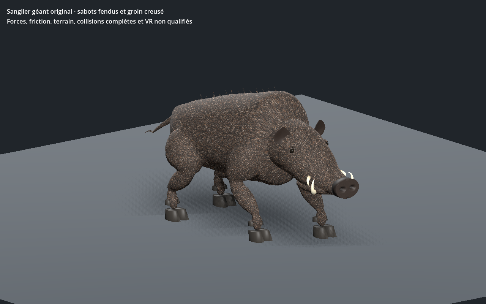

[Fiche 0.1.0](boar-original/v0.1.0/README.md) · [Recette JSON](boar-original/v0.1.0/recipe.json)

Recette exportée et capture de sa reconstruction, conservées sans réécriture.

Instantané historique de revue ; consulter la fiche pour la portée exacte des contrôles.

## Scarabée géant — six pattes

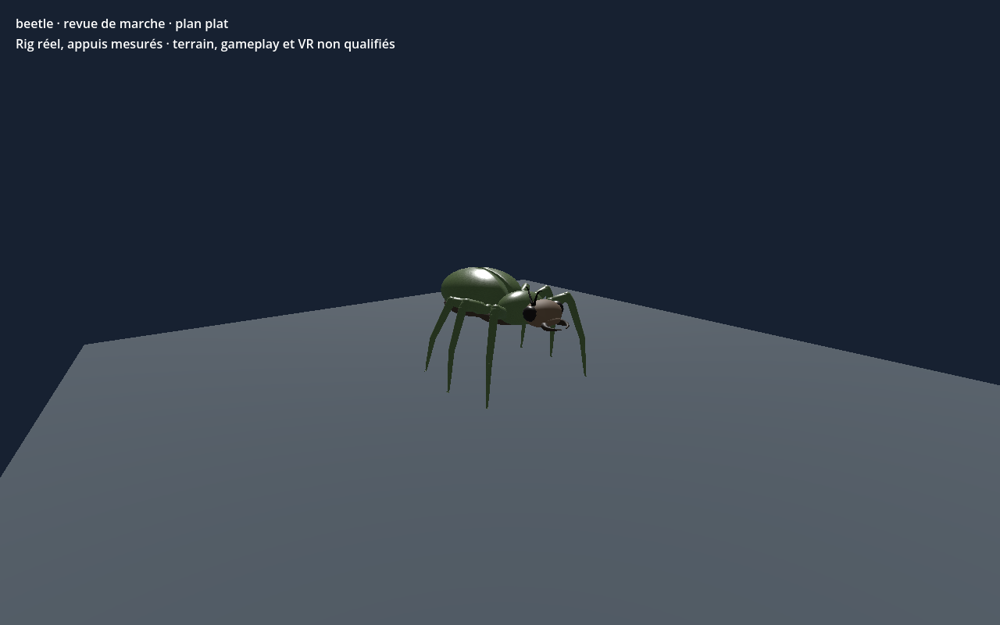

[Fiche 0.1.0](beetle-original/v0.1.0/README.md) · [Recette JSON](beetle-original/v0.1.0/recipe.json)

Génome natif de revue : 6 pattes locomotrices et tête crânienne dédiée, sans torse dupliqué. Orientation locale du composant de tête : 180° autour de Y. Le lien de marche référence un clip précalculé lié au SHA du modèle ; les modifications de forme demandent une nouvelle revue.

CPU, éditeur central et Godot Compatibility/Forward+ : quatre cycles rectilignes sur sol plat, au moins 3 appuis. Terrain, virages, forces, collisions complètes, gameplay, VR et finition artistique non qualifiés.

## Scorpion — marche articulée

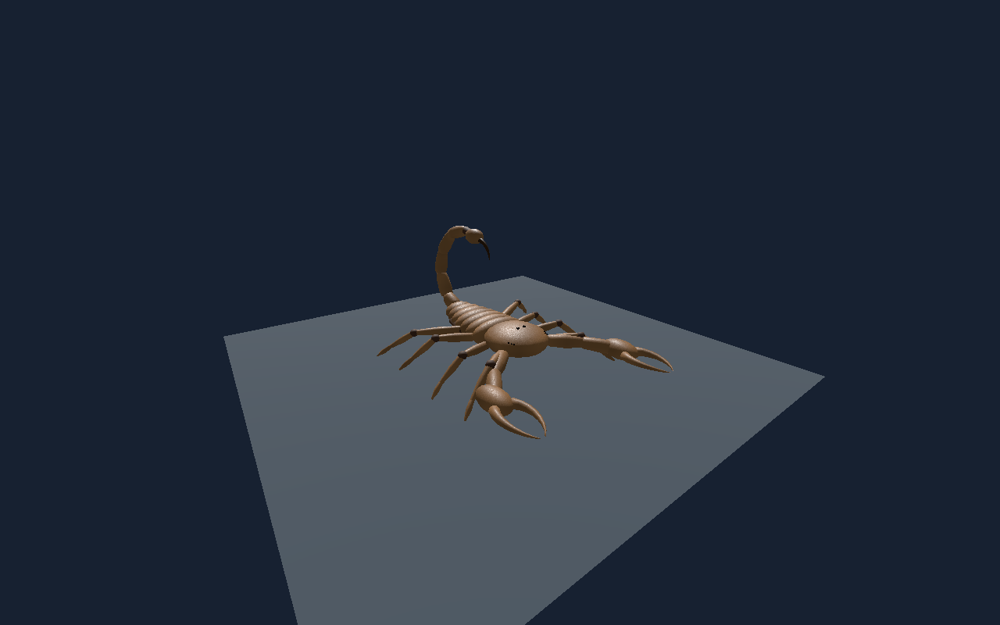

[Fiche 0.2.0](scorpion-original/v0.2.0/README.md) · [Recette JSON](scorpion-original/v0.2.0/recipe.json)

Nouvelle version documentaire animée, conservant la fiche statique 0.1.0. Recette réellement téléchargée puis reconstruite : pas de 0,08 m, levée de 0,04 m, cycle de 1,5 s, part d’appui de 0,74. Huit pattes locomotrices distinctes des deux pédipalpes ; trois actionneurs simplifiés par patte.

Audit CPU de 673 instants par LOD, éditeur et Godot : au moins quatre appuis sur sol plat ; 8 992 / 4 470 / 1 998 triangles et deux images 256 × 256. Ce ne sont pas des preuves de forces, terrain, virages, gameplay, VR ou photoréalisme final.

## Serpent

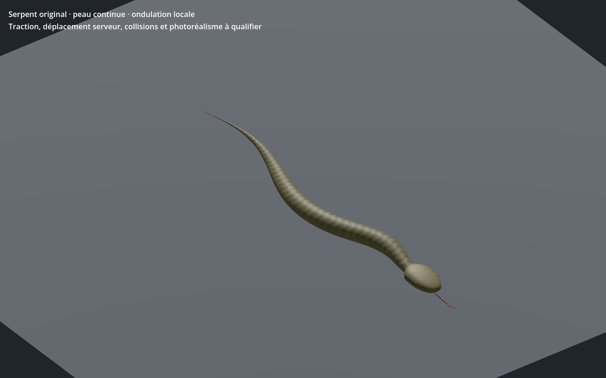

[Fiche 0.1.0](serpent-original/v0.1.0/README.md) · [Recette JSON](serpent-original/v0.1.0/recipe.json)

Recette exportée et capture de sa reconstruction, conservées sans réécriture.

Instantané historique de revue ; consulter la fiche pour la portée exacte des contrôles.

## Dragon — crâne et narines connectés

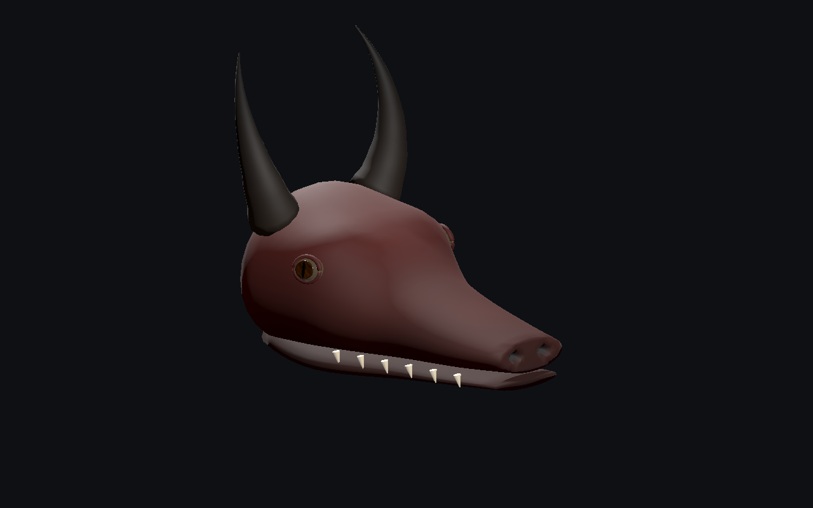

[Fiche 0.2.0](dragon-cranium-original/v0.2.0/README.md) · [Recette JSON](dragon-cranium-original/v0.2.0/recipe.json)

Tête seule : narines réellement intégrées au crâne, orbites sculptées, yeux enchâssés, cornes courbes et huit groupes de maillage. Recette reconstruite, attache vérifiée et comparaisons natives avant/après sous le même éclairage.

Tête seule encore stylisée, sans microrelief de peau ni rig de mâchoire. Corps, marche, ailes, vol, terrain, collisions exhaustives, monde principal, serveur/réseau/VR, FPS et photoréalisme final non qualifiés.

## Dragon — corps et marche, ailes à construire

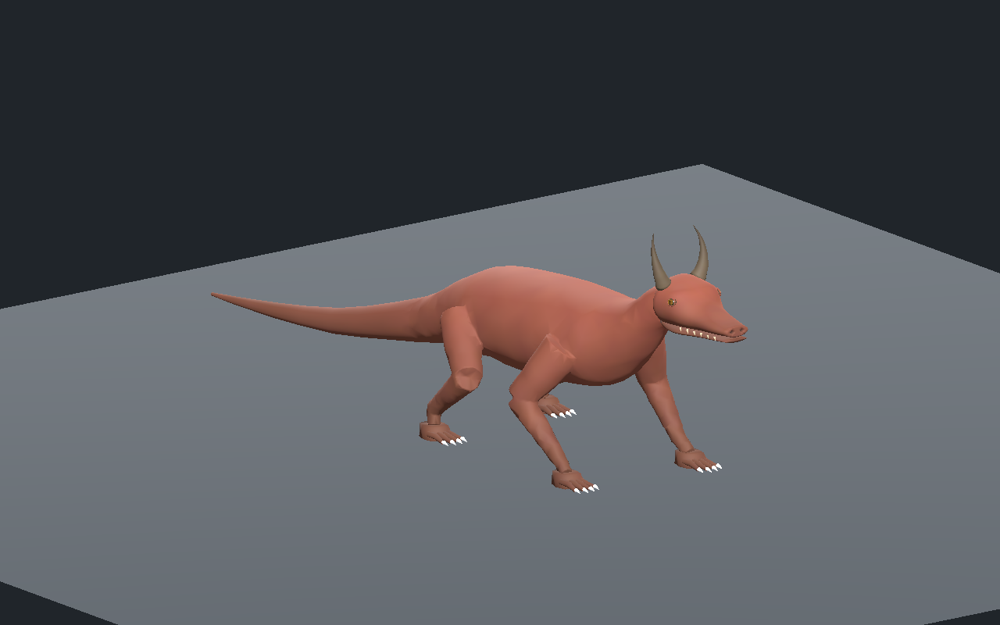

[Fiche 0.1.0](dragon-body-original/v0.1.0/README.md) · [Recette JSON](dragon-body-original/v0.1.0/recipe.json)

Cou, queue corrigée et quatre pieds griffus sur un rig original de33os. Tête conservée, peau centrale connectée, recette téléchargée puis reconstruite, appuis contrôlés dans l’éditeur et les deux modes Godot. Corps encore stylisé, sans ailes.

Corps du dragon encore stylisé, sans ailes ni microrelief de peau. Marche lente sur sol plat dans des revues isolées ; pas de forces/centre de masse, terrain, virages, collisions exhaustives, vol, monde principal, serveur/réseau/VR, FPS ou photoréalisme final qualifiés.

## Dragon — ailes repliables et marche de revue

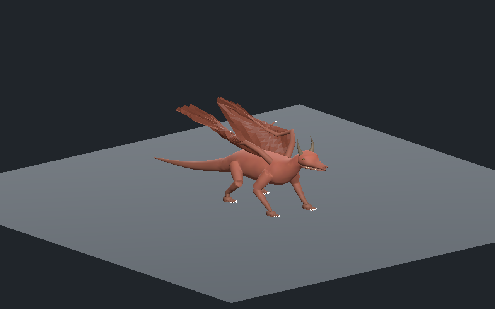

[Fiche 0.2.0](dragon-wings-original/v0.2.0/README.md) · [Recette JSON](dragon-wings-original/v0.2.0/recipe.json)

Repli compact au coude, poignet et doigts, membranes corrigées et UV animés contrôlés. Rig de57os, trois petites images partagées ; recette téléchargée puis reconstruite et vérifications dans l’éditeur/Godot. Finition encore stylisée, vol non qualifié.

Revue locale encore stylisée : repli compact et déploiement au sol, sans simulation de tissu ou de vol. Finition photoréaliste, anatomie finale, collisions exhaustives corps/ailes, forces, terrain, monde principal, serveur/réseau/VR et FPS restent non qualifiés.

## Requin — attaches corrigées et quatre lots

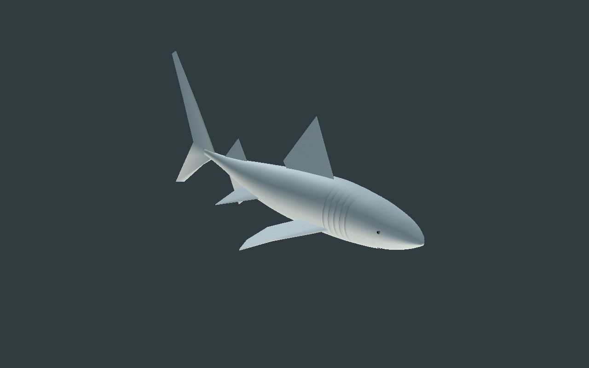

[Fiche 0.2.0](shark-original/v0.2.0/README.md) · [Recette JSON](shark-original/v0.2.0/recipe.json)

Bases pelviennes et pectorales rentrées et contrôlées pendant la nage ; regroupement14→4maillages, mêmes triangles et trois petites images. Recette téléchargée puis reconstruite, rendus éditeur/Godot. Première finition encore stylisée.

Revue originale encore stylisée : nage latérale locale, quatre lots par LOD et sommets de base des nageoires contrôlés sur129poses/LOD. Composants séparés, sans peau soudée, collision exhaustive ni hydrodynamique. Bouche ouverte/dents, finition photoréaliste, variantes spécifiques, monde principal, serveur/réseau/VR et FPS restent non qualifiés.

## Crabe — huit pattes et pinces articulées

[Fiche 0.1.0](crab-original/v0.1.0/README.md) · [Recette JSON](crab-original/v0.1.0/recipe.json)

Nouvelle famille originale : marche latérale à huit pattes, deux pinces courbes animées et chitine originale256/128/128. Recette réellement téléchargée puis reconstruite ; appuis vérifiés dans l’éditeur et les deux modes Godot.

Crabe original de revue : huit pattes marcheuses et deux pinces articulées, segments externes simplifiés et texture de chitine originale. Appuis cinématiques sur sol plat ; aucune preuve de masse/forces, terrain, collisions exhaustives, pression des pinces, anatomie finale, photoréalisme final, monde principal, serveur/réseau/VR ou FPS.

## Kraken — huit bras et ventouses

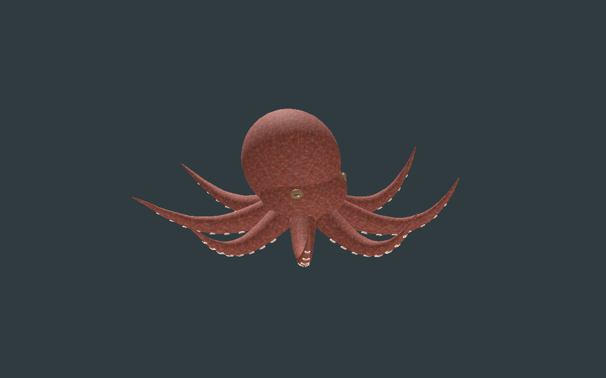

[Fiche 0.1.0](kraken-original/v0.1.0/README.md) · [Recette JSON](kraken-original/v0.1.0/recipe.json)

Nouvelle famille octopoïde : implantation native de huit bras, profil original optimisé, ventouses creuses et ondulation sur49os. Recette téléchargée puis reconstruite, éditeur et deux modes Godot ; finition encore stylisée.

Première adaptation originale octopoïde encore stylisée : huit bras, ventouses creuses et ondulation locale. Raccords tête/manteau/bras, coutures UV visibles, ventouses anguleuses et bec simplifié restent à améliorer. Pas de photoréalisme final, collisions exhaustives, adhésion, tissu/forces, hydrodynamique, vitesse autoritaire, monde principal, serveur/réseau/VR ou FPS qualifiés.

## Squelette — crâne affiné et mâchoire articulée

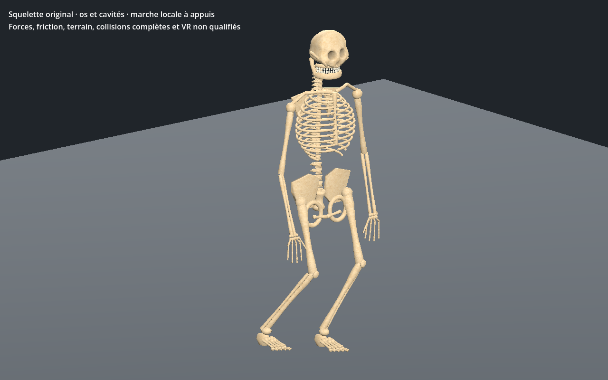

[Fiche 0.2.0](skeleton-original/v0.2.0/README.md) · [Recette JSON](skeleton-original/v0.2.0/recipe.json)

Relief facial repris, couronnes différenciées et pivot mandibulaire corrigé. Ouverture bornée vérifiée sur les vrais sommets dans l’éditeur et Godot ; marche et reconstruction requalifiées, images conservées.

Revue locale encore stylisée. Crâne, bassin et proportions restent à affiner avant approbation photoréaliste. Contrôles de marche sur sol plat et séparation verticale des deux arcades sur les ouvertures échantillonnées ; pas de collisions dentaires/craniales exhaustives, forces, terrain, attaque, équipement, monde principal, serveur/réseau, VR ou FPS qualifiés.

La version statique du [scorpion 0.1.0](scorpion-original/v0.1.0/README.md) et le [génome d’araignée déjà catalogué](../../templates/xeno-editor/giant-spider-eight-legs/v0.2.0/README.md) restent conservés. L’inventaire et la recréation des autres familles se poursuivent.

## Gobelin des forêts — revue locale

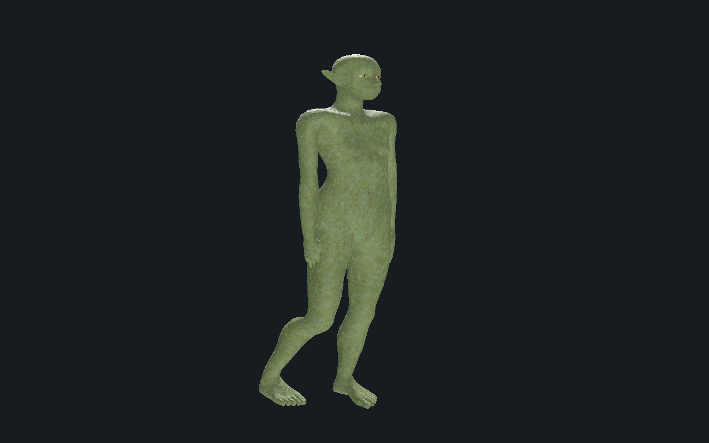

[Recette, captures et limites](gobelin-revue-20261107/README.md)

## Gelée bleue — étude de revue

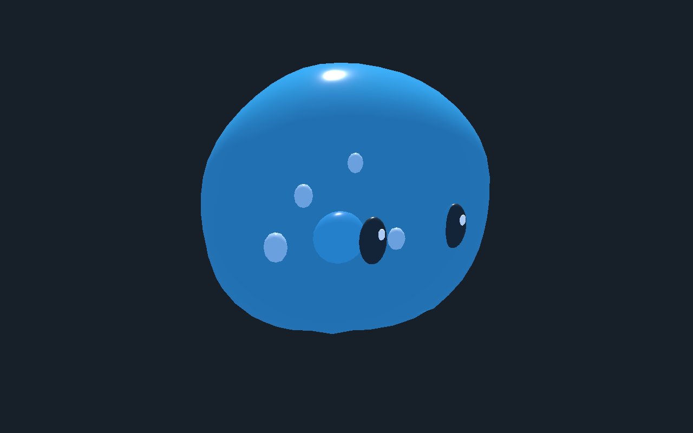

[Recette, captures et limites](gelee-bleue-revue-20261107/README.md)
