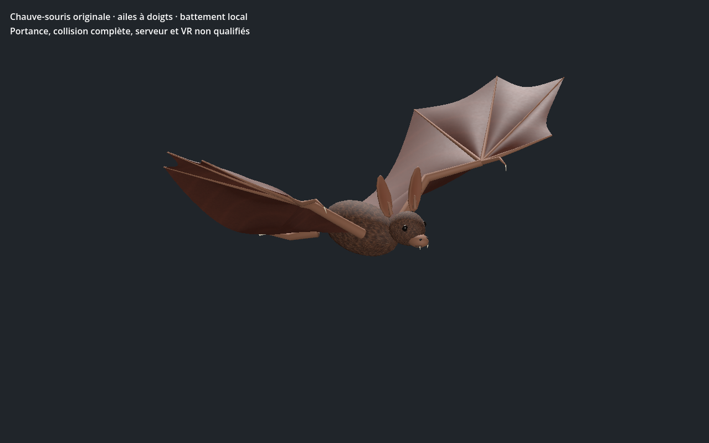

# Chauve-souris géante original — recette 0.1.0

[Recette JSON exportée](recipe.json) — version documentaire **0.1.0**, `review_only`.

La recette utilise `uo.bat-original/v1` et la source SHA-256 `777bc7ed3782561edbfe84a5428263f3ab12f925e3cb22ef7cac65abdcc64b19`. Le générateur et le modèle source ne sont pas distribués ici : ce JSON seul ne suffit pas à reconstruire le modèle. Cette entrée n’est pas un génome Xeno natif ni une entrée strict-v1 du catalogue.

La capture provient du contrôle Godot de la variante reconstruite avec cette recette ; SHA-256 du GLB reconstruit : `fb1b5c0421b0db0554cdfe2701db17cec3e2c69c98122d8aef3f64f130f5c05b`. Le contrôle historique `PASS_BAT_NATIVE_SKIN_LODS_AND_WINGBEAT` s’est terminé avec le code 0. La géométrie et les matières de ce lot sont documentées comme originales ou procédurales ; aucune référence historique EA/Origin n’est incluse.

La capture et la preuve locale ne valident pas les collisions complètes, l’intégration au serveur ou à la VR, ni la qualité artistique finale.

SHA-256 de la recette : `282f5c6c90ebc71984f1ec936da1f5e649c5453cb412abe91205baca6400f979` ; de la capture : `18635ebfe17ddf80f2ff8c0679eae85f4b0540c16af7fa23e7bd37d8730b0390`.
