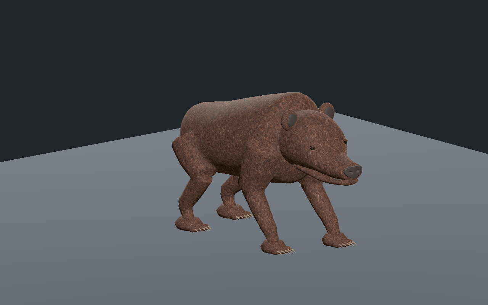
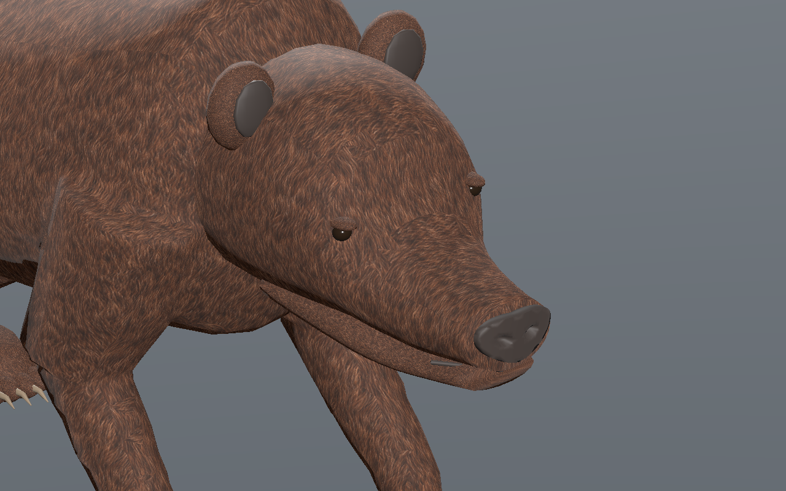

# Ours brun — plantigradie et marche, recette 0.1.0

[Recette JSON exportée](recipe.json) · [Profil anatomique](anatomy-profile.json) · [Mesures](validation.json) · [Provenance et empreintes](provenance.json) · [Galerie](../../GALERIE.md)

Première base originale de revue pour l’ours brun : bosse d’épaules, tête abaissée, petites oreilles rondes, queue courte, pieds plantigrades à cinq doigts et griffes visibles. Le composant crânien séparé contient uniquement la tête et se réutilise dans l’atelier de revue ; il n’est pas encore une pièce admise dans la palette native du catalogue MCP. Le profil ne qualifie pas les ours noirs, polaires, variantes grizzlis ou hybrides.

La première ébauche avait un nez trop proche du sanglier et des UV de fourrure étirés aux épaules. Le nez est raccourci et remodelé ; les cartes métriques du tronc et du crâne limitent la distorsion à moins de 1,73. Les changements de direction entre cartes de fourrure restent visibles et demandent une amélioration artistique.

La recette a été réellement téléchargée depuis l’éditeur puis reconstruite avec un pas de 0,30 m, quatre cycles de 1,8 s et une levée de 0,075 m. Les deux images montrent cette reconstruction. Le modèle sélectionné de l’atelier, à pas de 0,28 m, passe Godot Compatibility et Forward+ ainsi que les contrôles de LOD, tête seule, lecture après fin, appuis, partage de trois images et téléchargement du bon GLB. La variante reconstruite passe Godot Forward+.

Budgets : **10 976 / 6 142 / 3 156 triangles**, 27 os et trois images **512 / 256 / 256** pixels. Les 601 instants CPU et 241 instants natifs par LOD vérifient au moins trois appuis et une dérive inférieure à 0,24 mm. L’estimation RGBA8+mipmaps de 2 097 148 octets concerne uniquement les images ; ce n’est pas une mesure de mémoire totale pilote ni de FPS en jeu.

SHA-256 du modèle capturé : `9b227e106f7f03598e512b5f0ca74c98e7de5abfd658aedb306361f30663587f`.
SHA-256 de la recette : `1d0dcb8d250015b1903abe6bb96eb5459904cf7fa26e009b58ab80346ea3da2e`.

Ce JSON est un projet paramétrique documentaire, pas un génome natif ou une entrée strict-v1. Les générateurs, pièces, GLB et adaptateurs privés nécessaires ne sont pas distribués ici : le JSON seul n’est pas autonome. La sculpture, les oreilles internes, le raccord tête/cou et la fourrure restent en revue artistique ; aucun photoréalisme final n’est approuvé. Les mesures concernent un sol plat isolé et ne prouvent pas terrain, virages, forces, collisions exhaustives, combat, serveur, monde principal ou VR.
