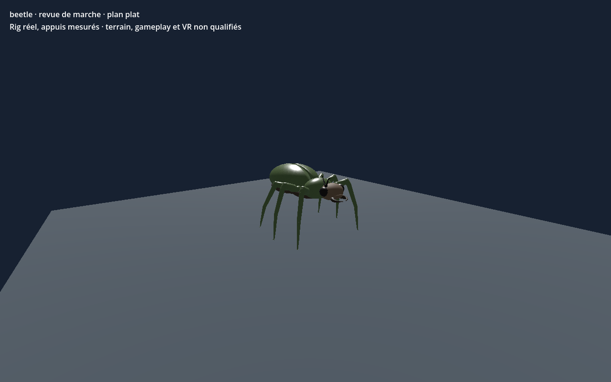

# Scarabée géant — six pattes — recette 0.1.0

[Recette JSON](recipe.json) · [Provenance et empreintes](provenance.json) · [Galerie](../../GALERIE.md)

Génome natif de revue : 6 pattes locomotrices et tête crânienne dédiée, sans torse dupliqué. Orientation locale du composant de tête : 180° autour de Y. Le lien de marche référence un clip précalculé lié au SHA du modèle ; les modifications de forme demandent une nouvelle revue.

**Portée vérifiée :** CPU, éditeur central et Godot Compatibility/Forward+ : quatre cycles rectilignes sur sol plat, au moins 3 appuis. Terrain, virages, forces, collisions complètes, gameplay, VR et finition artistique non qualifiés.

Ce document conserve un instantané de travail original en `review_only`, sans autorité serveur ni approbation artistique finale. Les générateurs, pièces, modèles et adaptateurs locaux nécessaires ne sont pas distribués ici ; ce JSON seul ne reconstruit pas le modèle. Aucune compatibilité strict-v1 n'est revendiquée.

SHA-256 du modèle effectivement capturé : `3b380521bc4436b5e9b06239608fa5b3f0ee12c81570a4fb63a7eba62008d72d`.
SHA-256 de la recette : `b6af938fcfb19bf6c5db1f717c961f2b0a26db0fc22b9a1fb57bf76b8ab509d2`.
SHA-256 de l'image : `62430b8a92b85a18e3458fc6ed8832fc14a9f10254aee2b09b63bcdf70bb7c07`.
