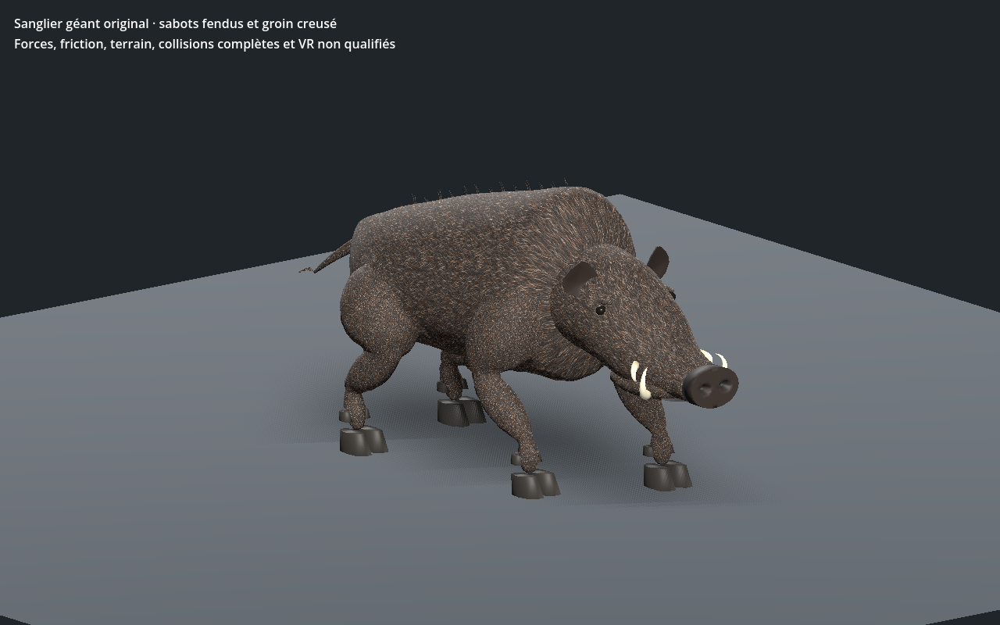

# Sanglier géant original — recette 0.1.0

[Recette JSON exportée](recipe.json) — version documentaire **0.1.0**, `review_only`.

La recette utilise `uo.boar-original/v1` et la source SHA-256 `6bf2329359c043681135d4cfdfb878009af2a64874be4fca459b7d7b7217860b`. Le générateur et le modèle source ne sont pas distribués ici : ce JSON seul ne suffit pas à reconstruire le modèle. Cette entrée n’est pas un génome Xeno natif ni une entrée strict-v1 du catalogue.

La capture provient du contrôle Godot de la variante reconstruite avec cette recette ; SHA-256 du GLB reconstruit : `e7ffa2e077141cb1347234c5ab826a4e04192b1b0773216f52ddce50434fb010`. Le contrôle historique `PASS_BOAR_NATIVE_SKIN_AND_SOLE_ANCHORS` s’est terminé avec le code 0. La géométrie et les matières de ce lot sont documentées comme originales ou procédurales ; aucune référence historique EA/Origin n’est incluse.

La capture et la preuve locale ne valident pas les collisions complètes, l’intégration au serveur ou à la VR, ni la qualité artistique finale.

SHA-256 de la recette : `51ada4df53addd13f9099bf29cbf4edfb09ec20f494e440410ea2145122386c4` ; de la capture : `8f1287df6611299dbaa75026588baf8bec44b8d7db2a3af3ae71de9b945a8df6`.
