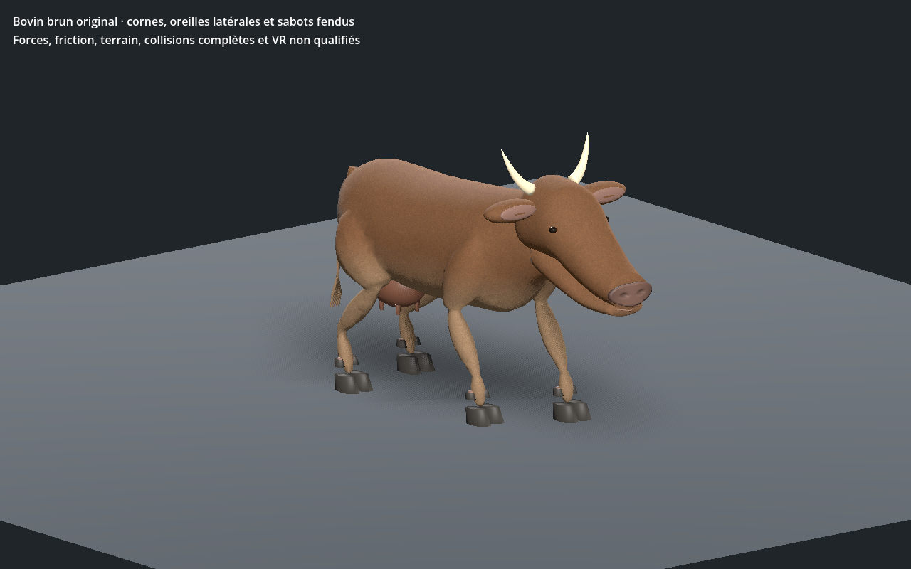
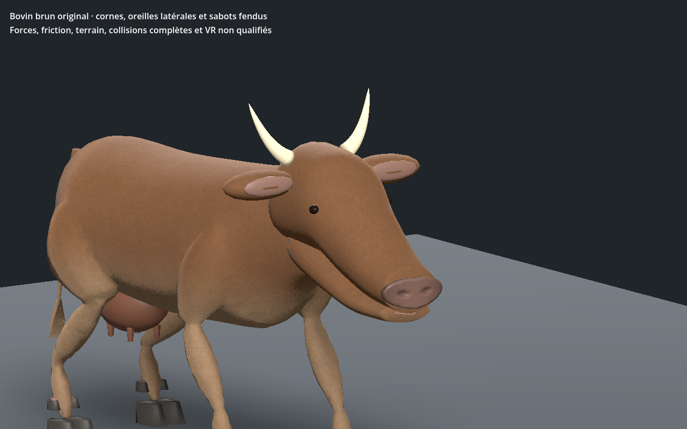

# Vache brune — première revue anatomique et marche, recette 0.1.0

[Recette JSON](recipe.json) · [Profil anatomique](anatomy-profile.json) · [Mesures](validation.json) · [Provenance](provenance.json) · [Galerie](../../GALERIE.md)

Nouvelle revue pour l’identité bovine brune du jeu : corps bovin original avec peau continue, tête allongée sans torse dupliqué, deux oreilles latérales, deux cornes, queue à touffe, mamelle et quatre trayons. Chaque pied possède deux sabots porteurs et deux ergots relevés. Les proportions, les oreilles, les orbites, le mufle et les raccords restent simplifiés ; ce modèle n’est pas un scan ni un résultat photoréaliste final.

Le détail de poil court reprend une image originale partagée déjà conservée dans le projet. Le pigment brun/crème est calculé par sommet, avec une plage explicitement bornée après rejet d’un premier dégradé incorrect. Aucun pixel d’une photographie de référence ou d’un ancien modèle du jeu n’est utilisé. Trois images seulement : **512 / 256 / 256 pixels** ; estimation RGBA8 avec mipmaps **2 097 148 octets**, hors mémoire totale du pilote et sans mesure FPS.

Les LOD comptent **9 666 / 4 790 / 2 394 triangles**, avec **45 os** et quatre influences maximum. Les cartes métriques mesurées du corps, du crâne et de la mâchoire n’ont pas de triangle UV écrasé ; anisotropie maximale inférieure à **1,724**. La tête indépendante et le corps possèdent les mêmes positions, normales, UV et couleurs rendus. Le flux du poil et la densité de toutes les petites pièces ne sont pas qualifiés.

La marche est contrôlée sur **601 instants par LOD au CPU**, puis **241 dans l’éditeur et Godot** : au moins trois appuis, dérive maximale inférieure à **0,27 mm**, écart vertical d’appui inférieur à **0,26 mm**. Une très petite excursion sous le plan, environ **0,0032 mm**, reste dans la tolérance numérique déclarée ; il ne s’agit pas d’un modèle de contact physique. Les arêtes uniques des trois LOD sont contrôlées pendant la séquence, sans allongement au-delà de 1,246 fois leur longueur de repos dans cette variante. Ce contrôle ne certifie pas les intersections ni l’équilibre dynamique.

La version sélectionnée passe Godot Forward+ et Compatibility. Le vrai lien de l’éditeur central, ses trois LOD, les commandes lecture/pause/reprise/relecture, le relief, la topologie, la tête seule et l’enregistrement JSON sont contrôlés dans le navigateur. La recette téléchargée augmente le pas de **0,27 à 0,28 m** ; elle est reconstruite et effectivement chargée dans Godot Forward+. Les deux images montrent cette reconstruction.

SHA-256 du modèle capturé : `40b56258deafc40988dfe9a879937a9c29cd076b2c31c9e16b67916393b10541`.
SHA-256 de la recette : `748a766bbdd831407a28807e6d6caa0134988edc9953699f0f2e867d7f7738c9`.

Les générateurs, GLB, caches et adaptateurs privés restent locaux : le JSON documentaire seul ne permet pas une reconstruction autonome. Les statistiques du catalogue et les autorités serveur restent inchangées. Première revue bovine encore stylisée, sur sol plat dans l’éditeur et Godot isolés. Photoréalisme final, terrain, virages, forces, collisions exhaustives, gameplay réseau et VR non qualifiés.
