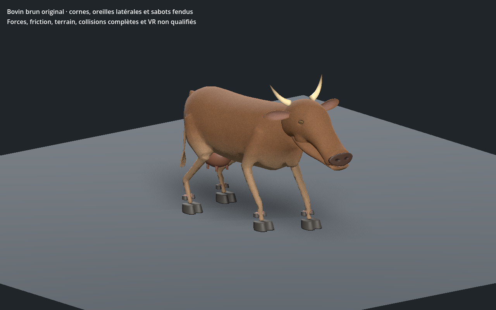
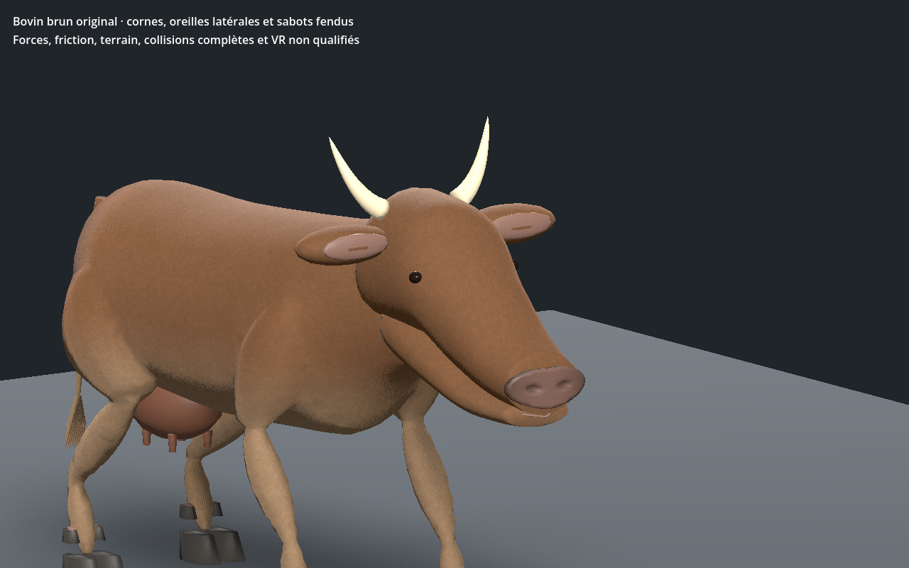
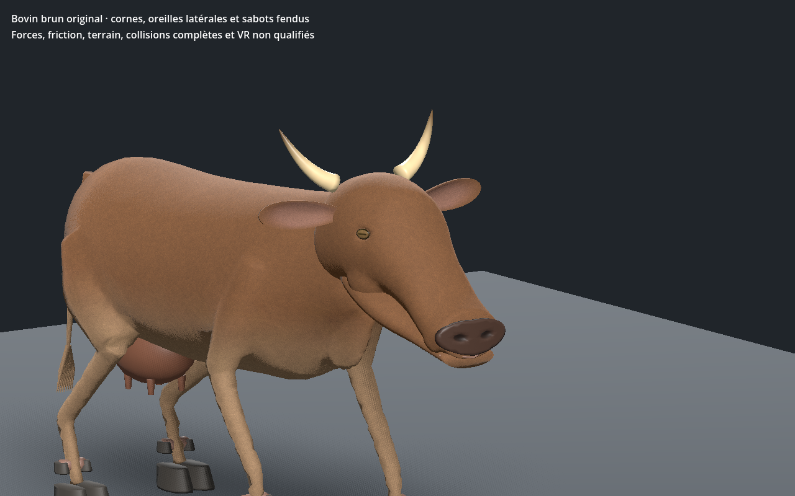

# Vache brune — crâne, oreilles et fanon, recette 0.2.0

[Recette JSON](recipe.json) · [Profil anatomique](anatomy-profile.json) · [Mesures](validation.json) · [Provenance](provenance.json) · [Galerie](../../GALERIE.md)

Le crâne original est désormais une surface sculptée continue, avec orbites creusées et volumes de joues raccordés. Les disques d’oreilles deviennent des coupes fermées à intérieur nuancé ; les yeux sont aplatis, bordés de paupières et portent une pupille horizontale par pigment de sommets. Les cornes reçoivent des pointes plus sombres. Le fanon est uni à la peau du corps, les départs de membres sont affinés et les sabots possèdent un biseau.

| Première revue 0.1.0 | Raffinement 0.2.0 |
| --- | --- |
|  |  |

L’inspection native a rejeté un candidat dont les volumes de museau cachaient les narines malgré une géométrie fermée. La position du mufle est corrigée et un contrôle vérifie maintenant cinq rayons frontaux par narine et par LOD contre les triangles réels du crâne. Ce contrôle ne couvre pas toutes les directions de vue ou toutes les intersections.

Le corps et la tête indépendante gardent les mêmes positions, normales, UV et couleurs rendus. Les cartes métriques mesurées du corps, du crâne et de la mâchoire restent sans triangle UV écrasé, anisotropie maximale **<1,72**. Le crâne seul compte **2 400 / 1 200 / 520 triangles**, fermé et connecté. Proportions, raccords anatomiques, fanon, peau et flux de poil restent à affiner : le rendu demeure stylisé.

Budgets du modèle complet : **12 898 / 6 622 / 3 394 triangles**, 45 os et quatre influences maximum. Trois images **512 / 256 / 256** inchangées, issues du même détail original de poil court ; estimation RGBA8+mipmaps **2 097 148 octets**. Le microrelief du mufle réutilise une carte existante, sans ajouter d’image. Ce ne sont pas des mesures de mémoire totale du pilote.

Les clés du clip passent à 120 Hz. Sur 601 instants CPU par LOD et 241 dans l’éditeur/Godot : **trois appuis minimum**, dérive d’appui **<0,08 mm**, hauteur absolue d’appui **<0,08 mm** et garde au sol des sabots **>94 mm** sur les échantillons proches du sommet du retour. Une très petite excursion sous le plan (<0,0008 mm) reste dans la tolérance numérique, sans contact physique simulé. La levée est réglable dans la recette, ici **0,11 m**. Compression/allongement de toutes les arêtes uniques, aire de faces et orientation par rapport aux normales skinnées sont contrôlés ; ce n’est pas une preuve de toutes les collisions.

Le modèle sélectionné passe Forward+ et Compatibility. Le vrai lien central, trois LOD, lecture/pause/reprise/fin/relecture, relief/topologie, tête seule et téléchargement JSON sont contrôlés. La recette téléchargée change le pas de 0,27 à **0,28 m**, puis est reconstruite et chargée dans Godot Forward+. Les deux images montrent cette reconstruction.

## Coût natif observé, scène bornée

Une scène isolée de **64 instances animées**, en 1280 × 800, sans ombres, avec cache chaud et VSync demandée désactivée, a été mesurée sur le modèle sélectionné. Trois images sont réellement partagées. Après 30 trames de chauffe, 120 trames sont relevées par LOD :

| LOD | Triangles dessinés dans la scène | Appels de dessin | Intervalle médian jusqu’à `frame_post_draw` |
| --- | ---: | ---: | ---: |
| Proche | 825 472 | 320 | 2,853 ms |
| Intermédiaire | 423 808 | 320 | 2,909 ms |
| Lointain | 217 216 | 320 | 3,157 ms |

Ces intervalles muraux incluent l’ordonnancement du moteur ; ils ne sont ni un timestamp GPU ni une attente de fin GPU. Le relevé ne démontre pas un gain de temps avec la baisse des triangles. Les appels de dessin restent constants : le regroupement des matériaux est un prochain axe à mesurer. Monde, ombres, IA, physique, réseau, foule en gameplay et VR sont absents ; aucune garantie de FPS du jeu n’en découle.

SHA-256 du modèle capturé : `04872e3f86d90d0dc8ae02d4909e6ffcf9e36aa3ca0fbb42bd11e55fc0bb1060`.
SHA-256 de la recette : `64cba6a26dcc45e8ffc98a9fd70a346573acb623d9c7b37d1c17eef33bde61f7`.

La [version 0.1.0](../v0.1.0/README.md) reste conservée. Son format v1 exige son générateur archivé ; le générateur v2 refuse de la réinterpréter silencieusement. Générateurs, caches, GLB et adaptateurs privés ne sont pas distribués ; le JSON documentaire seul n’est pas autonome. Revue anatomique encore stylisée sur sol plat, éditeur réel et Godot isolé. Aucun photoréalisme final, terrain, virage, forces, collisions exhaustives, monde principal, réseau ou VR qualifié.
