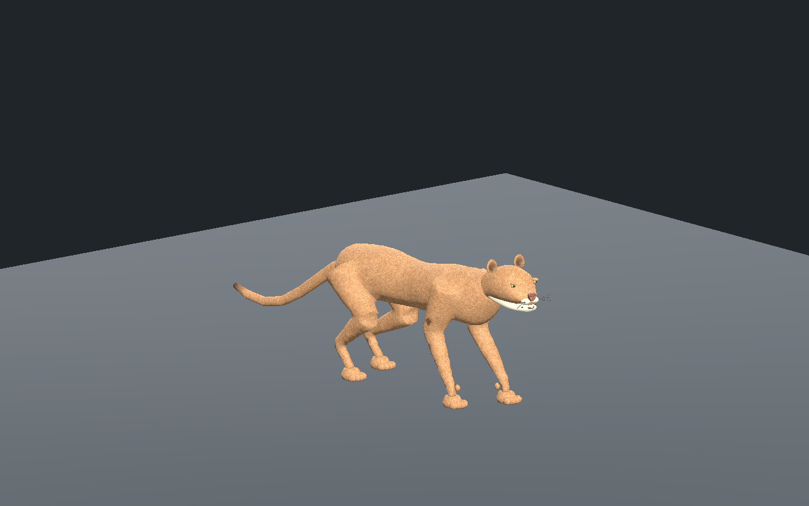
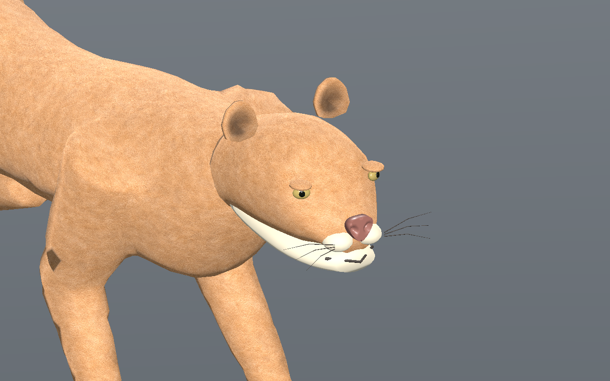

# Puma — première base originale de revue, recette 0.1.0

[Recette JSON](recipe.json) · [Profil anatomique](anatomy-profile.json) · [Mesures](validation.json) · [Provenance](provenance.json) · [Galerie](../../GALERIE.md)

Cette nouvelle famille part de l’identité historique `mobile:felines_cougar`, qui ne disposait pas de recette anatomique dédiée dans l’inventaire. Les maillages historiques du jeu ne sont pas copiés. Corps élancé à taille marquée, tête courte, deux masses de museau, petites oreilles concaves, pupilles rondes et longue queue cylindrique à huit articulations. Les quatre pattes restent digitigrades : quatre doigts d’appui et un ergot antérieur hors sol ; les griffes ne sont pas exposées dans cette marche de revue.

Les premiers candidats étaient trop proches de l’ours : dos trop haut, tête trop longue et pelage sombre à poils longs. Le profil a été aminci et raccourci, les disques d’oreilles remplacés par des pavillons creux et l’albédo remplacé par une création ImageGen originale de poil court fauve. La pointe de queue et l’intérieur des oreilles sont assombris par couleurs de sommets. La tête seule utilise les mêmes attributs et pigments que le corps.

La recette a été réellement téléchargée depuis l’éditeur puis reconstruite : pas de **0,23 m** et quatre cycles de **1,8 s**, contre 0,22 m dans le modèle sélectionné. Les captures montrent cette reconstruction. Le modèle sélectionné passe Godot Compatibility et Forward+, les trois LOD et l’éditeur réel ; la reconstruction passe Forward+. Les contrôles de lecture après fin, tête seule, partage des images et téléchargement du bon GLB passent séparément.

Budgets : **9 440 / 5 182 / 2 626 triangles**, 33 os, quatre influences maximum par sommet et trois images **512 / 256 / 256** pixels. Les 601 instants CPU et 241 instants par LOD dans l’éditeur et Godot vérifient au moins trois appuis, une dérive inférieure à **0,14 mm**, une hauteur d’appui inférieure à **0,34 mm** et une levée minimale de **44,8 mm**. Les cartes métriques du corps, du crâne et de la queue limitent l’anisotropie UV mesurée à moins de 1,74. L’estimation RGBA8+mipmaps de 2 097 148 octets concerne les images seules, pas les FPS ou la mémoire totale du pilote.

SHA-256 du modèle capturé : `57f119cb1433c03fd7c1d4e38c48650c9bf0898d68c0b25269693261ec3840e3`.
SHA-256 de la recette : `a983ebd9c445e3b6b322503c8abff3d4ddba36119a2053b201c8b2b7abf01033`.

Cette base demeure stylisée : raccord tête/cou, volumes d’orbite et de museau, coussinets, ventre clair et flux du pelage restent à améliorer. Les cartes métriques évitent les forts étirements mais leurs changements de direction restent visibles. La marche lente ne prouve ni la course ni le placement naturel des traces arrière dans les traces avant.

Le JSON est documentaire et nécessite les générateurs, modèles et adaptateurs privés non distribués ici ; ce n’est pas un génome natif ou une entrée serveur. Première copie originale de revue du puma. Appuis, déformations et rendu isolés sur sol plat ; sculpture et pelage non approuvés photoréalistes. Aucun autre félin, terrain, virage, force, collision exhaustive, gameplay réseau ou VR qualifié.
