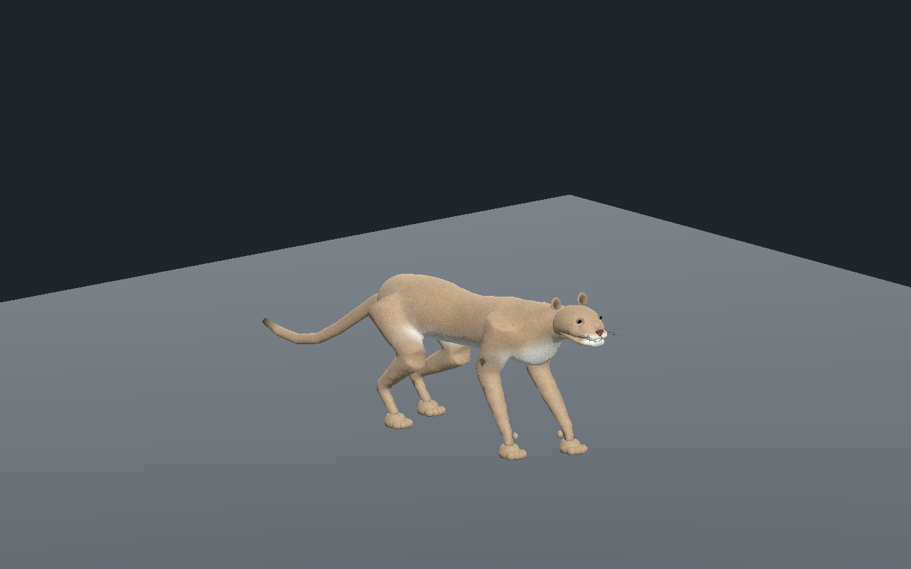
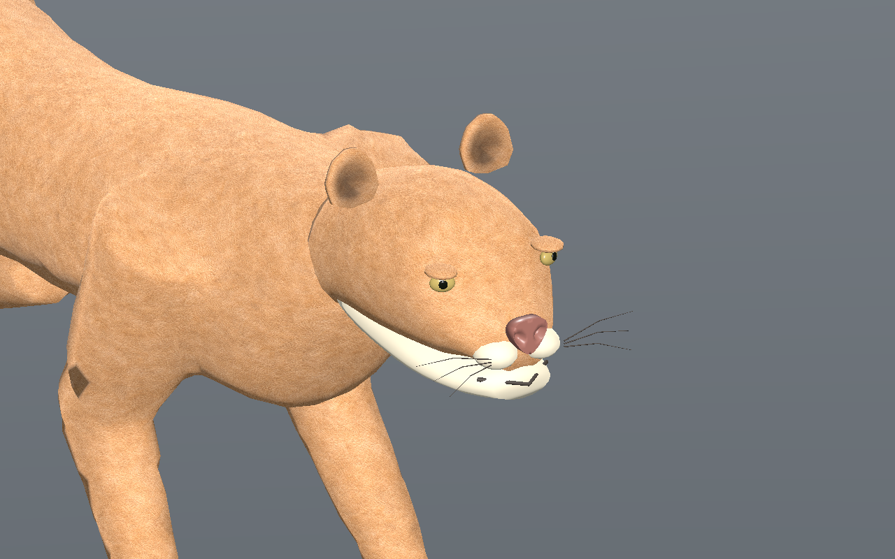
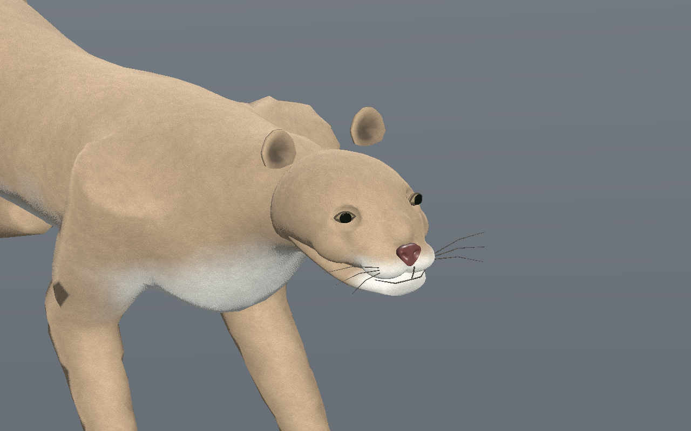

# Puma — tête continue et pelage nuancé, recette 0.2.0

[Recette JSON](recipe.json) · [Profil anatomique](anatomy-profile.json) · [Mesures](validation.json) · [Provenance](provenance.json) · [Galerie](../../GALERIE.md)

Le crâne et les masses du museau forment désormais une surface fermée continue, au lieu de volumes de moustaches superposés. Les orbites sont creusées, les ouvertures de paupières sont en amande et les surfaces optiques sont enfoncées de 6 mm. La pupille reste ronde, partiellement masquée par l’ouverture des paupières. Le nez est réduit et la ligne de bouche suit le philtrum et les deux lèvres. Le collier de cou du corps est prolongé pour mieux recouvrir l’arrière du crâne.

| Première base 0.1.0 | Nouvelle sculpture 0.2.0 |
| --- | --- |
|  |  |

Le poil utilise toujours trois images. Le détail de luminance du bitmap original est séparé du pigment fauve/crème des sommets : le museau, la gorge et le ventre clairs possèdent une transition progressive. Les deux régions sémantiques du crâne gardent les mêmes réglages de matière et les mêmes couleurs aux frontières. Le microrelief et le contraste du poil sont dérivés de la source originale, sans pixels photographiques externes ni image supplémentaire.

Le contrôle de fermeture porte sur la surface complète, même si plusieurs régions de matériau la partagent. Le crâne et la mâchoire sont fermés, chacun en une seule composante connectée sur les trois LOD. Les cas de région manquante, faces dupliquées et copie fermée déconnectée sont rejetés. La tête seule et le corps ont les mêmes positions, normales, UV et couleurs rendus.

Un défaut d’import natif a aussi été observé : Godot 4.8 bêta laissait le clearcoat des yeux désactivé malgré les paramètres présents dans le GLB. L’adaptateur de revue applique uniquement les deux valeurs scalaires déclarées, avec correspondance de noms de meshes uniques et contrôle des primitives. Six surfaces optiques réutilisent deux matériaux adaptés ; les trois images restent partagées. Les valeurs réelles et leur conservation dans le cache sont contrôlées dans Godot ; l’éditeur charge les mêmes paramètres.

La recette est réellement téléchargée depuis l’éditeur puis reconstruite : pas de **0,23 m**, contre 0,22 m dans le modèle sélectionné. Les images montrent cette reconstruction. La marche conserve au moins trois appuis : 601 instants CPU et 241 instants par LOD dans l’éditeur/Godot, dérive inférieure à **0,14 mm**, hauteur d’appui inférieure à **0,34 mm** et levée minimale supérieure à **44,8 mm**. La version sélectionnée passe Compatibility et Forward+ ; la reconstruction passe Forward+.

Budgets : **11 744 / 6 306 / 3 314 triangles**, 33 os, quatre influences maximum et trois images **512 / 256 / 256**. L’estimation RGBA8+mipmaps des images reste de 2 097 148 octets ; aucune mesure FPS ou mémoire totale du pilote. Les cartes métriques du corps, du crâne, de la mâchoire, des rebords orbitaux et de la queue gardent une anisotropie mesurée inférieure à 1,74.

SHA-256 du modèle capturé : `86a623908d155cef019b24eee01d152bb426f713a8ff3b58fecde2e8e243df61`.
SHA-256 de la recette : `b935c11b28f51b515f40559b0e3d5bfe5c454436f3265b33220ec6f283e58488`.

Les volumes des joues et orbites, les oreilles, les raccords anatomiques et le flux du poil restent à affiner. Cette version ne prouve pas les collisions exhaustives, les forces, la course ou le placement naturel des traces arrière dans les traces avant. La [version 0.1.0](../v0.1.0/README.md) reste disponible ; générateurs, caches de sculpture, modèles et adaptateurs privés ne sont pas distribués ici. Le JSON documentaire seul n’est pas autonome. Revue originale du puma sur sol plat dans l’éditeur et Godot isolés. La sculpture reste stylisée : aucune approbation photoréaliste finale, terrain, virage, forces, collisions exhaustives, gameplay réseau ou VR.
