# Crabe — huit pattes, pinces articulées et marche latérale

[Recette JSON](recipe.json) · [Conception](design-profile.json) · [Mesures](deformation-measurements.json) · [Validation](validation.json) · [Provenance](provenance.json) · [Galerie](../../GALERIE.md)

Première recette documentaire originale du crabe, version **0.1.0**. Il possède **quatre paires de pattes marcheuses et une paire de pinces**, deux yeux pédonculés, une carapace large et une plaque abdominale ventrale. Cette distinction des appendices suit la [description anatomique de l’ADFG](https://www.adfg.alaska.gov/index.cfm?adfg=invasiveprofiles.europeangreencrab_characteristics). La forme est une adaptation originale côtière/géante pour le jeu ; elle ne prétend pas reproduire une espèce mesurée. Aucun pixel ni modèle de référence n’est copié.

Les pattes sont aplaties et légèrement renflées, avec recouvrement simplifié des articulations et extrémités d’appui fines. Chaque patte utilise cinq segments externes et trois actionneurs ; cette simplification ne représente pas les sept articles biologiques complets. Les pinces ont des doigts courbes, un doigt mobile par côté et de petites dents de prise. Le mouvement des pinces est uniquement visuel, sans simulation de pression ou de combat.

| Dessus | Pinces |
| --- | --- |
| 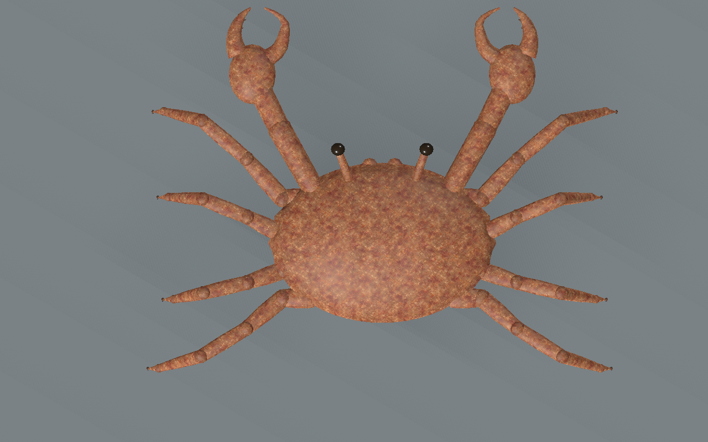 | 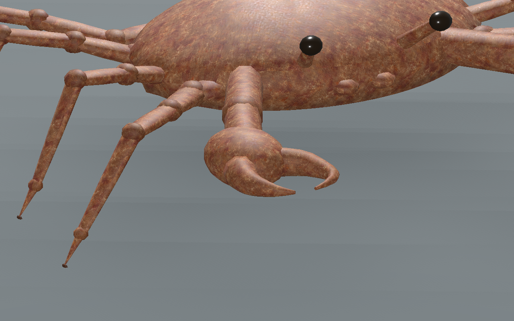 |

Une texture originale de chitine a été créée avec l’outil intégré ImageGen : pores, taches irrégulières, variations brun-roux et mouchetures pâles. Elle est réduite à **256px** ; un conditionnement des bords conserve des échantillons opposés identiques. Normal et rugosité sont dérivés à **128px**. Ce microrelief est approximatif et ne constitue pas une mesure de profondeur. Géométrie, UV, rig et animation à pas identique restent inchangés par ce nouveau matériau ; l’ancien grain procédural reste régénérable avec les mêmes attributs et pixels.

| Grain procédural initial | Nouvelle chitine, mêmes caméra/temps/lumière |
| --- | --- |
| 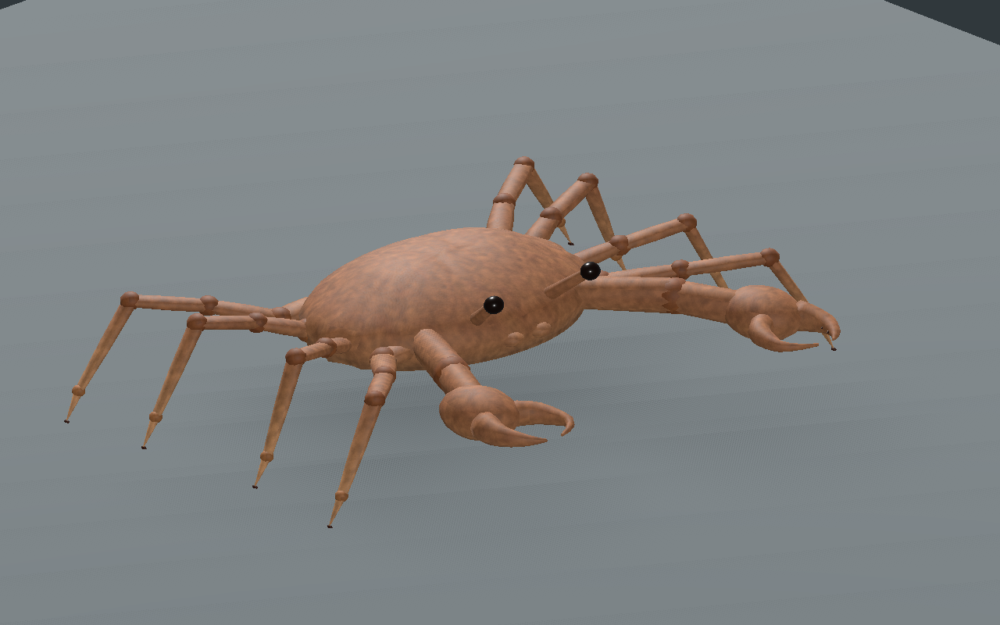 | 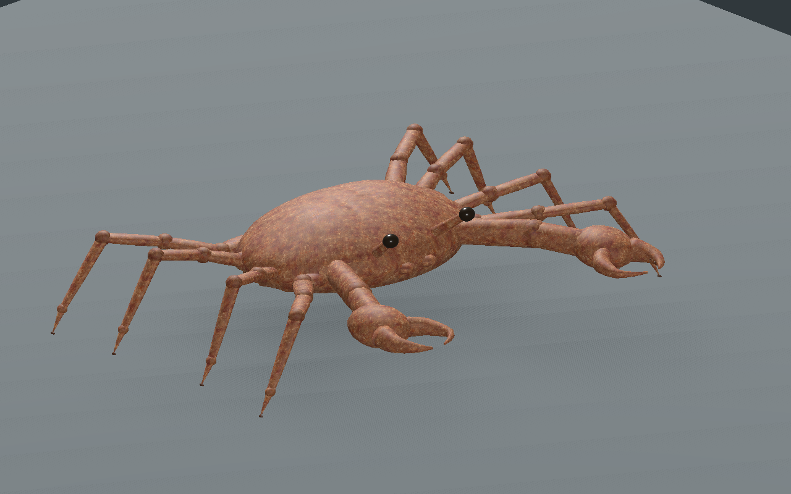 |

Budget réel : **9360 /5264 /2704 triangles**, **57 os**, **quatre lots de matériau par LOD**, trois images **256/128/128**, estimation RGBA8 avec mipmaps **524284octets**. Le GLB reconstruit pèse **1915264octets**. Chaque LOD conserve106composants fermés ; les pièces restent séparées, sans peau soudée. Un seul os porte chaque face rigide, ce qui conserve ses longueurs, aires et métriques UV pendant l’animation. Anisotropie UV maximale mesurée **1.6793**. Les projections métriques conservent des coutures de carte, à revoir artistiquement.

| LOD1 | LOD2 |
| --- | --- |
|  |  |

La marche latérale déplace le vrai os racine et contre-anime les segments pour fixer les appuis au sol. L’éditeur central charge le modèle réel, contrôle les trois LOD,129poses/LOD, les pinces et les appuis, lecture/pause/reprise après fin, topologie, squelette, microrelief, ombres, six vues et formats736/320. Les contrôles visuels changent réellement les pixels. La recette téléchargée conserve les profils et change le pas de0,065 à **0,072m**, puis est reconstruite et contrôlée. Les attributs de liaison et pixels de la reconstruction sont identiques à la sélection ; seules les pistes dépendant du pas changent.

CPU : **601poses/LOD**, au moins **six appuis réels**, hauteur absolue maximale **0.2000mm**, dérive d’ancrage maximale **0.000193mm**, levée minimale **40.124mm**. La projection de la racine visuelle reste dans le polygone des appuis ; ce n’est pas une preuve de centre de masse ou de forces. Douze centres de racines — huit pattes, deux pinces, deux pédoncules — sont vérifiés à l’intérieur des triangles de carapace à chaque LOD. Ce contrôle ne prouve pas toutes les intersections des surfaces.

Godot **Compatibility et Forward+** contrôlent la sélection et la reconstruction sur **129poses/LOD**, avec17poses de repères CPU comparées aux vrais binds importés. Au moins six contacts ; erreur CPU/natif maximale **0.000240mm**. Deux instances partagent les images avec des rotations de pinces indépendantes ; le transform de l’entité de jeu est conservé. Aucun gain FPS n’est déduit du nombre de lots ou de la taille des images.

| Début | Quart du cycle |
| --- | --- |
|  |  |
| 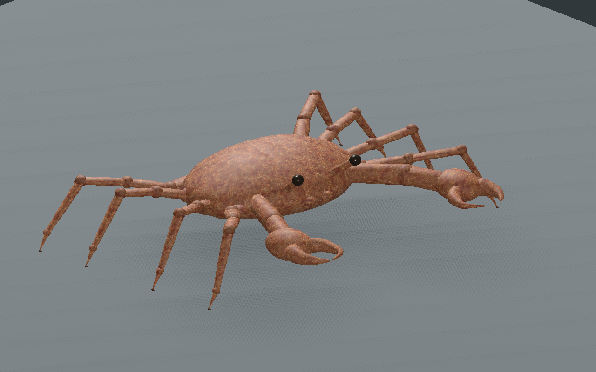 | 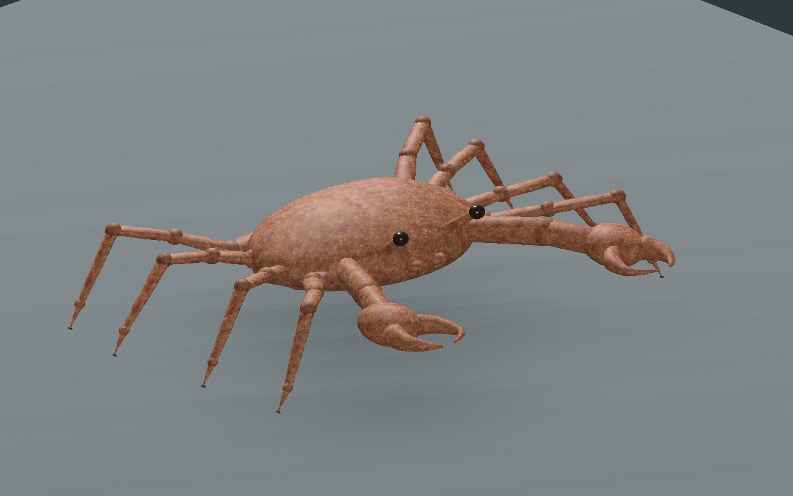 |

Les vues aux quarts de cycle montrent les transitions où les huit pattes peuvent toucher le sol. Les captures suivantes sont prises à mi-levée : chacune est contrôlée dans Godot avec **six appuis et deux pieds levés**, à environ40mm du sol.

| 12,5 % du cycle | 37,5 % |
| --- | --- |
| 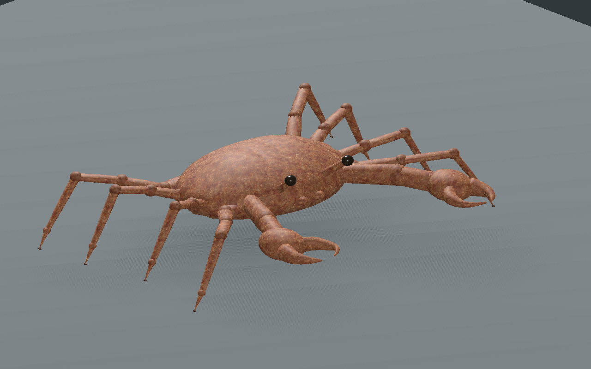 |  |
| 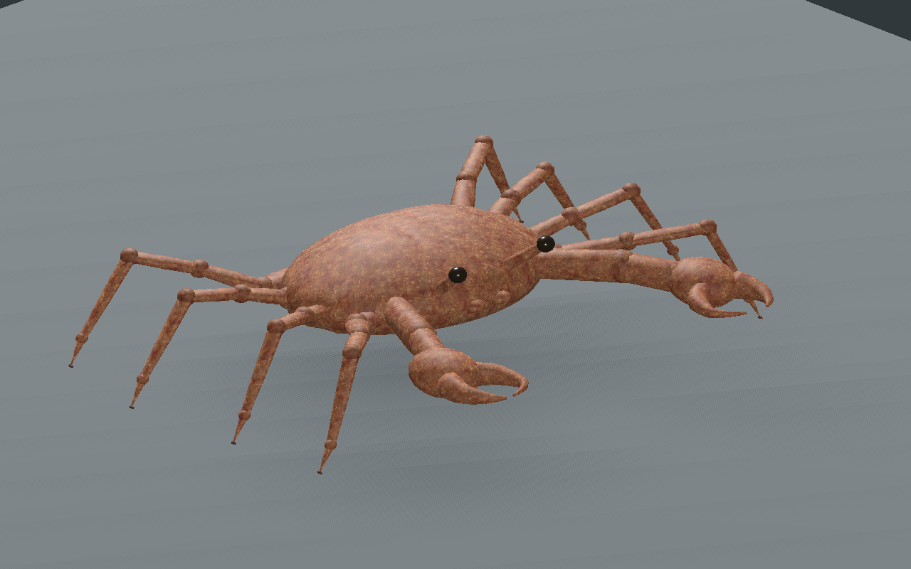 | 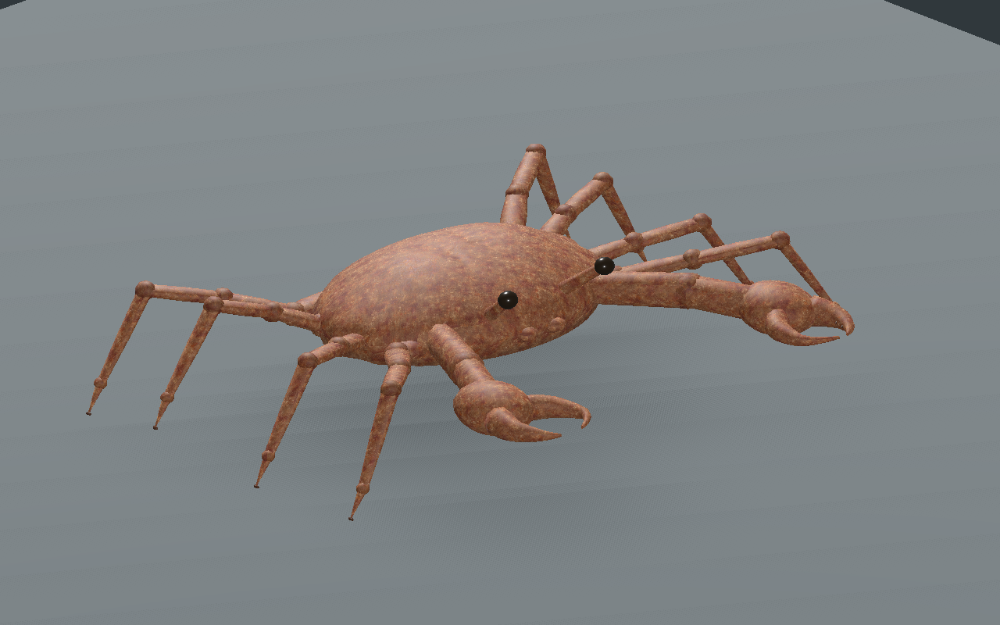 |

| Yeux | Extrémités des pattes |
| --- | --- |
| 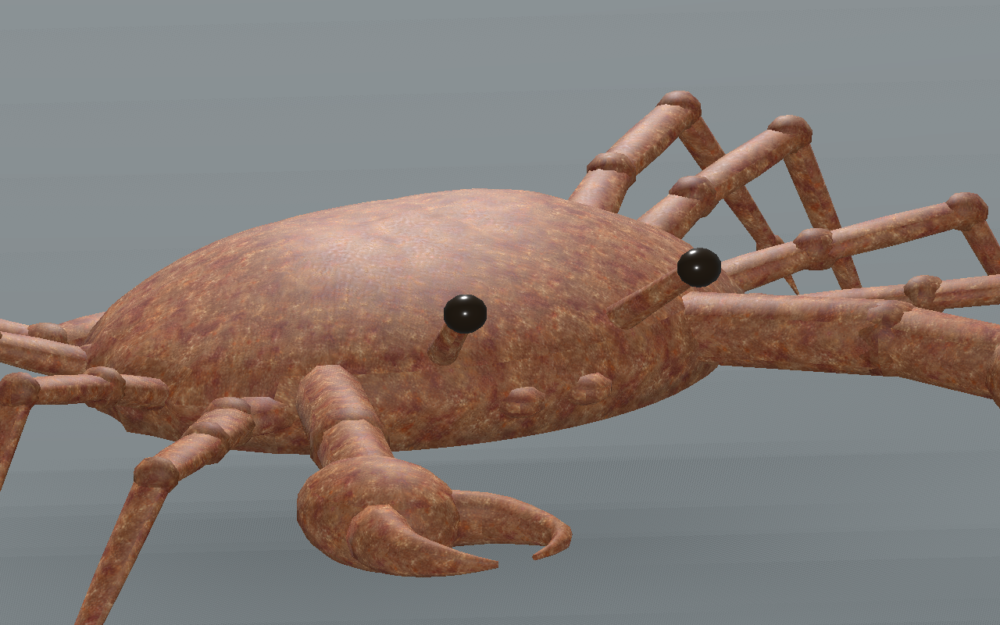 | 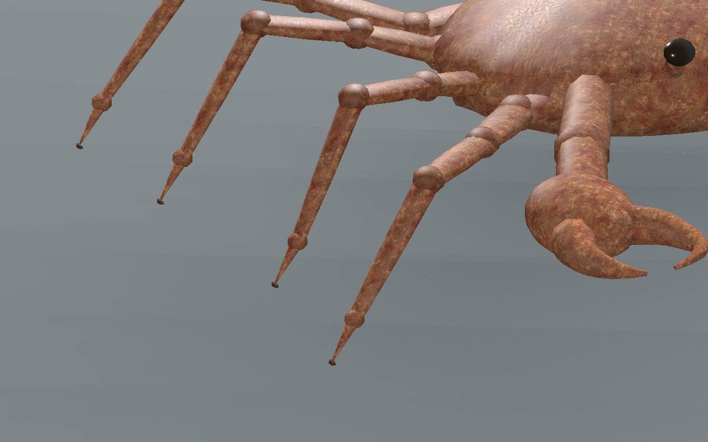 |

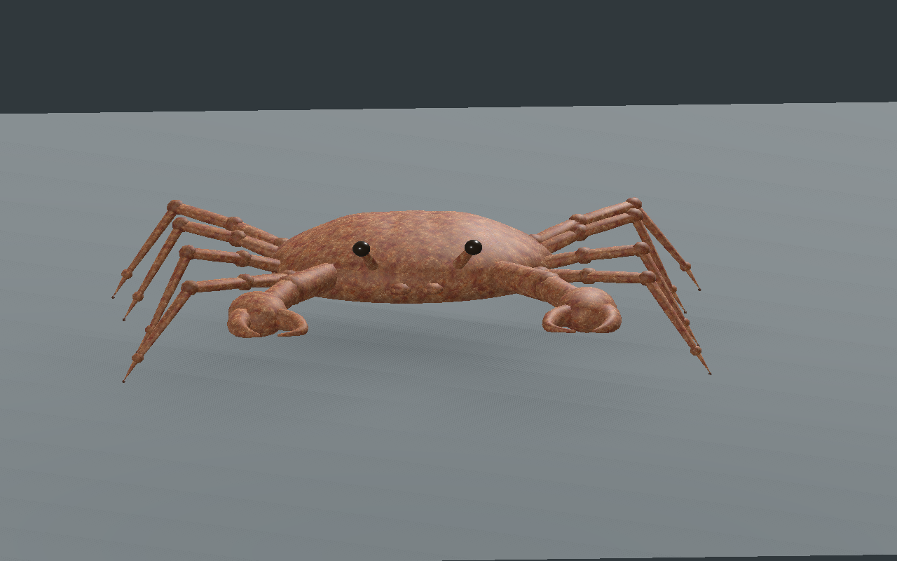

Seize captures natives de la reconstruction et deux comparaisons de matériau sont conservées sans retouche. Modèle reconstruit : `91f2a5536013ce25981ffc9cd8640e5ff10101ce52343dc69ede1b1f7068e816`. La recette dépend des ressources originales locales ; aucun GLB, générateur, bitmap privé ou génome de production n’est distribué.

Crabe original de revue : huit pattes marcheuses et deux pinces articulées, segments externes simplifiés et texture de chitine originale. Appuis cinématiques sur sol plat ; aucune preuve de masse/forces, terrain, collisions exhaustives, pression des pinces, anatomie finale, photoréalisme final, monde principal, serveur/réseau/VR ou FPS.
