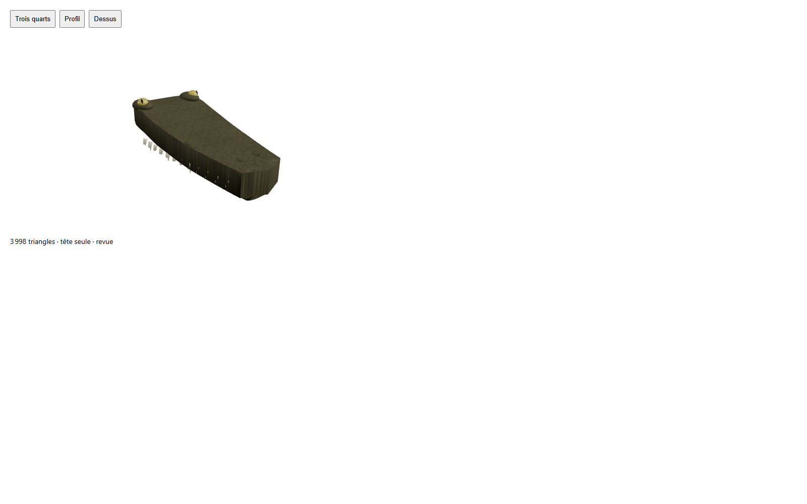

# Crocodilien — prototype à corriger — recette 0.1.0

[Recette JSON](recipe.json) · [Provenance et empreintes](provenance.json) · [Galerie](../../GALERIE.md)

Archive provisoire : l’image représente uniquement le composant crânien head-02, pas le corps complet. Défauts visibles conservés pour la reprise : crâne trop plat et épais, flancs aux UV étirés et yeux trop saillants. Cette version ne doit pas être sélectionnée comme modèle final.

**Portée vérifiée :** Tête seule : export, topologie et rendu statique contrôlés. Corps 01 construit à 8 734 / 4 902 / 2 814 triangles, mais audit de déformation, marche et validations Godot non exécutés. Aucun PASS artistique ou de créature complète.

Ce document conserve un instantané de travail original en `review_only`, sans autorité serveur ni approbation artistique finale. Les générateurs, pièces, modèles et adaptateurs locaux nécessaires ne sont pas distribués ici ; ce JSON seul ne reconstruit pas le modèle. Aucune compatibilité strict-v1 n'est revendiquée.

SHA-256 du modèle effectivement capturé : `38684c59c2ad30205ce371362460ccbdccb8ab5ef7cbc08d877fb6571237a7c6`.
SHA-256 de la recette : `f1e859f4be9e6d970a6f8e9509a33f1953f680bea5411c045cc5a606439a8a30`.
SHA-256 de l'image : `eb2219c74fa89c1a4284992749f7bcd56871db6d3c923ba6ccb492700ab7ce40`.
