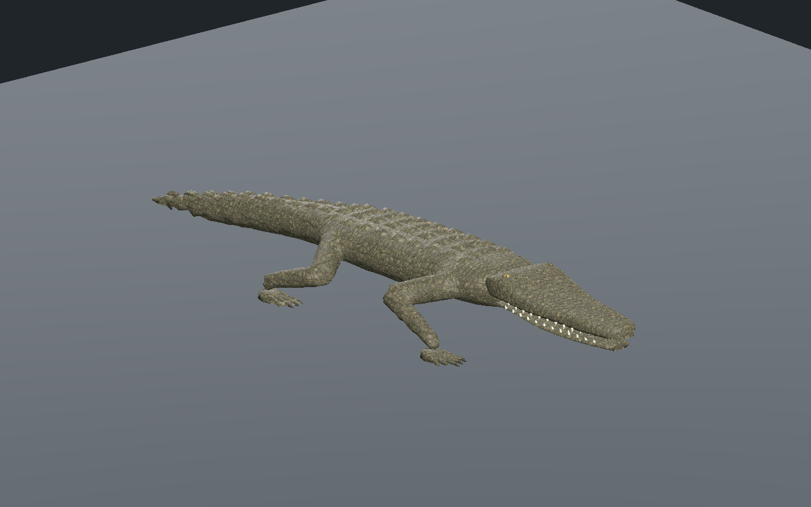
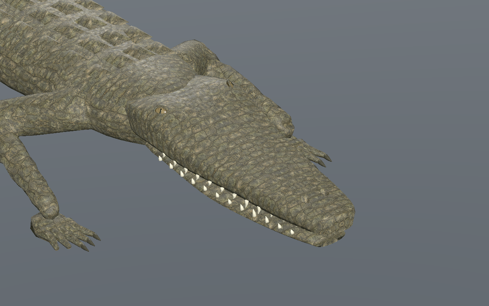
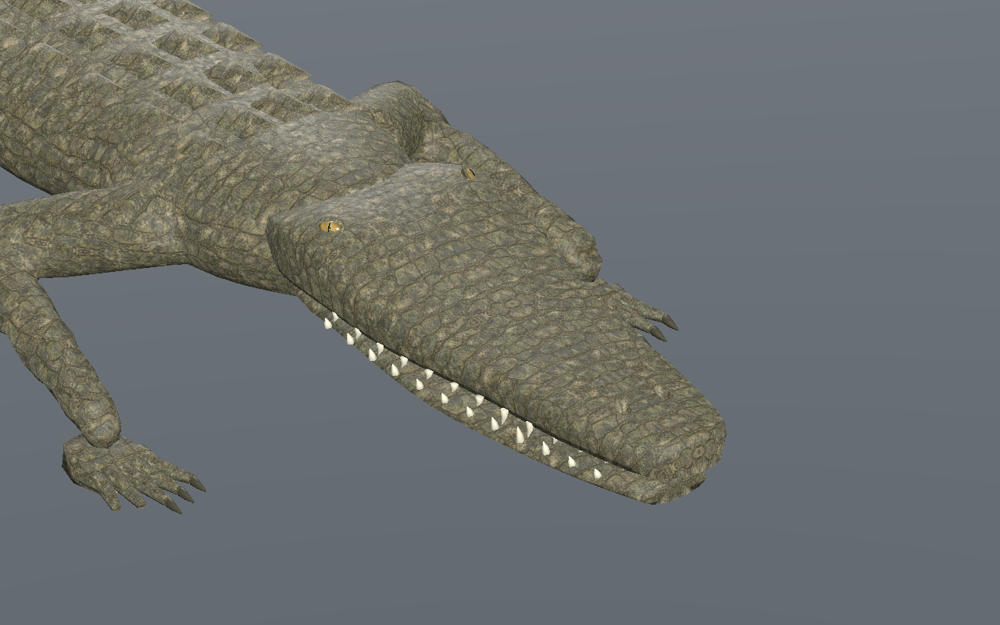
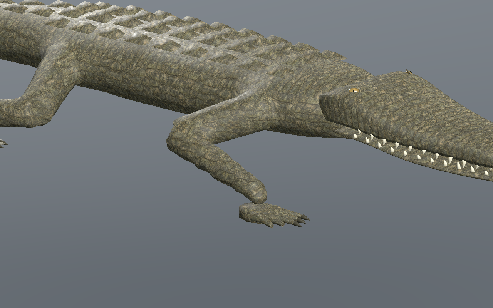
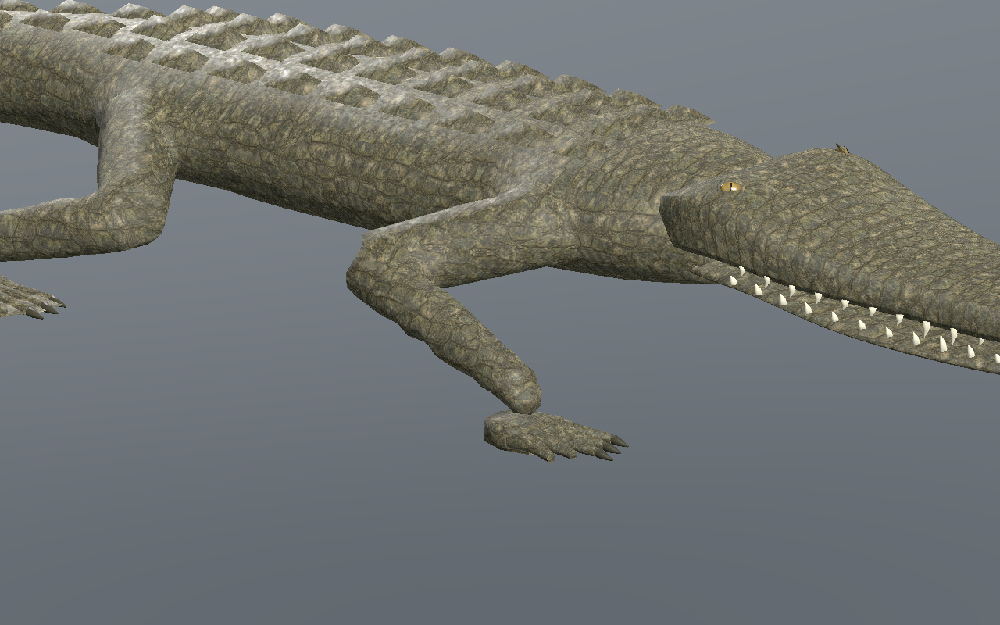
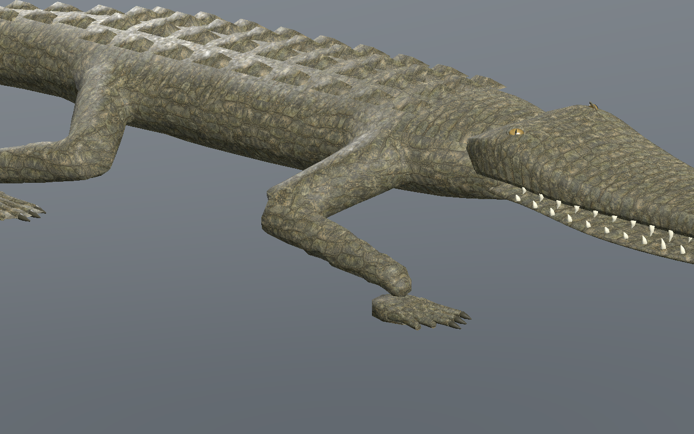
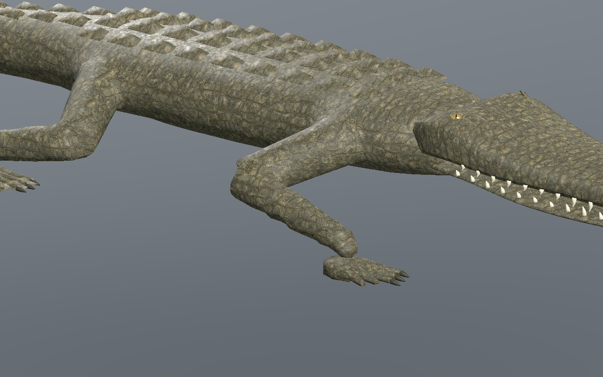
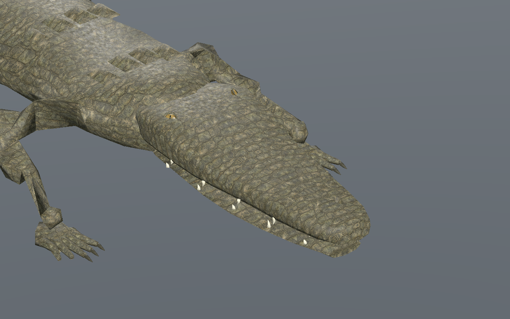

# Crocodilien — nuque affinée, yeux et UV régularisés

[Recette JSON](recipe.json) · [Profil de tête](cranial-profile.json) · [Mesures UV](uv-measurements.json) · [Validation](validation.json) · [Provenance](provenance.json) · [Galerie](../../GALERIE.md)

Version **0.10.0**, issue de la [version0.9 conservée](../v0.9.0/README.md). Le dessus arrière du crâne est abaissé progressivement jusqu’à12mm et son contour resserré jusqu’à8%. Les vrais triangles donnent une baisse de9,5–11,6mm à z=-0,55m suivant le LOD. Les reliefs orbitaux sont atténués pour alléger la transition vers le cou.

| Version0.9 | Version0.10, même caméra et même pas |
| --- | --- |
|  |  |

Les yeux et pupilles sont plus petits, avec un iris ambré plus lisible. Les paupières suivent une ellipse plus étroite et moins profonde, déplacée1mm vers la surface. L’insertion des globes est contrôlée sur la vraie surface de chacun des trois LOD ; leur centre reste2,5mm sous cette surface.

Les UV continus du dessus, des flancs et des narines sont recalculés avec une régularisation de densité. Aucun triangle UV effondré ni différence UV sur les arêtes communes de cette carte. Les écarts de densité baissent d’environ10–19% ; le maximum d’anisotropie passe de1,824 à **1,809**. La densité locale reste variable, environ782–1404texels/m. Les coutures du corps restent à traiter.

| LOD | Anisotropie maximale, avant → après | Rapport densité max/min, avant → après |
| --- | --- | --- |
| 0 | 1.776 → 1.745 | 1.896 → 1.705 |
| 1 | 1.799 → 1.752 | 1.963 → 1.608 |
| 2 | 1.824 → 1.809 | 2.150 → 1.751 |

Budget conservé : **9566 /5442 /3066 triangles**, **31 os**, trois images **512/256/256**, estimation RGBA8 avec mipmaps **2097148octets**. Attributs non crâniens, matériaux, pixels et clips à pas identique conservés exactement. La tête0.9 est régénérée octet par octet. Aucun gain FPS ni coût total du pilote n’est déduit de ces budgets.

La sélection35 et la recette reconstruite36 passent **601poses/LOD en CPU**, puis **241poses/LOD dans Godot Forward+ et Compatibility**. Le vrai éditeur central vérifie trois LOD, lecture/pause/reprise après fin, déplacement réel, tête seule, partage des trois images, largeurs736/320 et téléchargements JSON/GLB. Le pas téléchargé est modifié de0,10 à **0,11m**, puis reconstruit.

Au moins **3appuis**, dérive CPU maximale **0.137mm**, hauteur absolue d’appui **0.337mm**, levée minimale **44.95mm**.

| Début | Quart du cycle |
| --- | --- |
|  |  |
|  |  |

Neuf captures natives sans retouche. Modèle reconstruit : `ad5ba017448ef927758997513975468243c5920c4101e5dcb4eec2343920a211`. Les recettes dépendent des ressources originales locales ; les GLB, générateurs et bitmaps privés ne sont pas distribués.

Revue locale sur sol plat dans l’éditeur et Godot isolé. Coutures du corps, raccord tête/cou, dentition finale, intersections exhaustives, terrain, virages, nage, forces, foule, monde principal, réseau, VR et FPS non qualifiés. Finition photoréaliste non approuvée.
