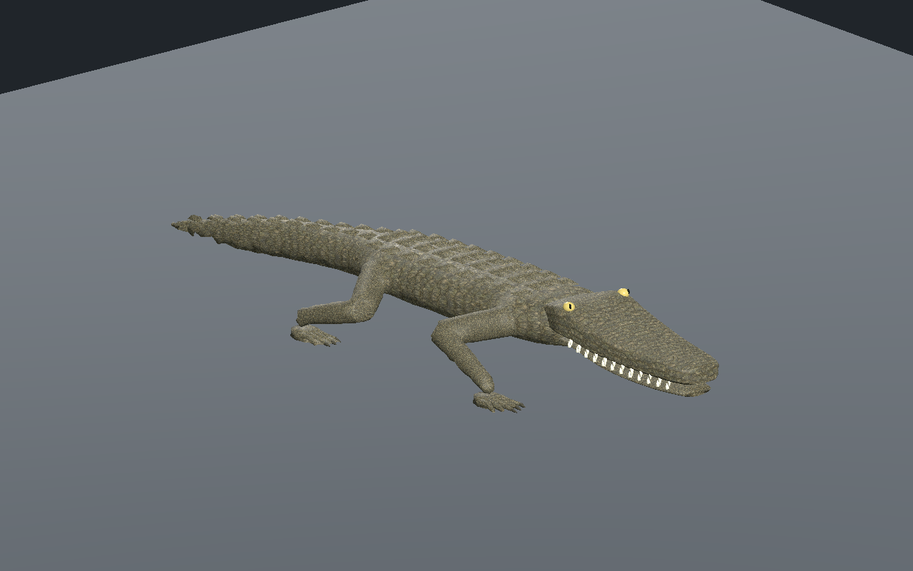
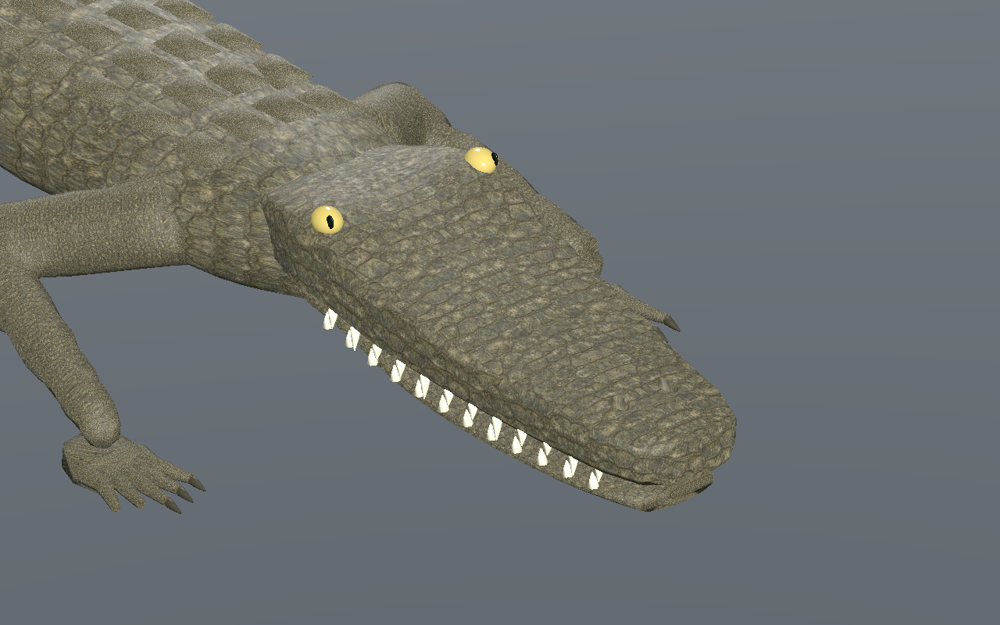

# Crocodilien — tête arrondie et marche, recette 0.2.0

[Recette JSON exportée](recipe.json) · [Profil crânien documenté](cranial-profile.json) · [Provenance et empreintes](provenance.json) · [Mesures de validation](validation.json) · [Galerie](../../GALERIE.md)

La tête remplace le crâne plat du prototype : museau arrondi, épaisseur réduite vers l’avant, bords biseautés et relief orbital intégré. Les yeux sont plus petits et en partie enchâssés. Les UV des flancs disposent d’une dimension verticale indépendante : aucun triangle UV écrasé sur les trois LOD, contre 80 au LOD proche de l’ancien composant. Les mâchoires et les bases des dents suivent le nouveau profil.

Le skinning des membres utilise une projection progressive sur la chaîne d’os, pour éviter les ruptures de poids autour des articulations. Le profil crânien est explicite dans la recette : `rounded-cranium-v2`. La recette téléchargée depuis l’éditeur a été reconstruite dans une révision distincte ; les deux captures montrent cette reconstruction et non le prototype 0.1.0.

Les flancs sont aussi contrôlés par leur distorsion UV : rapport maximal inférieur à 1,48 sur les trois LOD, contre plus de 500 dans un candidat intermédiaire. La densité de texture du crâne est alignée sur une échelle de 2,1 répétitions par mètre. Les yeux et la sculpture restent des approximations artistiques en cours d’amélioration.

Le corps possède quatre membres, cinq doigts par patte avant et quatre par patte arrière. La marche vérifiée reste rectiligne, sur sol plat, avec au moins trois appuis. Les budgets, amplitudes de déformation et erreurs d’appui mesurés figurent dans validation.json. Trois images seulement : albédo 512 × 512, normal et ORM 256 × 256. L’estimation RGBA8 avec mipmaps n’est pas une mesure de mémoire totale du pilote ni de FPS en jeu.

SHA-256 du modèle capturé : `b78d5d43f939958e905bf4b191f078e94de7d470a0bf1723f5b5dd64d4cd1cee`.
SHA-256 de la recette : `1113b141f53bada217883a51d6d0a649fec13bd4f2ccc598d21f2e0c427c9e02`.

La [version 0.1.0](../v0.1.0/README.md) reste disponible pour comparaison. Les générateurs, pièces, GLB et adaptateurs privés ne sont pas distribués : le JSON seul ne permet pas une reconstruction autonome. Ce lot reste `review_only`, sans approbation photoréaliste finale ni preuve de monde réseau, nage, terrain, virages, collisions exhaustives ou VR. Les essais Godot et éditeur sont isolés ; aucune autorité serveur ni ressource de production n’est modifiée.
