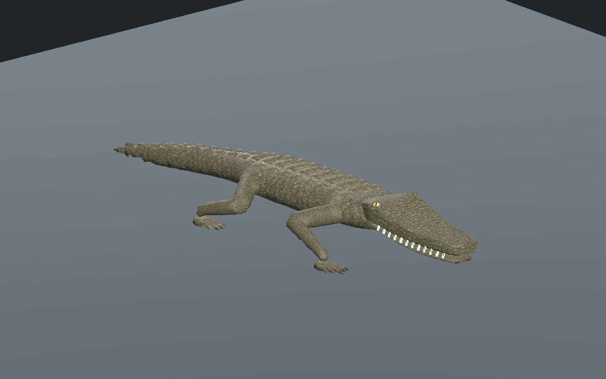
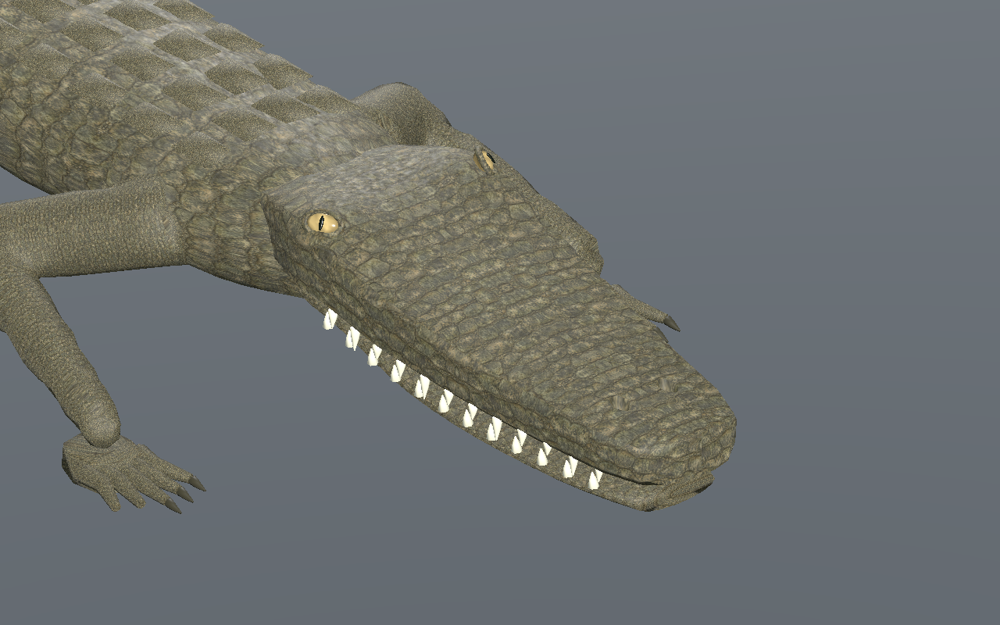

# Crocodilien — paupières et iris, recette 0.3.0

[Recette JSON](recipe.json) · [Profil crânien](cranial-profile.json) · [Provenance](provenance.json) · [Mesures](validation.json) · [Galerie](../../GALERIE.md)

Le museau arrondi et biseauté de la version 0.2.0 est conservé. Les yeux sphériques posés sur le crâne sont remplacés par des globes aplatis et orientés dans l’orbite. Deux rebords fermés de paupière utilisent les textures de peau existantes. L’iris reçoit des fibres ambrées et un anneau périphérique sombre par couleurs de sommets ; la pupille reste verticale. Le placement a été revu après inspection native : un premier candidat masquait trop l’iris.

Les UV du crâne restent corrigés : aucun triangle UV écrasé et anisotropie maximale des flancs inférieure à 1,48 sur les trois LOD. Le module de tête partagé et le corps exportent les mêmes positions, normales, UV et couleurs des yeux. Cette mesure du crâne ne certifie pas toute la densité de texture du corps ; les raccords tête/cou et l’aspect des dents restent à affiner.

Les trois LOD comptent **9 562 / 5 438 / 3 066 triangles**, soit 824 / 464 / 208 triangles ajoutés pour l’ensemble des modifications oculaires. Le rig conserve 31 os et les trois images 512 × 512, 256 × 256 et 256 × 256. Leur estimation RGBA8 avec mipmaps reste de 2 097 148 octets ; ce n’est ni la mémoire totale du pilote ni une mesure de FPS.

La marche est contrôlée sur 601 instants par LOD au CPU et 241 dans l’éditeur et Godot. Au moins trois appuis ; dérive des appuis inférieure à 0,14 mm, hauteur absolue en appui inférieure à 0,34 mm et levée minimale de 44,9 mm. La version sélectionnée est contrôlée avec Compatibility et Forward+. La recette téléchargée modifie le pas à 0,11 m ; elle est réellement reconstruite puis contrôlée dans Godot. Les captures montrent cette reconstruction.

SHA-256 du modèle capturé : `1eb5207af6e22424fcdc4ad4239803d306f42263e413d102d5755d4b3d8e37b2`.
SHA-256 de la recette : `5cefa0ab1027bac07b96a66341c99cb5c698bf0f61c83e6dd9991ef5f50f9836`.

Les [versions 0.2.0](../v0.2.0/README.md) et [0.1.0](../v0.1.0/README.md) restent disponibles. Les générateurs, GLB et adaptateurs privés ne sont pas distribués : le JSON seul ne permet pas une reconstruction autonome. Ce lot reste `review_only`, sans approbation photoréaliste finale. Revue CPU, éditeur réel et Godot isolé sur sol plat ; sculpture et textures encore en revue. Terrain, nage, virages, forces, collisions exhaustives, gameplay réseau et VR non qualifiés.
