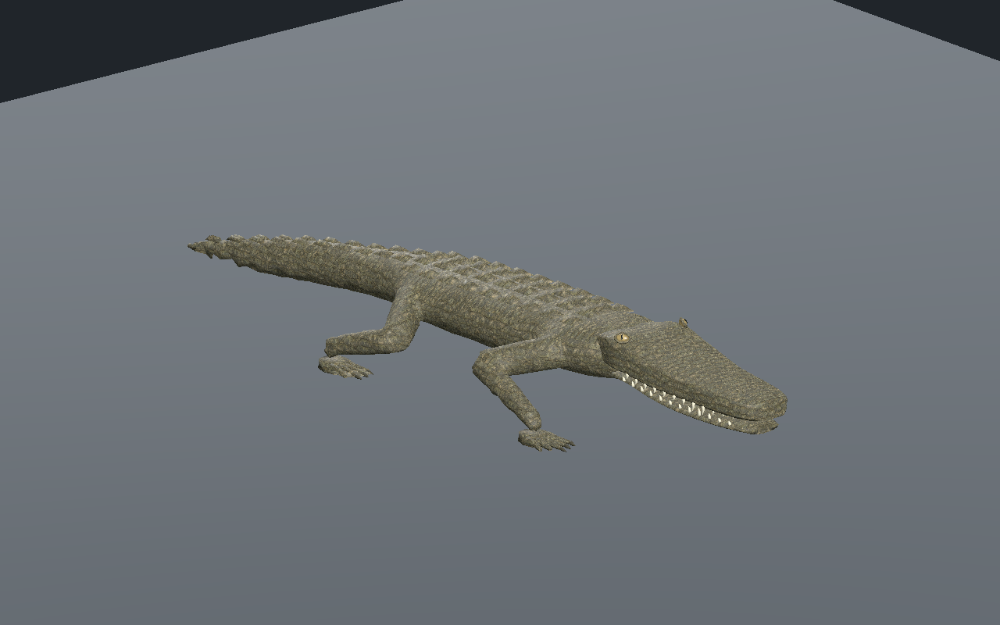
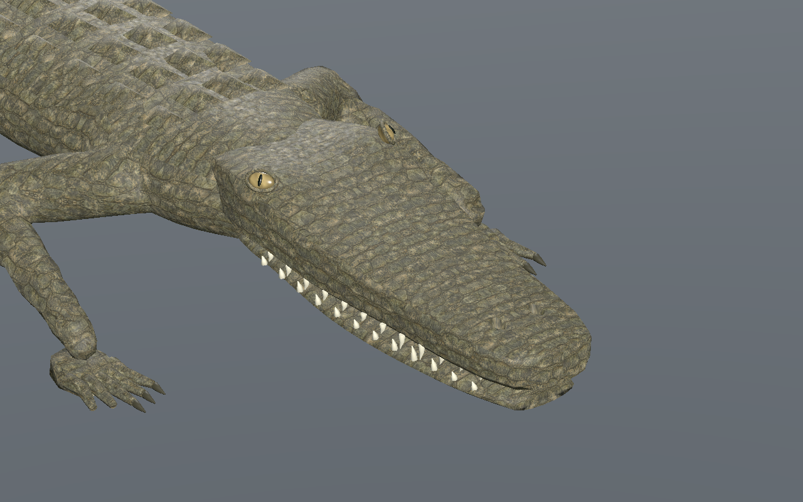

# Crocodilien — tête affinée et peau métrique, recette 0.4.0

[Recette JSON](recipe.json) · [Profil de tête](cranial-profile.json) · [Mesures UV](uv-measurements.json) · [Validation](validation.json) · [Provenance](provenance.json) · [Galerie](../../GALERIE.md)

Le crâne est légèrement aminci en hauteur et resserré derrière le bout du museau, en conservant les deux poches nasales géométriques. Les globes sont rapprochés et abaissés de quelques millimètres ; les paupières sont plus fines. L’iris ambré est assombri et moins brillant. Les dents sont moins blanches, de tailles variables selon leur position et les deux arcades sont décalées. Le raccord tête/cou reste à sculpter davantage.

Les anciens UV transférés depuis les cylindres des membres provoquaient des écrasements et des changements d’échelle. Le corps, la queue, les pattes, les doigts, les paumes, les membranes des pieds arrière, la mâchoire et les plaques dorsales utilisent maintenant des projections métriques directionnelles, à **2,1 répétitions par mètre**. Les normales et la géométrie du corps sont conservées ; seules les coutures UV dédoublent des sommets.

Dans la région des pattes du LOD0, la mesure des exports trouve **8 triangles UV écrasés avant, zéro après**, et une anisotropie maximale finie d’environ 1,70 après correction. Tous les triangles texturés des trois LOD sont inspectés. Sur les surfaces métriques, l’anisotropie reste sous **1,734** et la densité d’albédo est comprise entre environ 810 et 1 080 texels par mètre. Les flancs du crâne restent sous 1,55. Ces mesures concernent la pose de repos ; des changements de motif aux limites des projections restent possibles et demandent une revue artistique.

Le budget de triangles reste **9 562 / 5 438 / 3 066**, avec 31 os et les mêmes trois images **512 / 256 / 256** pixels. Aucun nouveau bitmap. Estimation des images RGBA8 avec mipmaps : **2 097 148 octets**, sans mesure de mémoire totale du pilote ni de FPS. Les sommets aux attributs identiques sont fusionnés après création des coutures : 16 931 sommets pour les trois LOD, contre 31 895 dans le premier candidat métrique. Le GLB sélectionné pèse 2 191 972 octets, contre 3 269 396 avant fusion ; les attributs rendus de chaque triangle, poids de skinning et images sont strictement identiques entre ces deux candidats.

La marche passe sur **601 instants par LOD au CPU** et **241 dans l’éditeur et Godot** : au moins trois appuis, glissement inférieur à **0,14 mm**, hauteur absolue en appui inférieure à **0,34 mm**, levée minimale supérieure à **44,9 mm**. La version sélectionnée passe Forward+ et Compatibility. Le téléchargement réel de la recette modifie le pas de 0,10 à **0,11 m** ; sa reconstruction est ensuite chargée et contrôlée dans Godot Forward+. Les images montrent cette reconstruction.

SHA-256 du modèle capturé : `0d76a1defadff87d59fe4a89de474407f3729b9e1459b26fb27acde3840ed797`.
SHA-256 de la recette : `fe0ec51704d6ce5479c7f994c1b47e8956a9161e09ca4d1ef9dfb3622b912c14`.

La [version 0.3.0](../v0.3.0/README.md) et les versions précédentes restent conservées. Le générateur courant exige le profil v4 ; les sources des profils précédents sont archivées séparément. Générateurs, GLB, caches et adaptateurs privés ne sont pas distribués ; le JSON documentaire seul ne reconstruit pas l’animal de manière autonome. Revue CPU, éditeur réel et Godot isolé sur sol plat. Sculpture et raccords UV restent en revue ; terrain, nage, virages, forces, collisions exhaustives, monde principal, réseau et VR non qualifiés.
