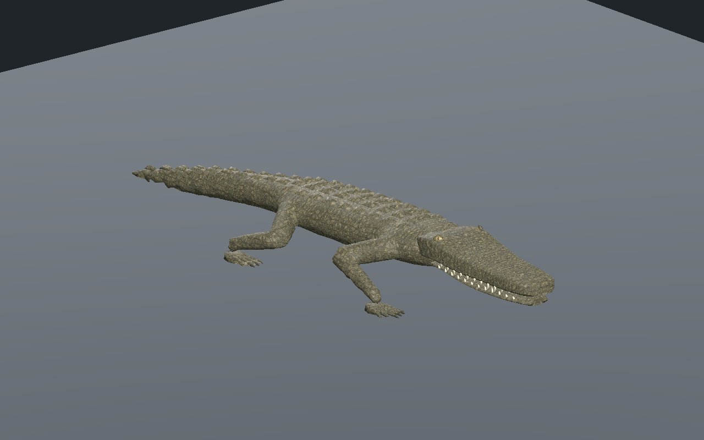
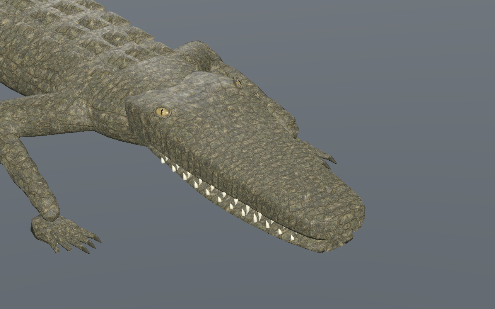
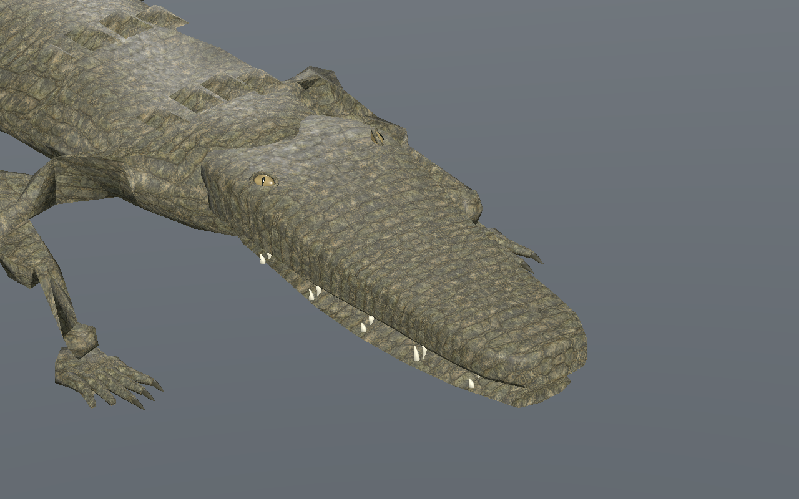
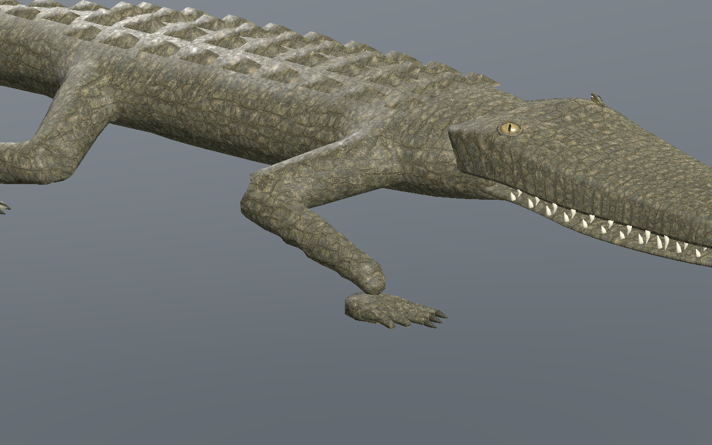
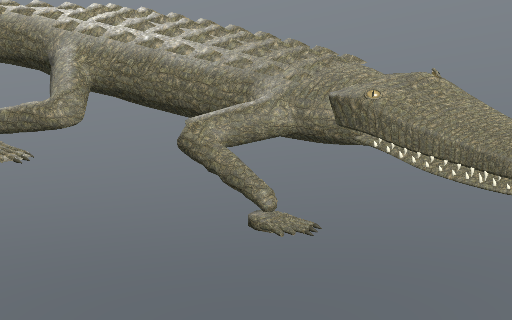
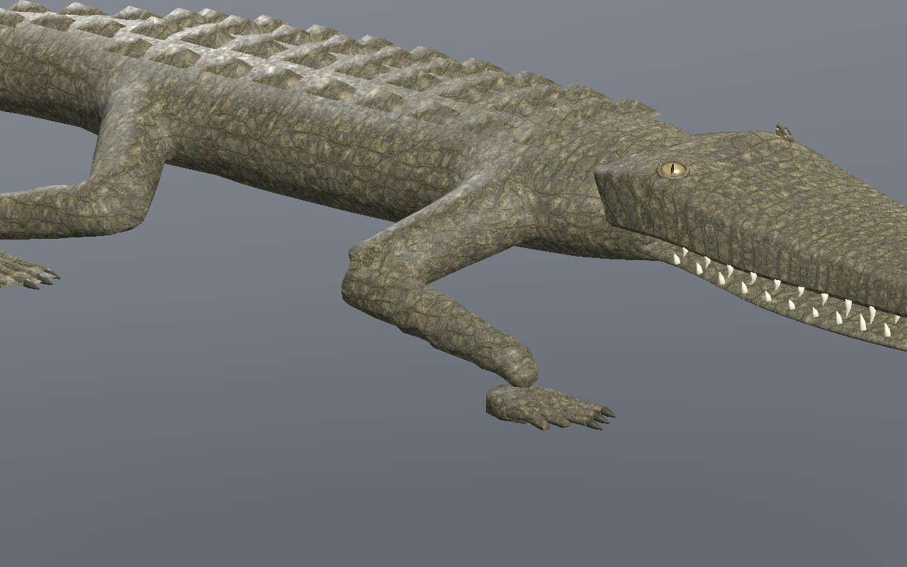
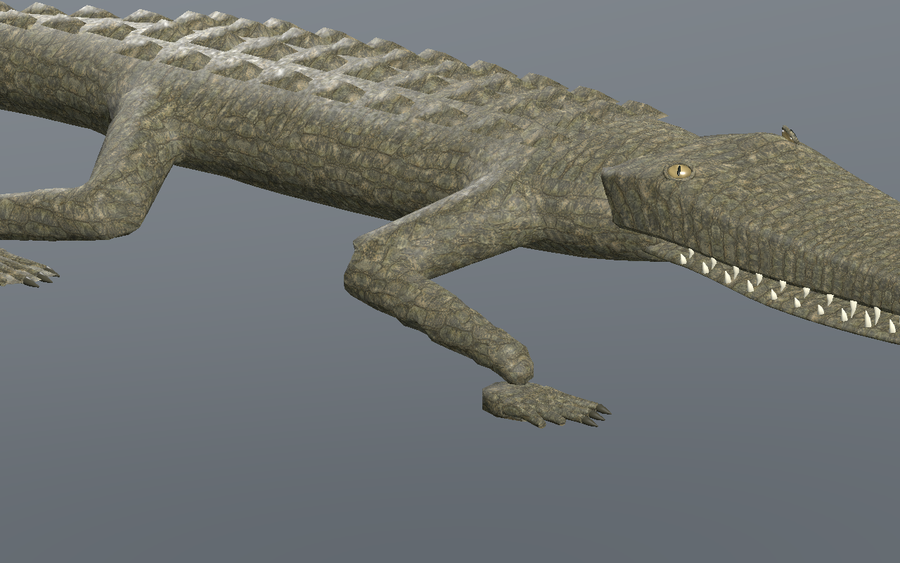

# Crocodilien — crâne arrondi et yeux attachés, recette 0.5.0

[Recette JSON](recipe.json) · [Profil de tête](cranial-profile.json) · [Mesures UV](uv-measurements.json) · [Validation](validation.json) · [Provenance](provenance.json) · [Galerie](../../GALERIE.md)

Le contour du crâne est arrondi dans la géométrie, en particulier à l’arrière de la tête. Les globes passent de 28 × 18 × 14 mm à **24 × 15,5 × 10,5 mm de rayons locaux**. Chaque œil est placé par intersection avec la surface réelle du crâne de son LOD, avec environ **8,8 mm d’insertion**. Cela corrige notamment le flottement trouvé dans le premier candidat au LOD2. Iris et pupilles restent des pièces originales, sans nouvelle image.

Le dessus, les flancs et les deux poches nasales forment maintenant **un dépliage UV continu**, calculé sur les vrais triangles. La coupe est conservée sous le crâne. Les trois LOD ont zéro triangle UV écrasé ; l’anisotropie maximale de tous les triangles du crâne reste sous **1,86**, et celle des flancs sous **1,33**. Les arêtes communes du dessus et des côtés ont des UV identiques à la précision de l’export. La densité locale varie : environ **426 à 1 535 texels/m** au repos ; une petite zone nasale utilise moins de texels. Les coutures des projections du corps restent un sujet distinct.

Le corps et la marche sont conservés. Les UV de toute la peau sont aussi mesurés pendant **601 poses par LOD** : anisotropie maximale **2.379**, aucun Jacobien UV effondré. Ces mesures ne constituent pas une approbation artistique finale.

Le budget est **9 566 / 5 442 / 3 070 triangles**, 31 os, trois images **512 / 256 / 256** pixels et **2 097 148 octets** estimés en RGBA8 avec mipmaps. L’arrondi ajoute quatre triangles par LOD à la version 0.4.0. Aucun nouveau bitmap ; aucune mesure de FPS ou de mémoire totale du pilote. Le GLB reconstruit pèse **2,181,296 octets**.

La marche passe les contrôles CPU, éditeur et Godot : au moins **trois appuis**, dérive maximale CPU **0.137 mm**, hauteur absolue en appui **0.337 mm**, levée minimale **44.95 mm**. Godot contrôle les vrais binds et paumes sur 241 instants par LOD. La sélection passe Forward+ et Compatibility. La recette téléchargée dans l’éditeur porte le pas à **0,11 m** ; elle est reconstruite puis vérifiée dans Godot Forward+. Toutes les captures ci-dessous viennent de cette reconstruction.

| Début du cycle | Quart du cycle |
| --- | --- |
|  |  |
|  |  |

SHA-256 du modèle capturé : `4acec6dd035f6bd59d282b9ac0f6acb2ce50c95a0dd611628fda6c9e88353f9d`.
SHA-256 de la recette : `8fdc3cfdf6f3ebf70cd073e07afb8b2f47924626539a46387348e88337b261aa`.

La [version 0.4.0](../v0.4.0/README.md) et les anciennes fiches restent conservées. Le générateur de cette version exige le profil v5 ; les sources précédentes sont archivées localement. Générateurs, GLB, caches et adaptateurs privés ne sont pas distribués : le JSON documentaire seul ne reconstruit pas l’animal de façon autonome. Revue locale CPU, éditeur réel et Godot isolé, marche rectiligne sur sol plat. Sculpture, raccord tête/cou et coutures du corps restent en revue ; terrain, virages, nage, forces, collisions exhaustives, monde principal, réseau, VR et coût en foule non qualifiés.
