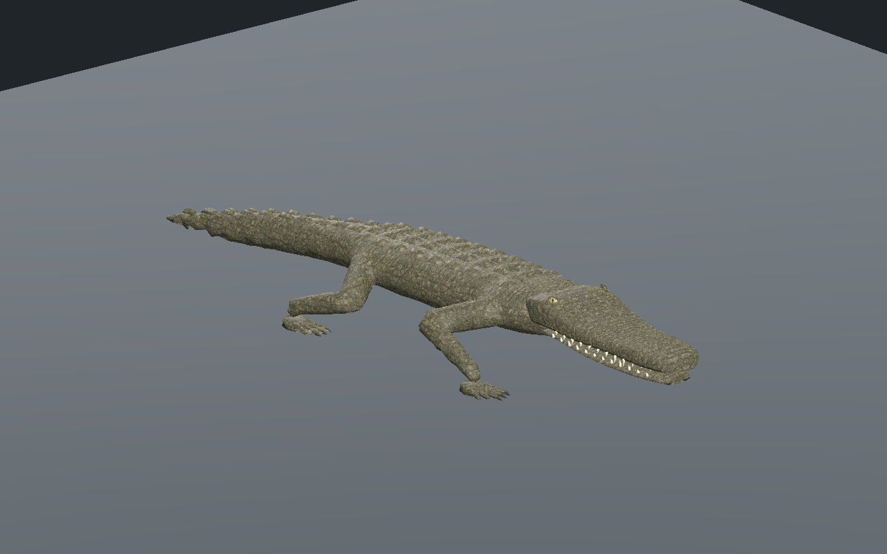
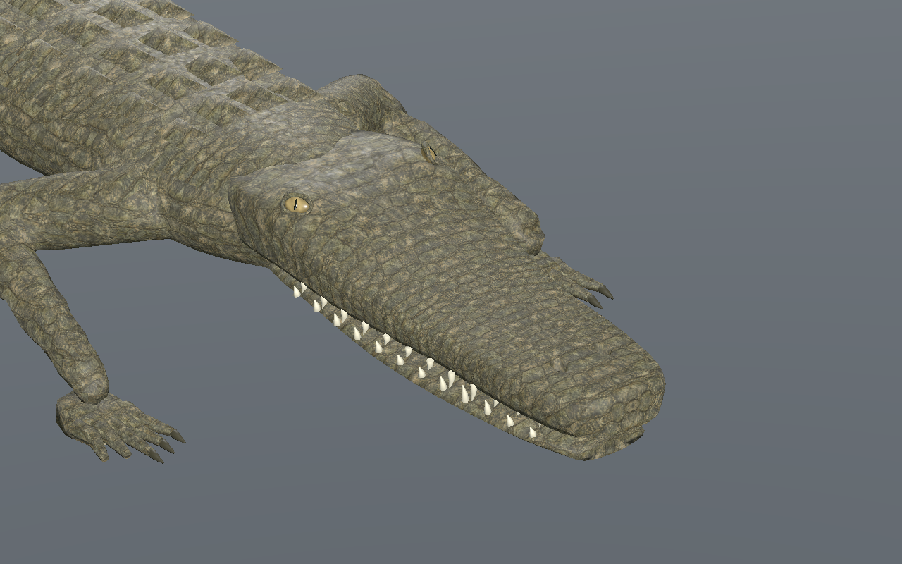
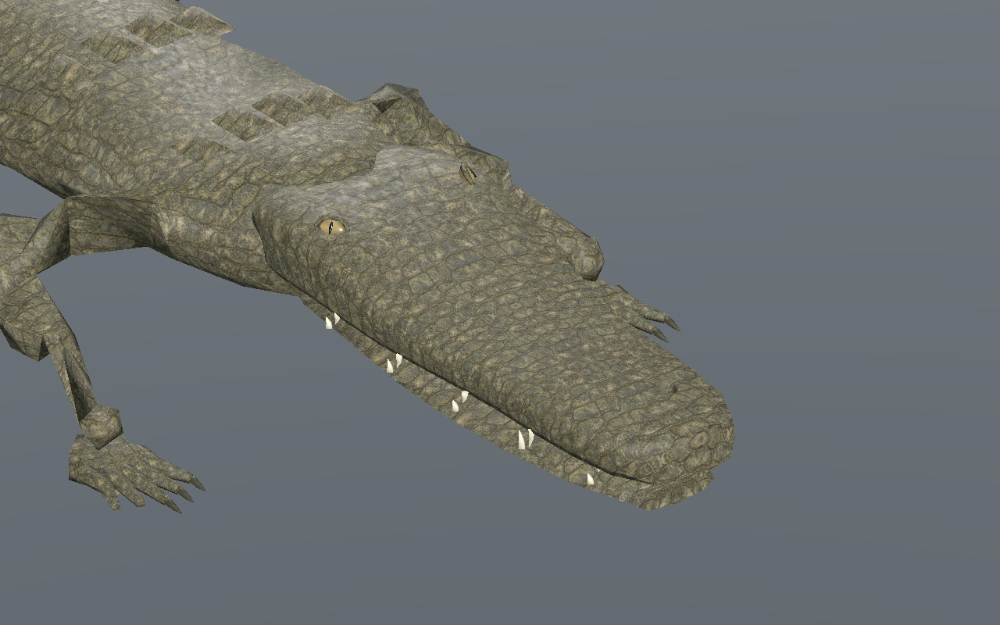
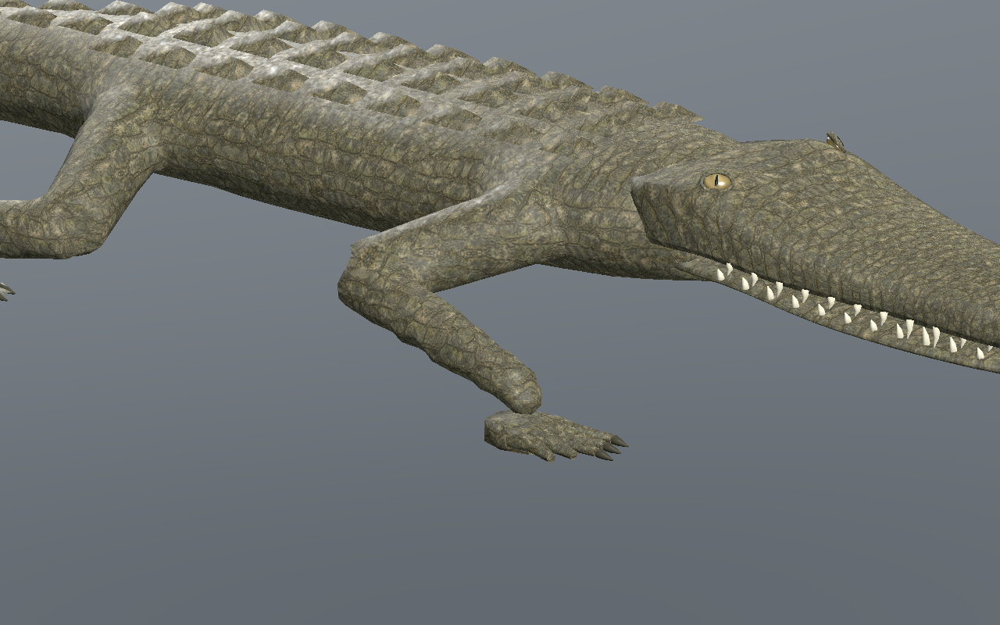
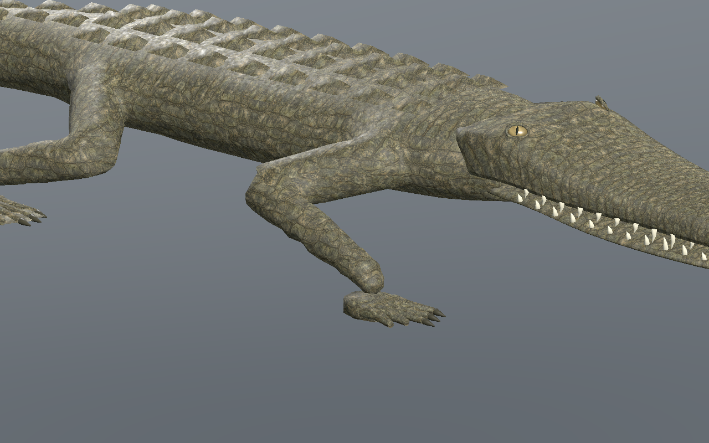
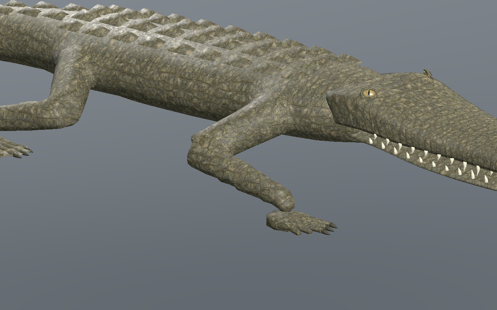
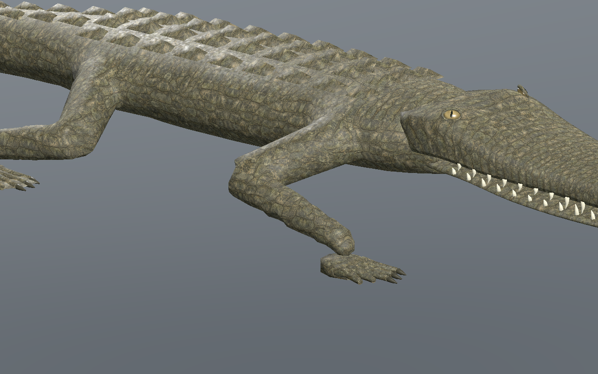

# Crocodilien — museau affiné et paupières sculptées, recette 0.6.0

[Recette JSON](recipe.json) · [Profil de tête](cranial-profile.json) · [Mesures UV](uv-measurements.json) · [Validation](validation.json) · [Provenance](provenance.json) · [Galerie](../../GALERIE.md)

Le museau est moins massif : son dessus descend progressivement jusqu’à **14 mm**, et son plancher remonte jusqu’à **8 mm** au milieu de sa longueur. Les joues et le chanfrein supérieur sont plus inclinés. Ces changements portent sur la géométrie réelle, avec le même nombre de triangles.

Les paupières ont maintenant une **arcade supérieure plus épaisse et une bordure inférieure plus fine**, au lieu d’un tube uniforme. Leur rayon varie de **3,2 à 5,5 mm**. Les deux globes restent insérés d’environ **8,8 mm** dans le crâne réel de chaque LOD, avec iris et pupille séparés. Aucune nouvelle image.

Les UV des paupières suivent leurs vrais triangles avec des projections métriques. Leur anisotropie maximale passe de **1.9934** dans la version 0.5 à **1.6785**. Cette correction réduit les étirements autour des yeux ; elle introduit de petites coutures de projection, distinctes du dépliage continu du crâne.

Le dépliage continu du dessus, des flancs et des cavités nasales est **recalculé pour cette forme**. Aucun triangle UV écrasé ; aucune différence UV sur les arêtes communes de ce dépliage. Son anisotropie maximale au repos est d’environ **1.8513** sur les trois LOD. La densité locale varie encore : cela ne supprime pas les coutures des projections du corps. Toute la peau animée est contrôlée sur **601 poses par LOD** ; anisotropie maximale mesurée **2.379**.

Budget conservé : **9 566 / 5 442 / 3 066 triangles**, **31 os**, trois images **512 / 256 / 256 pixels**, estimation RGBA8 avec mipmaps **2 097 148 octets**. Aucune mesure de FPS ni de mémoire totale du pilote.

Marche : **trois appuis minimum**, dérive CPU maximale **0.137 mm**, hauteur absolue d’appui **0.337 mm**, levée minimale **44.95 mm**. L’éditeur contrôle les trois LOD et la lecture/pause/reprise. La recette téléchargée, avec un pas de **0,11 m**, est reconstruite ; les versions sélectionnée et reconstruite passent **Godot Forward+ et Compatibility**, avec **241 poses par LOD** sur les vrais binds et paumes.

| Début du cycle | Quart du cycle |
| --- | --- |
|  |  |
|  |  |

Les sept captures sont issues de la recette reconstruite, sans retouche. Modèle capturé : `3b3548aa758b3a1ccadd6575c2ffc2fc854418cb212f72a0a9c85678dcde91d0`. Recette : `cad7ff40a1073ab0ca5e1583dedf5e0fdaf7144da3b7f4797c6497bcfd9ec8d3`.

La [version 0.5.0](../v0.5.0/README.md) reste conservée et son profil reste accepté par le générateur local. Le JSON documentaire dépend du générateur et des ressources locales ; aucun GLB, générateur privé ou cache n’est distribué. Revue locale CPU, éditeur réel et Godot isolé, marche rectiligne sur sol plat. Raccord tête/cou, coutures du corps, dentition et finition artistique restent en revue. Terrain, virages, nage, forces, collisions exhaustives, foule, monde principal, réseau et VR non qualifiés.
