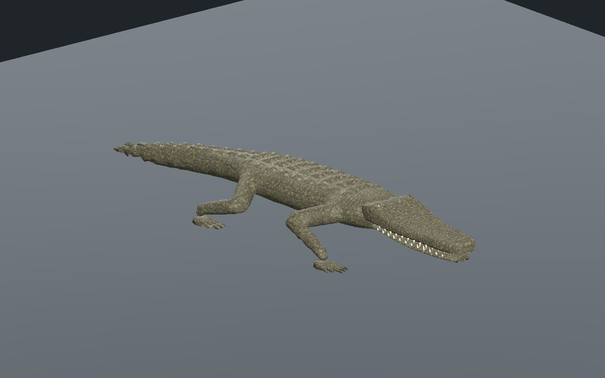
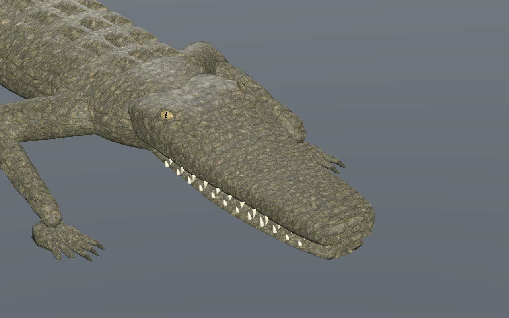
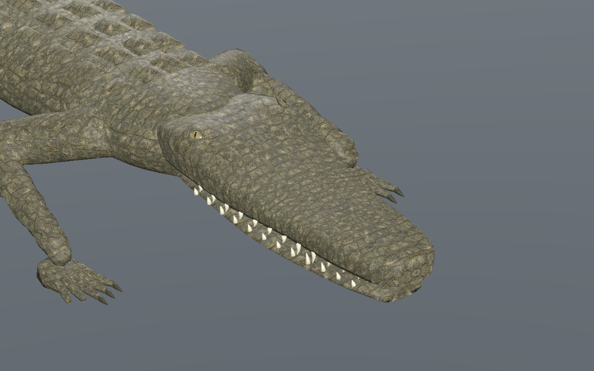
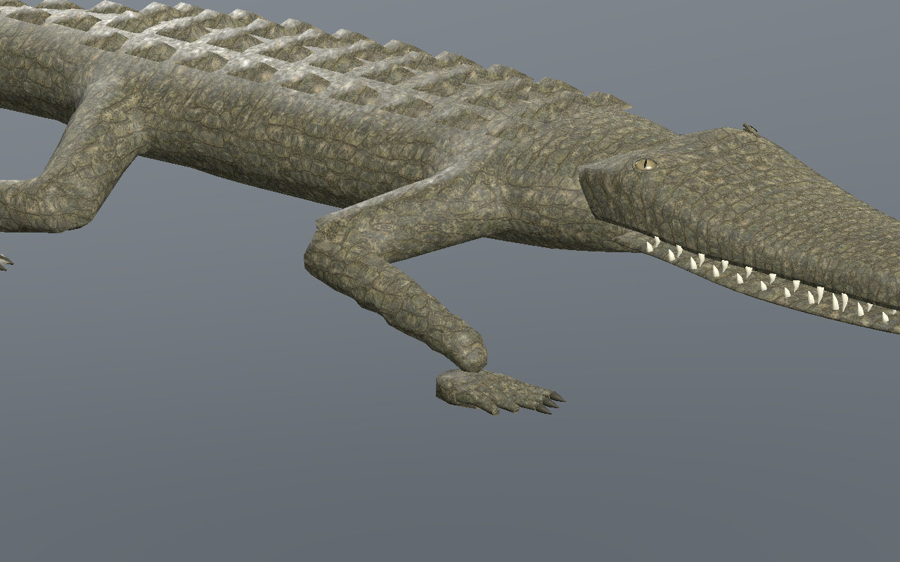
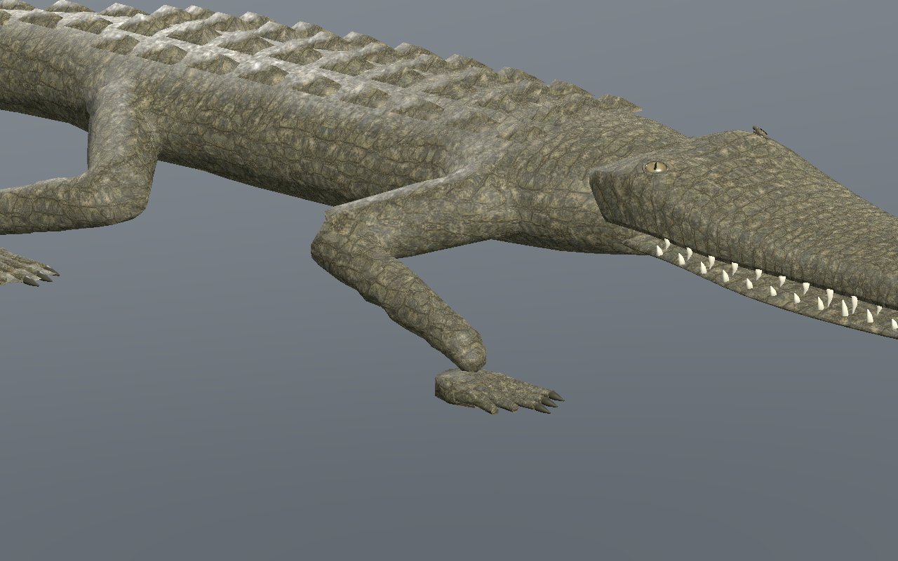
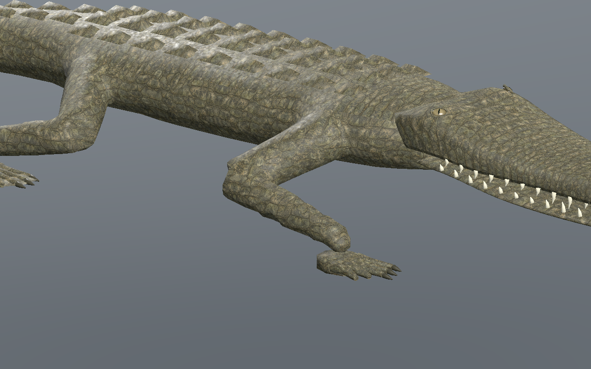
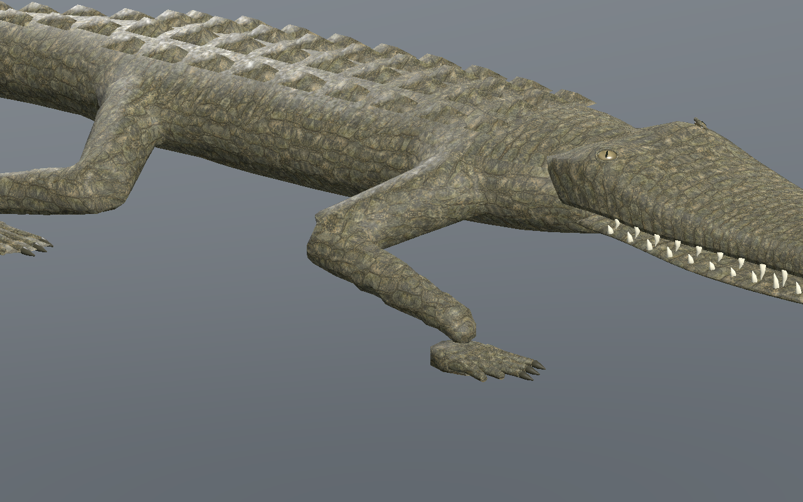
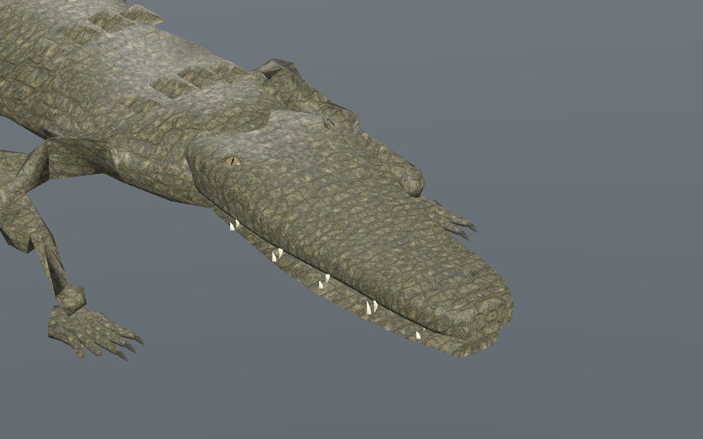

# Crocodilien — tête affinée, yeux intégrés et mâchoire dépliée

[Recette JSON](recipe.json) · [Profil de tête](cranial-profile.json) · [Mesures UV](uv-measurements.json) · [Validation](validation.json) · [Provenance](provenance.json) · [Galerie](../../GALERIE.md)

Version **0.7.0**. Le museau et la mâchoire sont progressivement resserrés, et le dessus de l’arrière du crâne descend jusqu’à **12 mm**. La largeur de l’extrémité du museau est réduite de12 %, celle du raccord arrière de14 %. Les positions des dents et les références des cavités nasales suivent cette forme. La [référence anatomique du NPS](https://www.nps.gov/ever/learn/nature/crocodile.htm) guide la silhouette ; aucun pixel ni modèle externe n’est copié.

| Version0.6, mêmes paramètres | Nouvelle tête0.7 |
| --- | --- |
|  |  |

Les yeux sont plus petits et orientés davantage vers le haut. Le centre est placé **1,2 mm sous la vraie surface** de chaque crâne LOD. Le globe dépasse d’environ **7,8 mm**, contre12,2 mm auparavant, avec paupières ajustées, iris moins clair et pupille verticale séparée. L’intersection avec le crâne exporté est vérifiée aux trois LOD.

La mâchoire reçoit une bande UV continue, coupée sur sa ligne ventrale, avec deux bouchons séparés. Un dépliage conformal initial est ajusté aux métriques des vrais triangles pour limiter la concentration des texels. Anisotropie maximale de la mâchoire sur les trois LOD : **1.4690 → 1.3487**. Les LOD0/1 progressent ; le LOD2 passe localement de1,2124 à1,3487. La densité reste entre environ**863 et1075 texels/m**. Le nombre total d’arêtes de couture ne diminue pas à tous les LOD : la bande remplace notamment les superpositions des anciennes projections. Les mesures gardent ce compromis explicite. Le dépliage conformal du crâne est recalculé ; les coutures du corps restent à travailler.

Budget inchangé : **9566 /5442 /3066 triangles**, **31 os**, trois images **512/256/256**, estimation RGBA8 avec mipmaps **2097148 octets**. Images embarquées et attributs du corps identiques ; aucune nouvelle texture ni mesure de FPS.

Marche vérifiée sur **601 poses/LOD en CPU**, puis **241 poses/LOD dans Godot Forward+ et Compatibility**, pour la sélection27 et la recette téléchargée puis reconstruite28. L’éditeur central vérifie trois LOD, lecture/pause/reprise, mouvement réel, tête seule, images partagées et téléchargements JSON/GLB. La recette exportée change le pas de0,10 à**0,11 m**. Trois appuis minimum ; dérive CPU maximale**0.137 mm**, hauteur absolue d’appui**0.337 mm**, levée minimale**44.95 mm**. À pas identique, les pistes d’animation du corps restent strictement identiques. L’anisotropie maximale de toute la peau animée reste2,20583 pour la sélection et2,37857 pour la reconstruction.

| Début | Quart du cycle |
| --- | --- |
|  |  |
|  |  |

Sept captures de la reconstruction et deux comparaisons à paramètres/caméra identiques sont conservées sans retouche. Modèle reconstruit : `fb1bdb6d9818067abeb06afb74d5cc93076ca7d97e93d791a09655ec00642940`. La [version0.6.0](../v0.6.0/README.md) reste disponible ; sa tête a été régénérée à l’identique octet par octet. La recette dépend des ressources originales locales ; les GLB, générateurs et bitmaps privés ne sont pas distribués.

Revue locale du crocodilien sur sol plat dans l’éditeur et Godot isolé. Finition photoréaliste, raccord cou/tête final, coutures du corps, dents, intersections exhaustives, terrain, virages, nage, forces, foule, monde principal, serveur/réseau/VR et FPS restent non qualifiés.
