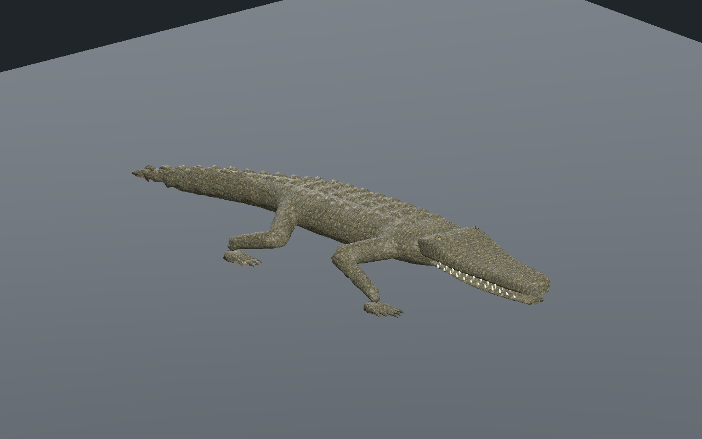
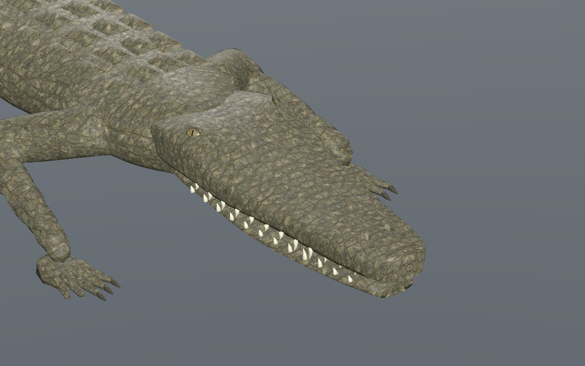
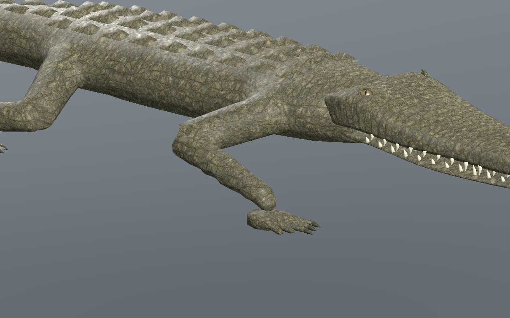
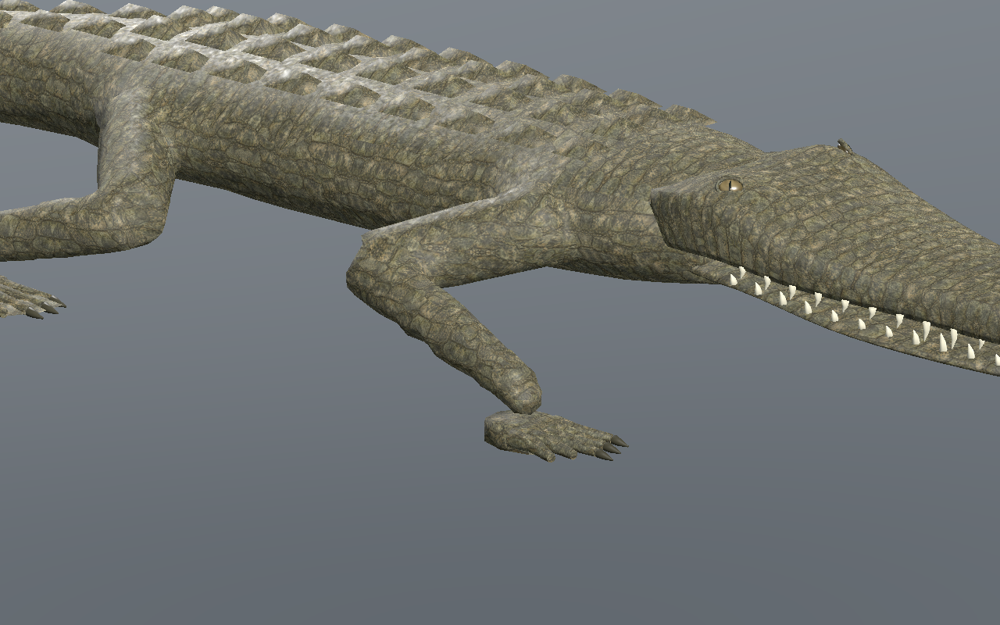
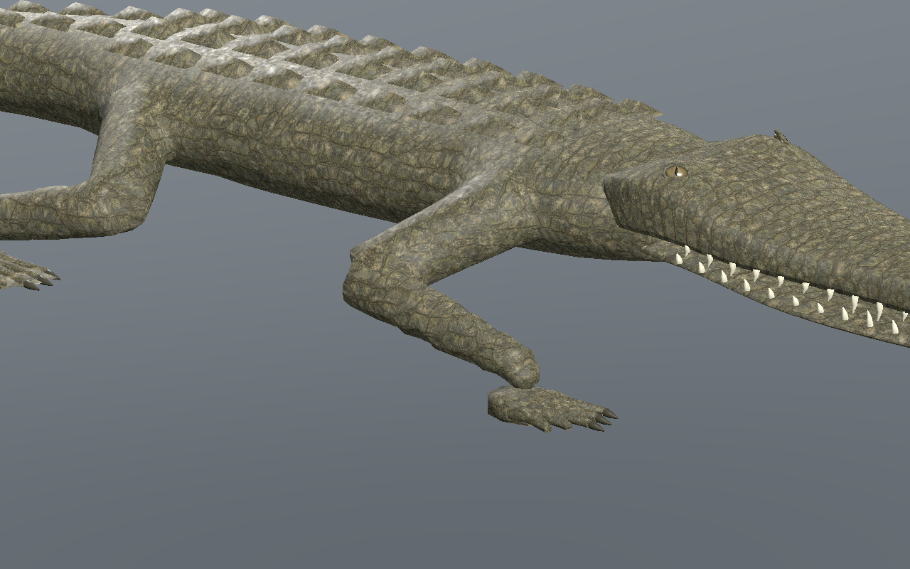
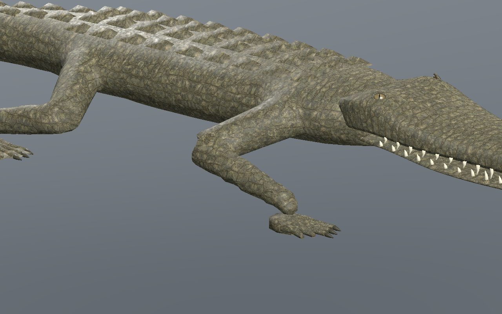
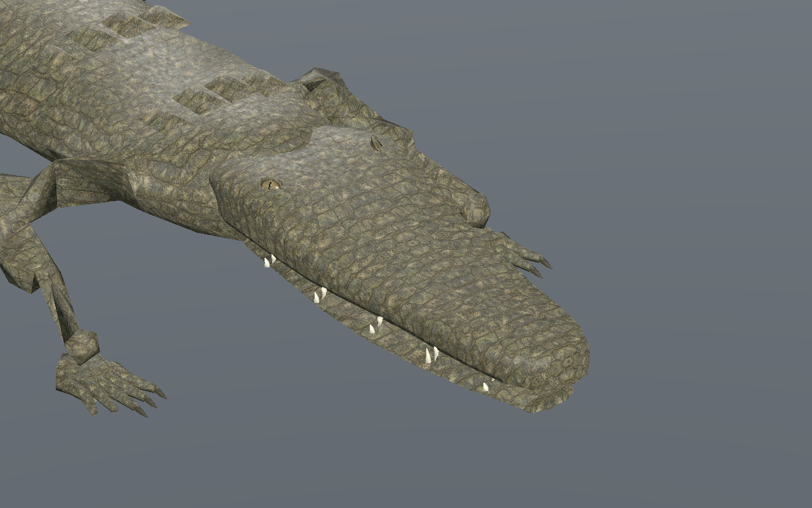

# Crocodilien — museau profilé, yeux orientés et écailles plus régulières

[Recette JSON](recipe.json) · [Profil de tête](cranial-profile.json) · [Mesures UV](uv-measurements.json) · [Validation](validation.json) · [Provenance](provenance.json) · [Galerie](../../GALERIE.md)

Version **0.8.0**. Le museau se resserre davantage vers son extrémité avec une transition de largeur lissée par PCHIP. Son extrémité est environ **11,4 % plus étroite qu’en0.7** ; la zone latérale du crâne descend progressivement jusqu’à5 mm. Mâchoire, dents et cavités nasales suivent la nouvelle largeur. Cette adaptation originale s’appuie sur la description du museau étroit et triangulaire du [crocodile américain par le NPS](https://www.nps.gov/ever/learn/nature/crocodile.htm). Aucun modèle ni pixel de référence n’est copié.

| Version0.7 | Version0.8, mêmes caméra, temps et pas |
| --- | --- |
|  |  |

Les yeux sont orientés davantage vers l’avant et les côtés, tout en restant sur le haut du crâne. L’iris ambré est assombri ; pupille verticale et paupières restent séparées. Le centre est situé **1,2 mm sous la vraie surface de chaque LOD**, avec environ **7,8 mm exposés et10,2 mm insérés**. Le contrôle d’intersection est effectué sur les triangles exportés.

Le dépliage continu du dessus, des côtés et des narines est ajusté aux métriques des vrais triangles. Il limite à la fois compression, étirement et anisotropie. La variation de taille des écailles diminue sans ajouter de texture ni de couture sur le dessus. La densité réelle du crâne est d’environ **631–1355 texels/m** ; anisotropie maximale **1.830**, aucun UV effondré. Le rapport entre densités maximale et minimale diminue de plus de35 % à chacun des trois LOD. La coupe ventrale reste séparée et les coutures du corps restent à revoir.

| LOD | Rapport densité max/min0.7 | Rapport0.8 | Anisotropie max0.8 |
| --- | --- | --- | --- |
| 0 | 3.686 | 1.911 | 1.780 |
| 1 | 3.501 | 1.977 | 1.797 |
| 2 | 3.378 | 2.150 | 1.830 |

Budget inchangé : **9566 /5442 /3066 triangles**, **31 os**, trois images **512/256/256**, estimation RGBA8 avec mipmaps **2097148 octets**. Les images, matériaux, attributs non crâniens et pistes d’animation à pas identique sont strictement conservés. La tête0.7 reste régénérable octet par octet. Aucun coût FPS ou mémoire totale du pilote n’est déduit de ces budgets.

La marche passe **601 poses/LOD en CPU**, puis **241 poses/LOD dans Godot Forward+ et Compatibility**, pour la sélection31 et sa recette reconstruite32. Le vrai éditeur central vérifie trois LOD, lecture/pause/reprise après fin de clip, déplacement réel, tête seule, partage des images, largeurs736/320 et téléchargements JSON/GLB. Le pas exporté est modifié de0,10 à **0,11 m**, puis reconstruit et contrôlé. Au moins **3 appuis** ; dérive CPU maximale **0.137 mm**, hauteur absolue d’appui **0.337 mm**, levée minimale **44.95 mm**.

| Début | Quart du cycle |
| --- | --- |
|  |  |
|  |  |

Neuf captures natives sans retouche. Modèle reconstruit : `1cc7d1923a04545e8fc97492309bb6c052b008ea6c28ea6a5ac62075055b3155`. [Version0.7 conservée](../v0.7.0/README.md). Les recettes dépendent des ressources originales locales ; GLB, générateurs et bitmaps privés ne sont pas distribués.

Revue locale du crocodilien sur sol plat dans l’éditeur et Godot isolé. Finition photoréaliste, raccord final tête/cou, coutures du corps, dents, intersections exhaustives, terrain, virages, nage, forces, foule, monde principal, serveur/réseau/VR et FPS restent non qualifiés.
