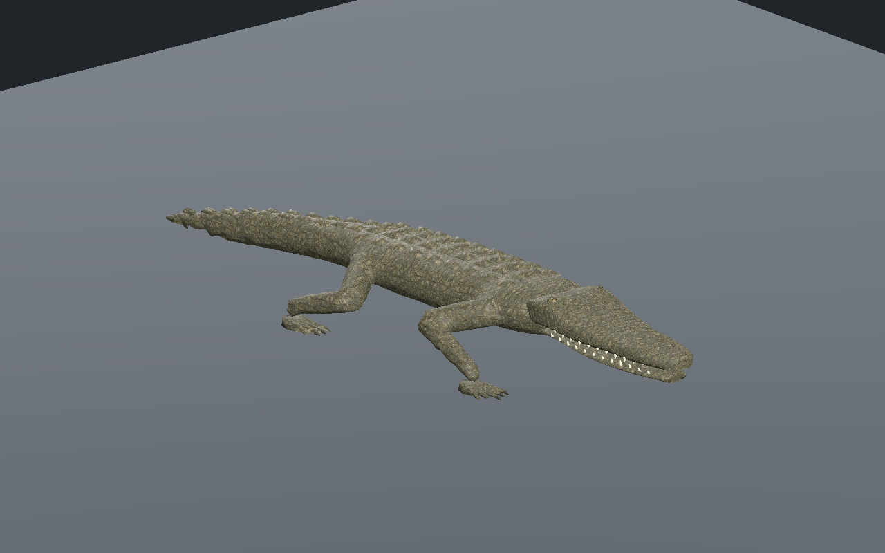
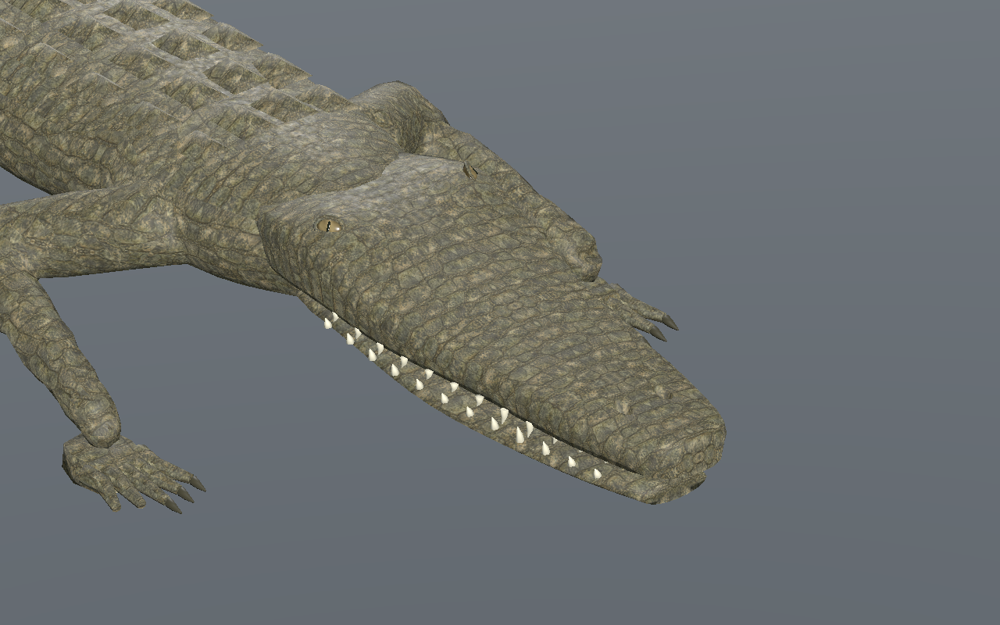
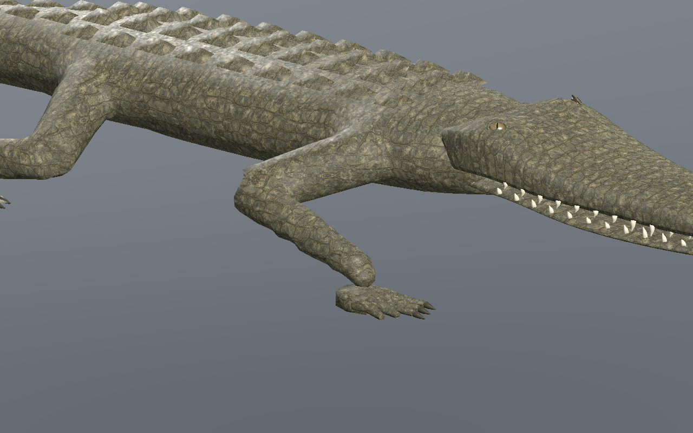
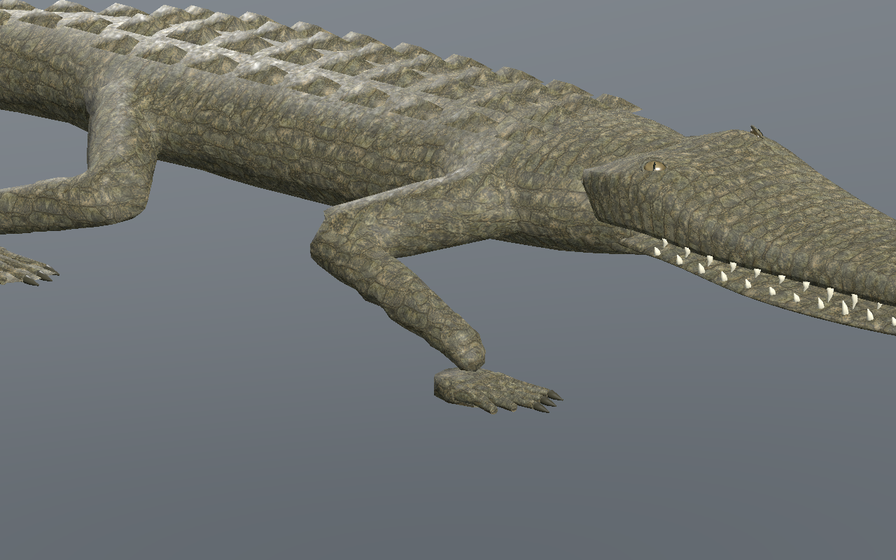
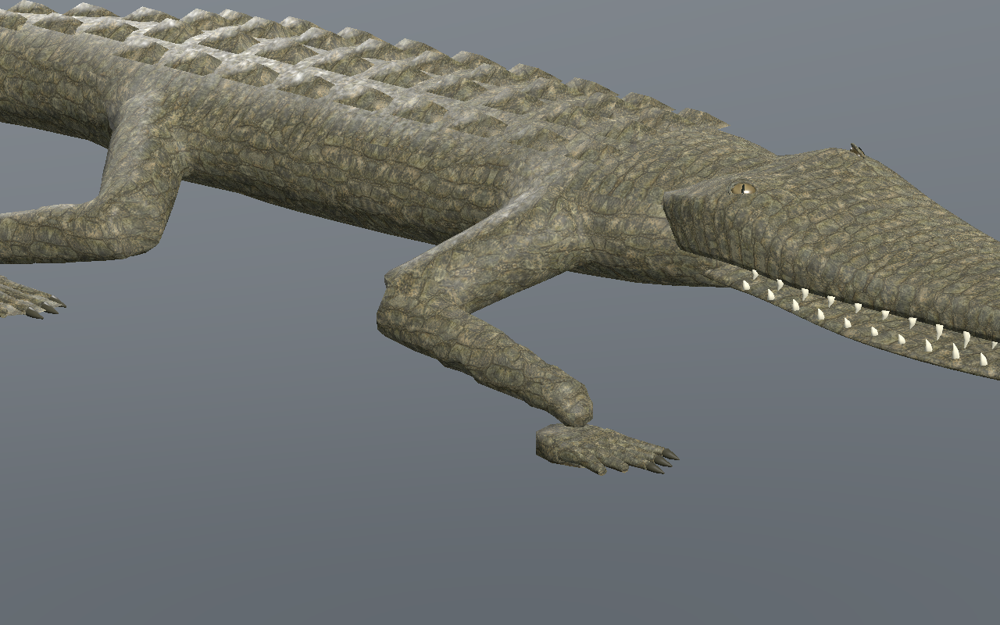
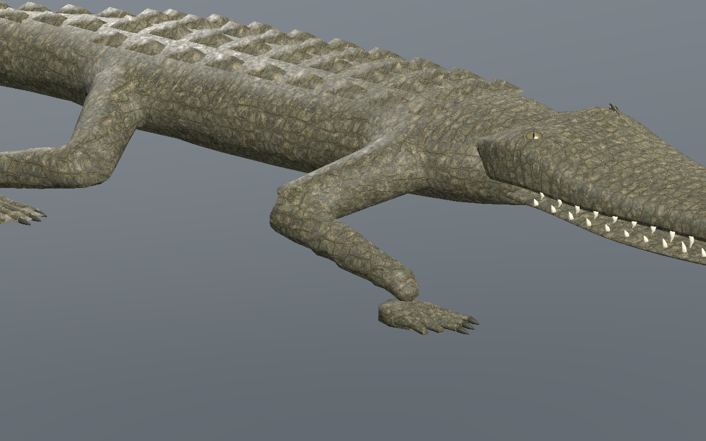
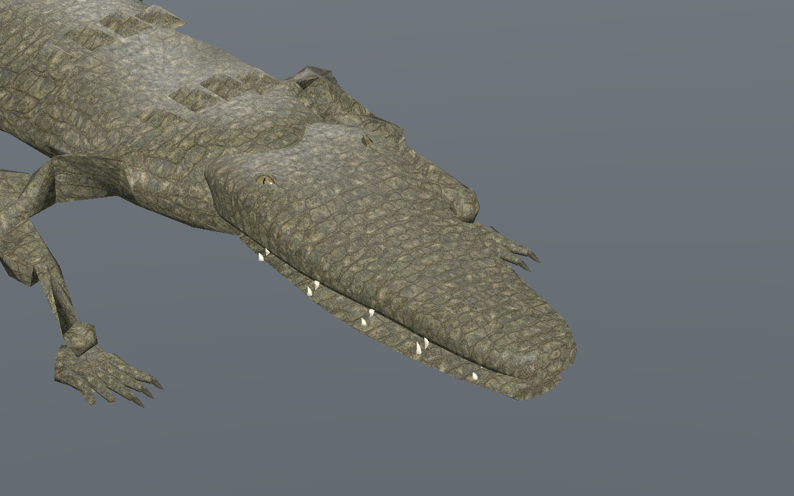

# Crocodilien — museau abaissé et paupières intégrées

[Recette JSON](recipe.json) · [Profil de tête](cranial-profile.json) · [Mesures UV](uv-measurements.json) · [Validation](validation.json) · [Provenance](provenance.json) · [Galerie](../../GALERIE.md)

Version **0.9.0**, issue de la [version0.8 conservée](../v0.8.0/README.md). L’avant du museau est aminci par deux transitions progressives : toit abaissé jusqu’à10mm, plancher et mâchoire relevés jusqu’à6mm. Sur les vrais triangles à z=-1,38m, l’épaisseur passe d’environ74 à60mm aux trois LOD. Les dents sont raccourcies de18% et leurs bases suivent la mâchoire.

| Version0.8 | Version0.9, même caméra et même pas |
| --- | --- |
|  |  |

Les paupières ont une profondeur réduite de38% pour atténuer leur forme d’anneau. Les globes sont davantage insérés : centre2,5mm sous la surface réelle de chaque LOD, exposition6,5mm, insertion11,5mm. L’iris ambré et la pupille verticale sont conservés. Les contrôles portent sur les triangles exportés.

Le dépliage continu dessus/flancs/narines est recalculé sur la nouvelle forme. Aucun triangle UV écrasé, différence UV nulle sur les arêtes communes du dessus et des flancs. Anisotropie crânienne maximale inférieure à1,825. Densité approximative630–1356texels/m. Les mesures varient légèrement selon le LOD ; elles ne constituent pas une amélioration uniforme de tous les indicateurs. La coupe ventrale et les coutures du corps restent distinctes.

| LOD | Anisotropie maximale | Rapport densité max/min |
| --- | --- | --- |
| 0 | 1.776 | 1.896 |
| 1 | 1.799 | 1.963 |
| 2 | 1.824 | 2.150 |

Budget conservé : **9566 /5442 /3066 triangles**, **31 os**, trois images **512/256/256**, estimation RGBA8 avec mipmaps **2097148octets**. Les attributs non crâniens, matériaux, pixels et clips à pas identique sont strictement conservés. La tête0.8 est régénérée octet par octet. Aucun gain FPS ni coût total du pilote n’est déduit de ces budgets.

La sélection33 et la recette reconstruite34 passent **601poses/LOD en CPU**, puis **241poses/LOD dans Godot Forward+ et Compatibility**. Le vrai éditeur central vérifie trois LOD, lecture/pause/reprise après fin, déplacement réel, tête seule, partage des trois sources d’images, largeurs736/320 et téléchargements JSON/GLB. Le pas téléchargé est modifié de0,10 à **0,11m**, puis reconstruit.

Au moins **3appuis**, dérive CPU maximale **0.137mm**, hauteur absolue d’appui **0.337mm**, levée minimale **44.95mm**.

| Début | Quart du cycle |
| --- | --- |
|  |  |
|  |  |

Neuf captures natives sans retouche. Modèle reconstruit : `7e35bc9c081222ce0018709370ee6f5814315aa2d64a181740b23e053521847b`. Recettes dépendantes des ressources originales locales ; les GLB, générateurs et bitmaps privés ne sont pas distribués.

Revue locale sur sol plat dans l’éditeur et Godot isolé. Coutures du corps, raccord tête/cou, dentition finale, intersections exhaustives, terrain, virages, nage, forces, foule, monde principal, réseau, VR et FPS non qualifiés. Finition photoréaliste non approuvée.
