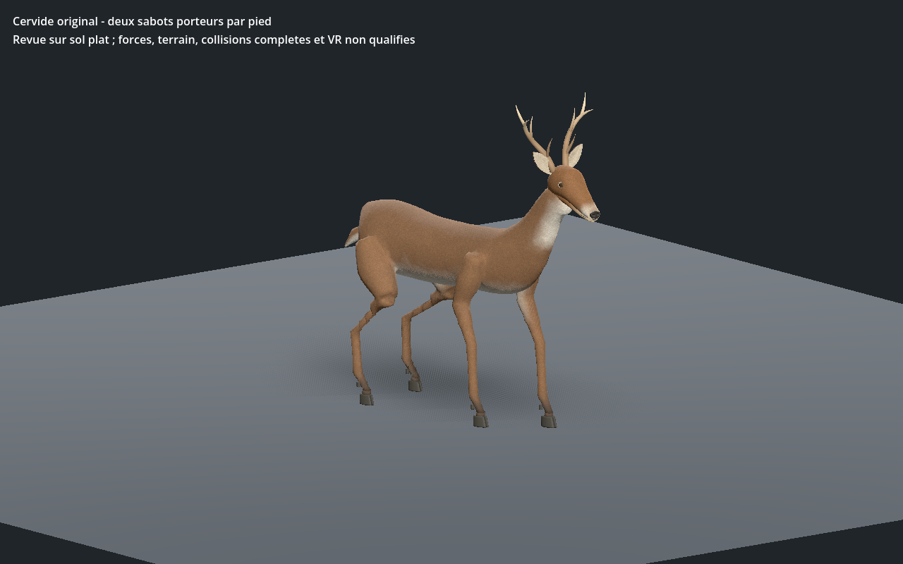
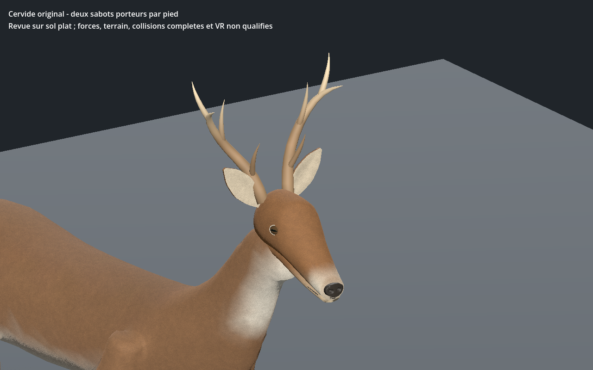
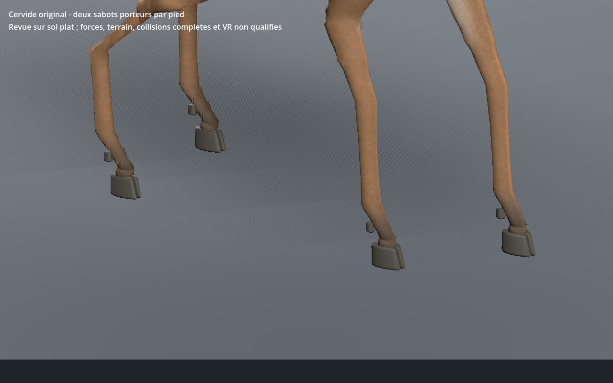

# Cerf à bois — première revue cervidée, recette 0.1.0

[Recette JSON](recipe.json) · [Profil anatomique](anatomy-profile.json) · [Validation](validation.json) · [Sections des membres](shaft-sections.json) · [UV](uv-measurements.json) · [Scène de coût du cerf](cost-measurements.json) · [Provenance](provenance.json) · [Galerie](../../GALERIE.md)

Nouvelle forme originale pour `mobile:deer_stag` : crâne dédié sans torse, grandes oreilles attachées, deux poches nasales réelles, pupilles horizontales, queue courte et quatre pieds à deux sabots porteurs. Le museau du premier prototype a été raccourci. Des couleurs de sommet dessinent les zones claires du cou, du ventre, du menton et de la queue sans ajouter de texture. Le cerf porte deux bois ramifiés originaux. Cette première variante partage encore les proportions corporelles de la biche ; le dimorphisme est à développer.

Les premiers pieds ressemblaient à des sabots bovins arrondis. Les deux empreintes sont maintenant symétriques et pointues, convergent vers l’avant et gardent leur séparation médiane ; les pieds arrière sont légèrement plus petits. Deux ergots sont relevés derrière chaque pied. Une courte peau de paturon rejoint les sabots sans prolonger artificiellement leur paroi noire. Les formes et les marques du pelage s’appuient sur les descriptions du [Missouri Department of Conservation](https://mdc.mo.gov/discover-nature/field-guide/white-tailed-deer) et de [NC Wildlife](https://www.ncwildlife.gov/species/white-tailed-deer), sans reprise de leurs images.

Les trois LOD comptent **13 130 / 7 036 / 3 666 triangles**, **32 os**, quatre influences maximum et trois images partagées **512 / 256 / 256** pixels. Estimation des images RGBA8 avec mipmaps : **2,097,148 octets** ; modèle reconstruit : **2,351,748 octets**. Ces tailles ne sont pas une mesure de mémoire totale du pilote.

Les jambes affinées passent **60 sections réelles**, avec un diamètre minimal de **49.35 mm** et un rapport de largeur maximal **1.082**. Le profil de rayons est propre aux cervidés ; le défaut du module commun reste identique dans les trois LOD d’un essai Blender avant/après. Tous les triangles texturés exportés ont des UV non écrasés et une anisotropie de repos inférieure à **1,735** ; les transitions entre projections et le flux du poil restent en revue.

La marche passe sur **601 instants par LOD au CPU**, puis **241 dans l’éditeur et Godot** : au moins **trois appuis**, dérive CPU maximale **0.066 mm**, hauteur absolue d’appui **0.066 mm**, levée minimale proche du sommet du pas **85.62 mm**. Les seuils de déformation et de section sont conservés ; ces mesures ne calculent ni les forces ni l’équilibre dynamique.

Le vrai lien central de l’éditeur ouvre un sélecteur biche/cerf. Trois LOD, lecture/pause/relecture, relief, topologie, tête seule et téléchargements sont contrôlés. Une erreur de visibilité après changement de LOD a été corrigée : les sphères des meshes skinnés sont recalculées pour la pose courante. Le comptage des triangles réellement rendus est contrôlé pendant la marche. La sélection passe Godot Forward+ et Compatibility. La recette téléchargée modifie le pas de **0,22 à 0,23 m** ; sa reconstruction passe à nouveau CPU, UV, sections, parité crânienne et Godot Forward+. Les trois captures montrent cette reconstruction.

La [scène de coût du cerf](cost-measurements.json) mesure 64 instances du cerf sélectionné à pas de 0,22 m, sans ombres, sur 120 trames après chauffe par LOD. Elle ne mesure pas le jeu complet ; les intervalles jusqu’à `frame_post_draw` ne sont pas des timestamps ou fins de calcul GPU. Aucun FPS en jeu n’est garanti.

SHA-256 du modèle capturé : `5a597a48dde979526a3092c0abaf223e7ae2967647903dbcabe787aab101d933`.
SHA-256 de la recette : `6e3f153f306940262fde2f0c5a1e15b3280a0269f414755767b7c732bf647a0c`.

Générateurs, GLB, caches et adaptateurs privés restent locaux ; ce JSON documentaire seul ne reconstruit pas l’animal de façon autonome. Première revue cervidée encore stylisée : CPU, éditeur réel et Godot isolé sur sol plat. Visage, poils, raccords et dimorphisme du corps restent à affiner. Terrain, virages, forces, intersections exhaustives, monde principal, réseau et VR non qualifiés.
