# Dragon — corps, quatre pattes et marche de revue

**Version0.1.0 : corps encore stylisé, ailes à construire.** [Tête réutilisée](../../dragon-cranium-original/v0.2.0/README.md).

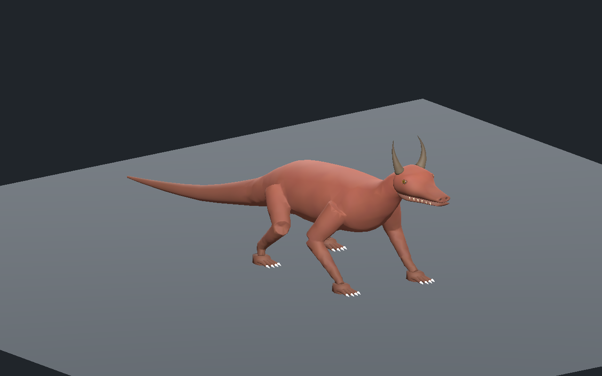

[Recette JSON](recipe.json) · [Conception](design-profile.json) · [Validation](validation.json) · [Mesures de queue](tail-measurements.json) · [Provenance](provenance.json) · [Galerie](../../GALERIE.md)

Le corps original ajoute un cou relevé, un torse, une longue queue et quatre pattes articulées à la tête conservée. Les paumes ont un volume de poignet relevé et leur recouvrement intérieur avec les membres est vérifié sur les vrais triangles, pour les troisLOD. Chaque pied a quatre doigts et quatre griffes ; c’est un choix de créature fantastique. Le rig compte33os, dont trois articulations de cou et huit de queue. Le torse, le cou, la queue et les douze segments des membres sont réunis en une peau fermée. La tête et les petits éléments des pieds restent des surfaces séparées en recouvrement.

| Profil | Dessus |
| --- | --- |
| 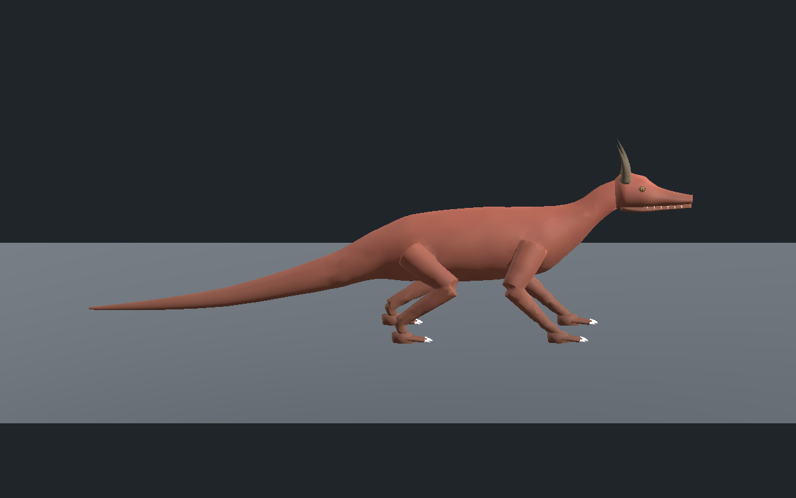 | 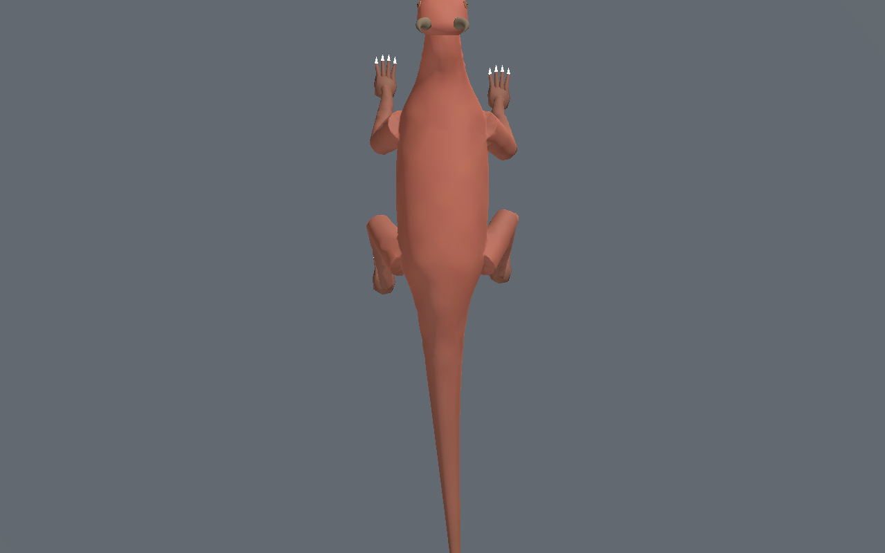 |

Budget réel : **11 626 / 7 122 / 4 226 triangles**, **six maillages et six matériaux parLOD**, quatre influences maximum et **aucune image de texture**. Le pigment est original et calculé en3D ; la peau n’a pas encore de microrelief réaliste. Ce budget ne mesure ni la mémoireGPU totale ni les FPS.

La tête n’est pas reconstruite approximativement : les trois détails conservent exactement indices, normales, UV et couleurs du composant précédent. Les positions reçoivent seulement une échelle uniforme de0.75 et une translation. La mâchoire a son os propre avec une très faible ouverture de revue.

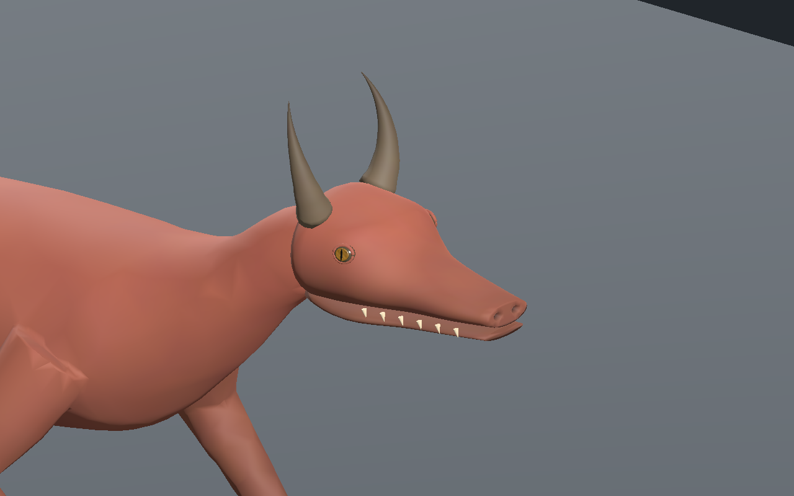

La première queue passait les tests de marche mais paraissait irrégulière dans Godot. Son extrémité voxel a été remplacée par des anneaux analytiques raccordés à une coupe réelle du noyau. Les anneaux ont moins de sommets vers la pointe ; les petites arêtes de coupe sont réunies en conservant la fermeture et les limites de déplacement, puis la qualité de triangulation minimale0.10 est réappliquée. Aucun seuil de déformation n’a été abaissé.

| Queue avant | Queue après, mêmes caméra, éclairage et pas |
| --- | --- |
| 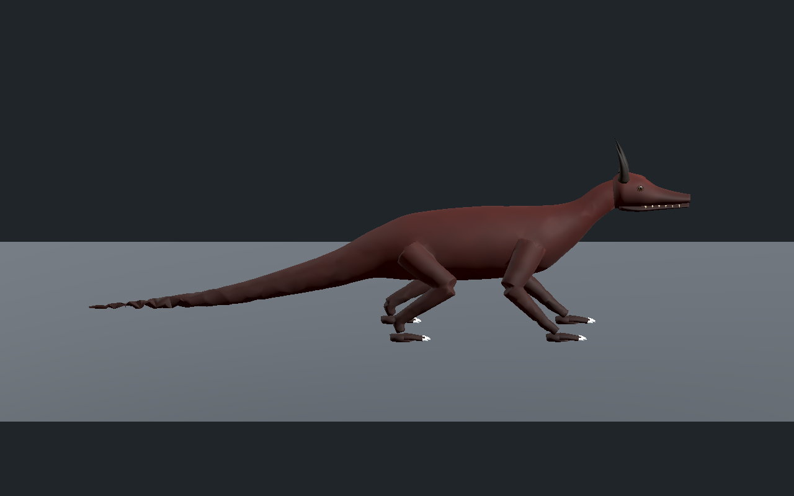 | 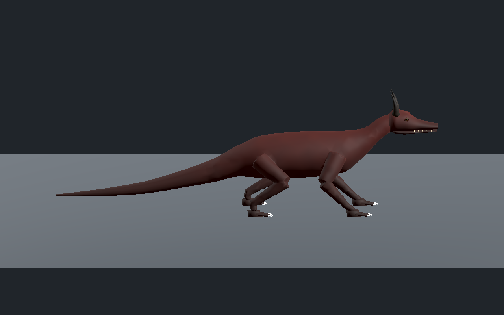 |

Les écarts radiaux des sommets distaux au profil original sont consignés pour les troisLOD. Les nouveaux sommets suivent ce profil à la précision d’export ; cela ne prouve pas une précision absolue de toute la surface ni une absence d’intersections.

Sur **601poses parLOD**, au moins **trois appuis**, dérive maximale **0.000406mm**, hauteur absolue d’appui **0.200mm** et levée minimale **64.73mm**. Ratio d’arête maximal **1.174**, minimal **0.791**, aire relative minimale **0.732** et alignement minimal des normales **0.300**.

Le vrai lien central de l’éditeur donne accès aux troisLOD, lecture/pause/reprise, tête seule, rig et topologie avec changements visibles, ainsi qu’aux téléchargements de recette etGLB vérifiés par empreinte. La recette téléchargée porte le pas de0.14à**0.15m** et sa reconstruction conserve exactement tous les attributs de liaison ; seule l’animation du pas change. Les deux variantes passent Godot Compatibility et Forward+ sur241poses/LOD, avec vrais binds et points des paumes.

| Poignets avant | Poignets corrigés, mêmes caméra, phase et pas |
| --- | --- |
|  | 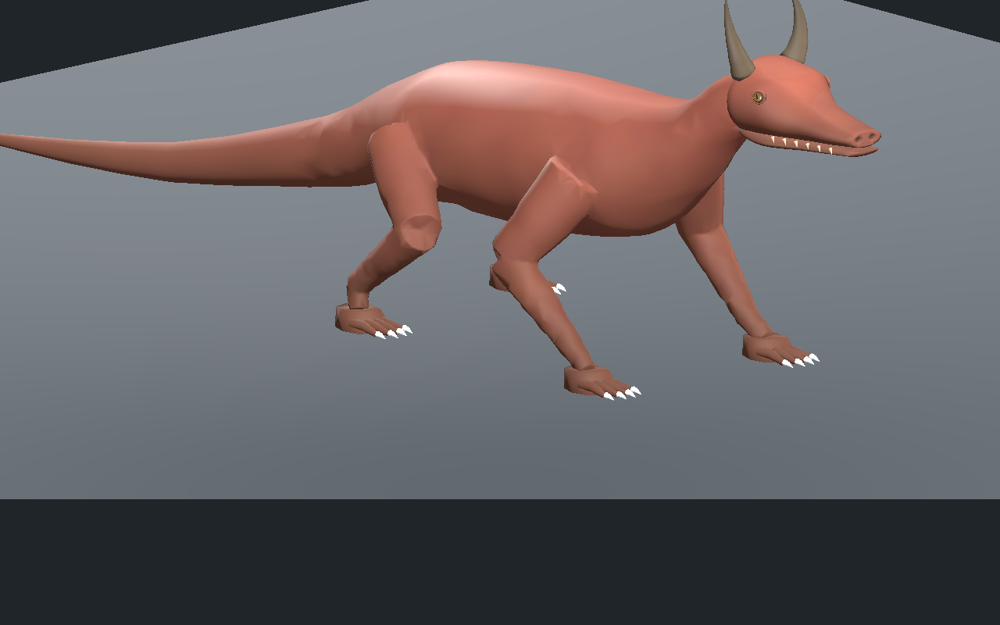 |

| Phase0% | Phase25% |
| --- | --- |
| 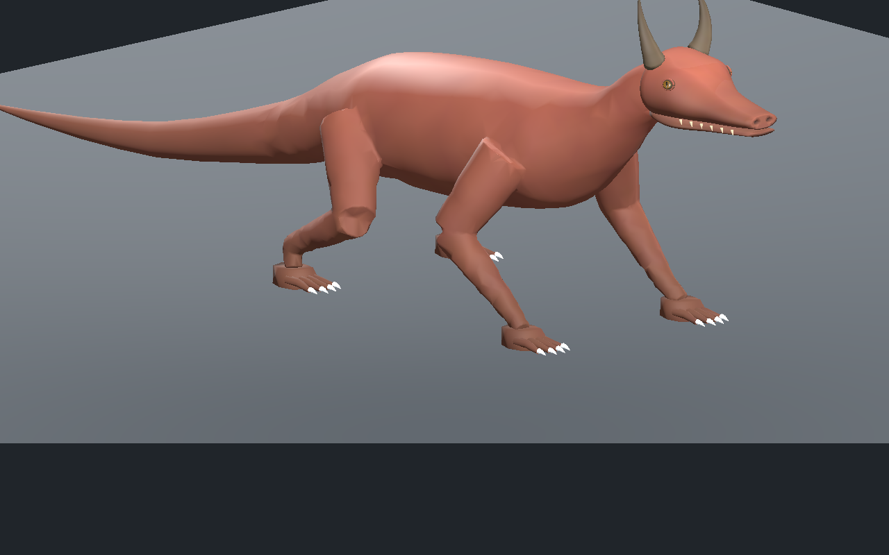 |  |

| Phase50% | Phase75% |
| --- | --- |
| 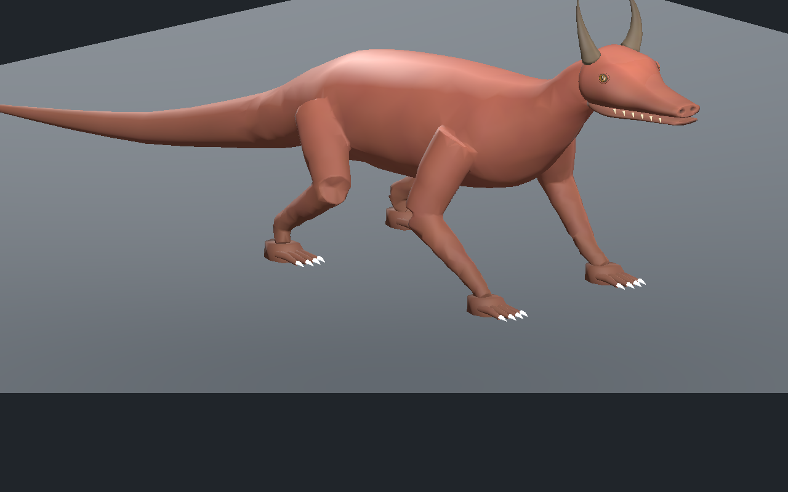 | 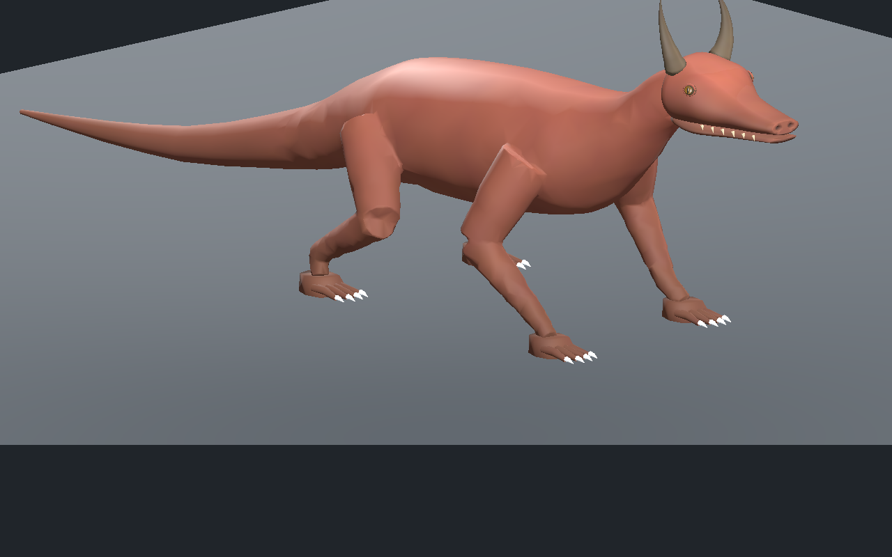 |

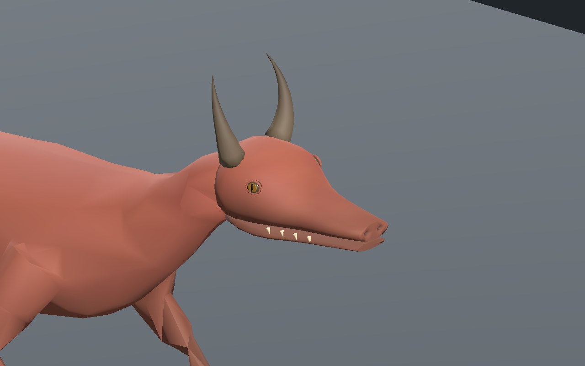

Les neuf vues principales montrent la reconstruction `1a5f4f3bea272692bea5580be7cb11e03d07307d8662186395e338cd561e0a15` ; les deux vues de queue comparent les essais01/07 sous les mêmes paramètres, et une vue supplémentaire conserve les anciens poignets. Toutes sont des captures natives non retouchées. La recette nécessite les dépendances originales locales : aucun modèle, générateur privé ou bitmap source n’est publié. Les identités proposées ne sont pas associées automatiquement aux entités serveur.

Corps du dragon encore stylisé, sans ailes ni microrelief de peau. Marche lente sur sol plat dans des revues isolées ; pas de forces/centre de masse, terrain, virages, collisions exhaustives, vol, monde principal, serveur/réseau/VR, FPS ou photoréalisme final qualifiés.
