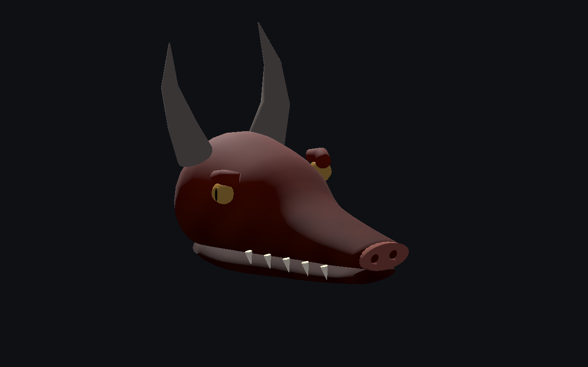
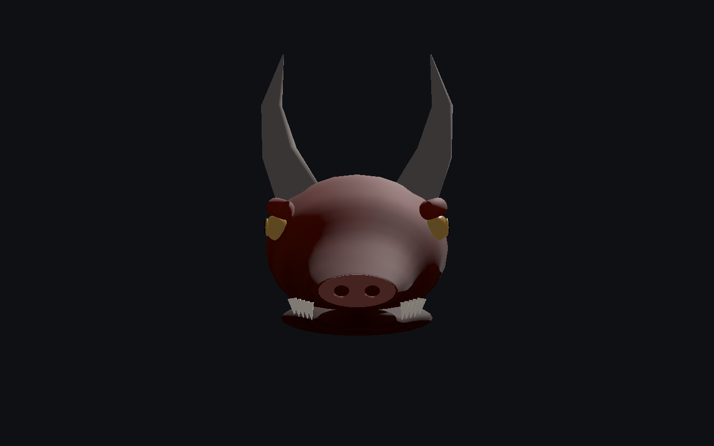
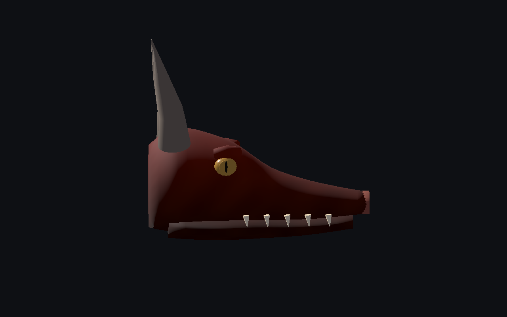
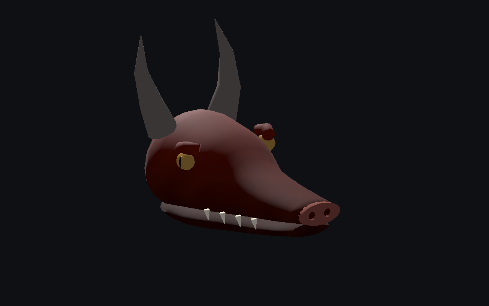
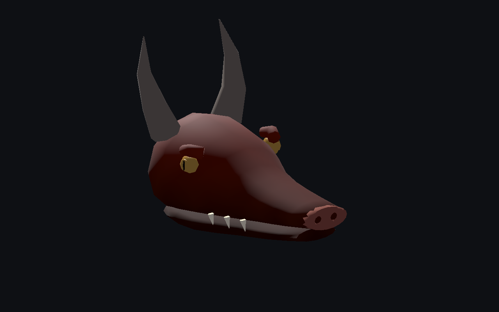

# Dragon — tête originale seule

**Version 0.1.0, première pièce de revue encore stylisée.** Le corps du dragon n’est pas recréé par cet incrément.

[Recette du composant](recipe.json) · [Projet d’attache sauvegardé dans l’éditeur](editor-project.json) · [Conception et défauts connus](design-profile.json) · [Validation](validation.json) · [Provenance](provenance.json) · [Galerie](../../GALERIE.md)

Crâne et mâchoire séparés, deux yeux à pupille verticale, deux cornes, dents et deux creux nasaux. La pièce ne contient ni torse ni membres. L’axe natif est −Z et la frontière arrière est au plan Z=0. Les globes sont insérés de 18 mm dans les triangles réels du crâne.

| Face | Profil |
| --- | --- |
|  |  |

Budget mesuré : **4 292 / 2 532 / 1 328 triangles**, **23 / 21 / 19 objets de maillage**, six matériaux et **aucune image de texture**. Le pigment est calculé depuis la position 3D puis conservé dans les couleurs des sommets ; ce prototype ne peut donc pas avoir d’étirement d’image UV. Cela ne constitue pas encore une peau de dragon photoréaliste ni une optimisation des appels de dessin.

Les surfaces individuelles sont fermées, les triangles et normales valides, le pigment identique aux sommets coïncidents. Les composants restent séparés et se recouvrent : aucune preuve d’absence générale d’intersection.

| Détail intermédiaire | Détail lointain |
| --- | --- |
|  |  |

Le vrai éditeur vérifie le chargement et l’empreinte, le socket, le déplacement, l’échelle non uniforme, la rotation, la sauvegarde/réouverture et l’export statique. Les imports de mauvaise empreinte ou retournés sont refusés sans remplacer la scène. Les anciennes têtes d’araignée et de scarabée sont également rechargées par le contrôle de régression.

Le projet d’attache conserve volontairement les octets du test : son corps par défaut, son régime et ses paramètres de locomotion génériques **ne sont pas une recette de dragon complet**. La recette principale décrit uniquement le composant original. Ses dépendances privées sont nécessaires pour reconstruire ou rouvrir le résultat ; aucun GLB ou générateur privé n’est publié ici.

Godot 4.8 bêta 2 importe les trois détails et l’assemblage réellement exporté, en Compatibility et Forward+. Les neuf captures non retouchées proviennent de Compatibility. Modèle proche SHA-256 : `2af5195b3313425d6835ad384de636e98627b2a5be45bf146ae539e291c54a9c`.

Défauts artistiques visibles à corriger : arcades encore en forme de petits blocs, courbure anguleuse des cornes, raccord de mâchoire, plaque nasale et yeux trop simples. Composant de tête seul, encore stylisé : ni dragon complet ni photoréalisme final. Corps, articulation de la mâchoire, ailes, marche, vol, collisions exhaustives, monde principal, serveur, réseau, VR et FPS non qualifiés.
