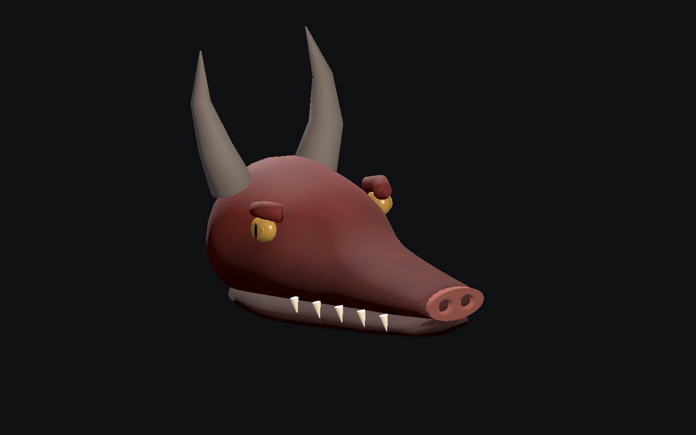
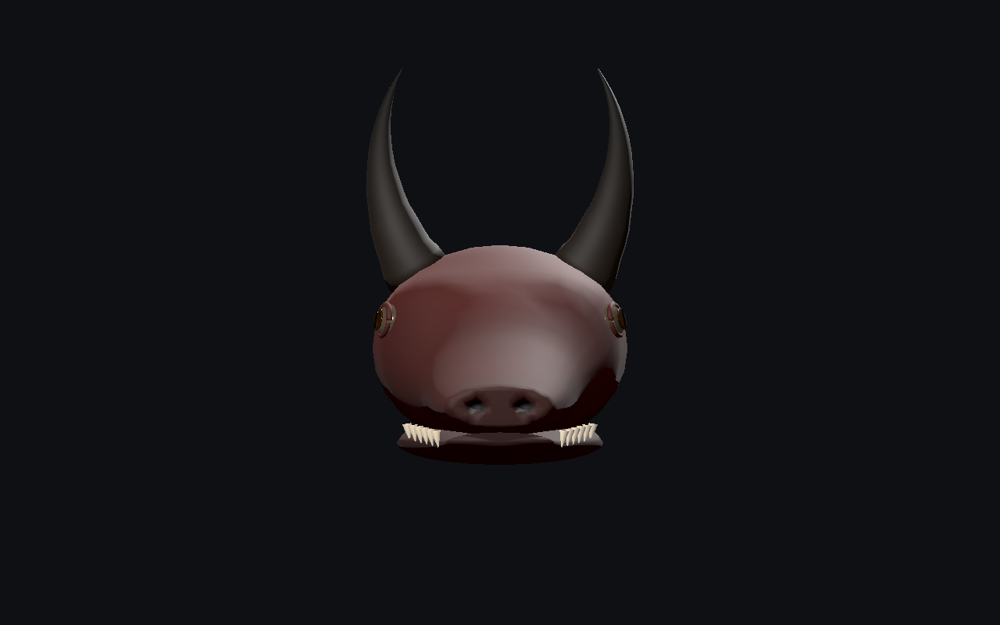
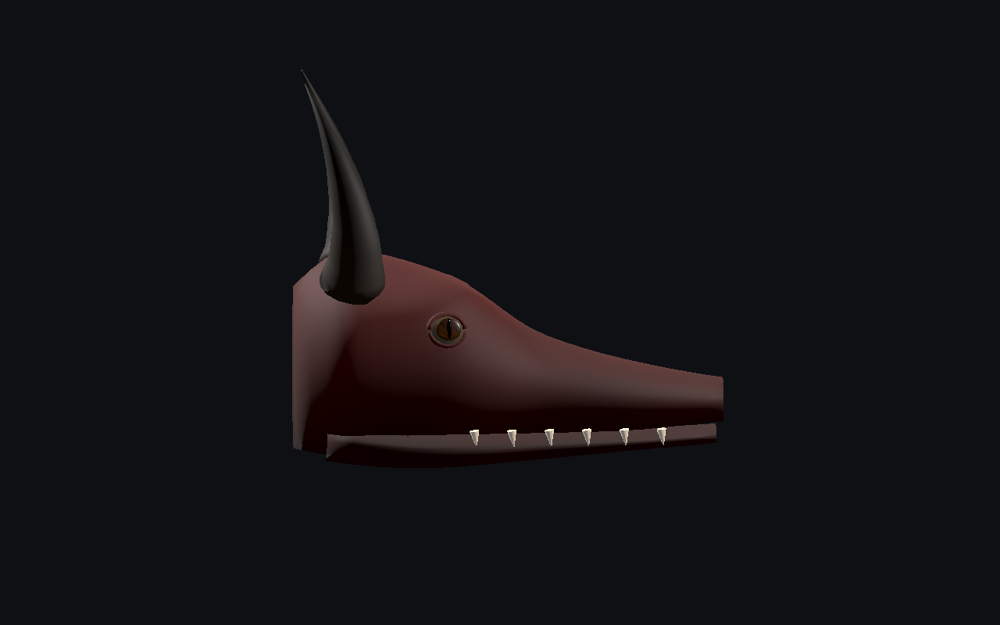
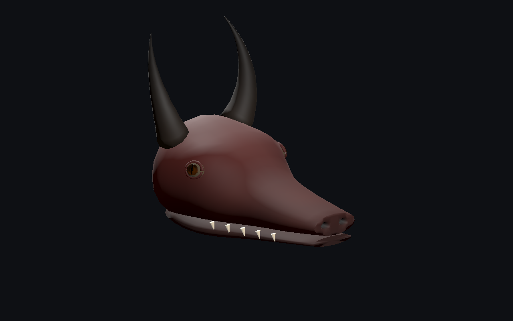

# Dragon — crâne, narines et yeux mieux intégrés

**Version 0.2.0, tête seule encore stylisée.** [Version précédente conservée](../v0.1.0/README.md).

[Recette du composant](recipe.json) · [Projet d’attache exact](editor-project.json) · [Conception](design-profile.json) · [Mesures et validation](validation.json) · [Provenance](provenance.json) · [Galerie](../../GALERIE.md)

| Avant, même éclairage | Après, même éclairage |
| --- | --- |
|  |  |

La plaque nasale séparée et le bouchon frontal du crâne sont remplacés par une seule surface crânienne connectée avec deux creux réels de **29 mm**. Sur les fichiers exportés, les rayons de contrôle au centre des anciens creux rencontraient le crâne après **10 mm**. Dix rayons par niveau de détail confirment désormais plus de 19 mm de profondeur libre, et29mm au centre.

Les grosses arcades détachées sont remplacées par une sculpture de la surface du crâne et des paupières plus fines. Les yeux sont orientés sur la normale réelle du crâne et insérés de **34 mm**. Les cornes suivent une courbe de Bézier au lieu de trois segments anguleux. La mâchoire est rapprochée du museau ; son articulation reste à réaliser.

| Face | Profil |
| --- | --- |
|  |  |

Budget : **6 308 / 3 862 / 2 084 triangles**, **huit objets de maillage à chaque niveau**, six matériaux et **aucune image de texture**. La v0.1.0 utilisait23/21/19objets et4292/2532/1328triangles. Les nouvelles cavités, paupières et courbes coûtent donc davantage de triangles, tandis que le regroupement par matériau et rôle anatomique réduit les objets. Cela ne mesure ni les FPS ni le temps GPU.

Un essai intermédiaire à6740triangles proches est conservé localement. L’échantillonnage des globes, iris et pupilles a été réduit pour retenir6308triangles. Les attributs du crâne, de la mâchoire, des paupières, des cornes et des dents sont strictement conservés entre cet essai et la sélection. Chaque groupe garde les plages de triangles de ses composants pour les inspections et un futur rig.

| Détail intermédiaire | Détail lointain |
| --- | --- |
|  |  |

Les contrôles relisent les vrais attributs : surfaces fermées, triangles/normales, régions crâniennes, pigment aux sommets coïncidents, insertion des yeux et ouvertures nasales. Le vrai éditeur valide empreinte, socket sous transformations, sauvegarde/réouverture et export statique. Les mauvais imports sont refusés sans remplacer la scène ; les anciennes têtes araignée et scarabée sont rechargées par le contrôle de régression.

Godot4.8bêta2 importe les trois détails, l’ancienne tête et l’assemblage exporté, en Compatibility et Forward+. La recette sauvegardée reconstruit exactement les trois GLB. Douze captures natives non retouchées sont conservées, dont trois vues de l’ancienne tête rendues dans la même scène. La vue tournante et le maillage sont contrôlés à736/320px.

Le projet d’attache utilise un corps et des traits génériques par défaut : **ce n’est pas un génome de dragon complet**. La recette principale décrit le composant ; elle nécessite les dépendances originales locales. Aucun GLB ni générateur privé publié. Modèle proche : `17ecfdd283e9f87b0312562ac02e34926aca465d37618129b6702a7fa3ed2d9f`.

Tête seule encore stylisée, sans microrelief de peau ni rig de mâchoire. Corps, marche, ailes, vol, terrain, collisions exhaustives, monde principal, serveur/réseau/VR, FPS et photoréalisme final non qualifiés.
