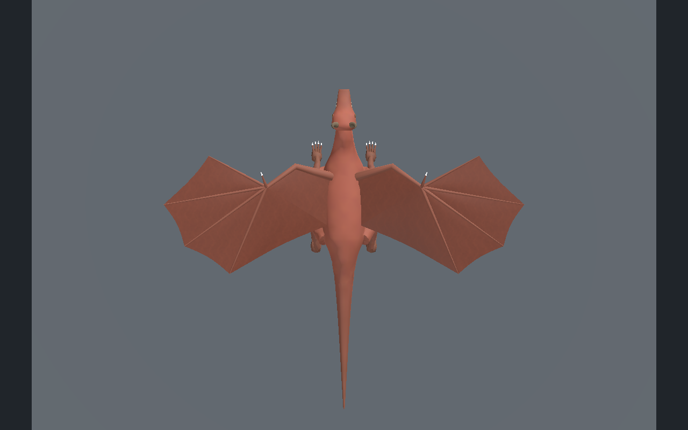
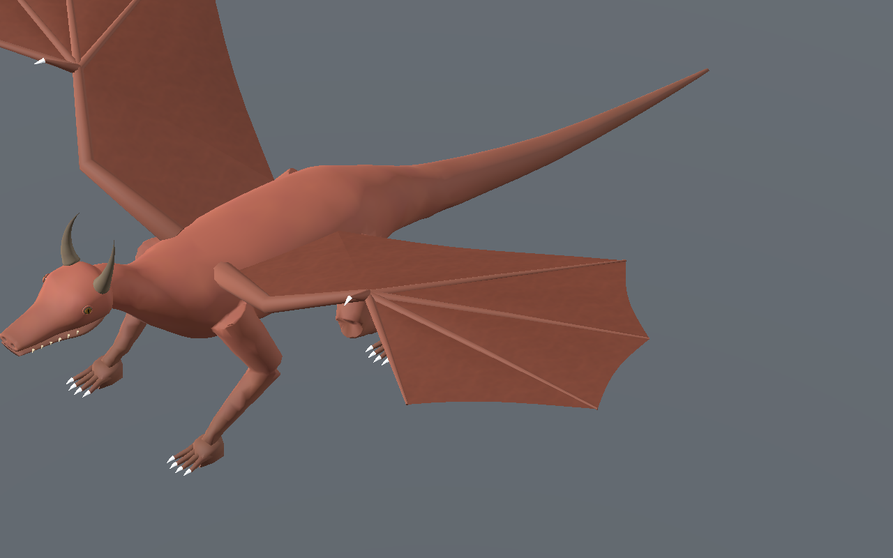
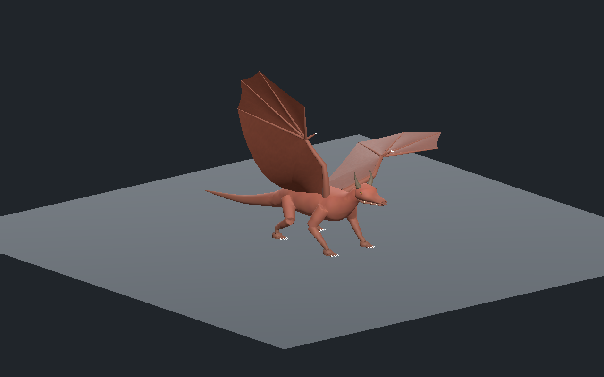
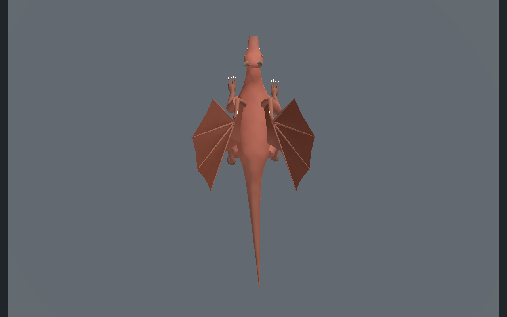
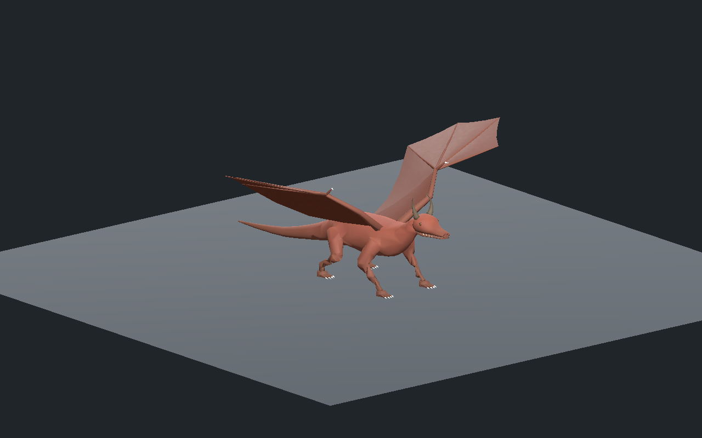
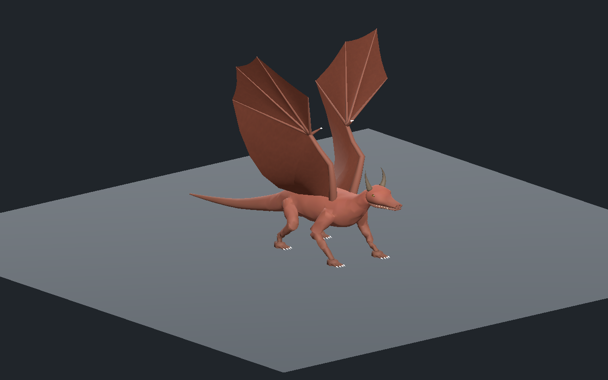
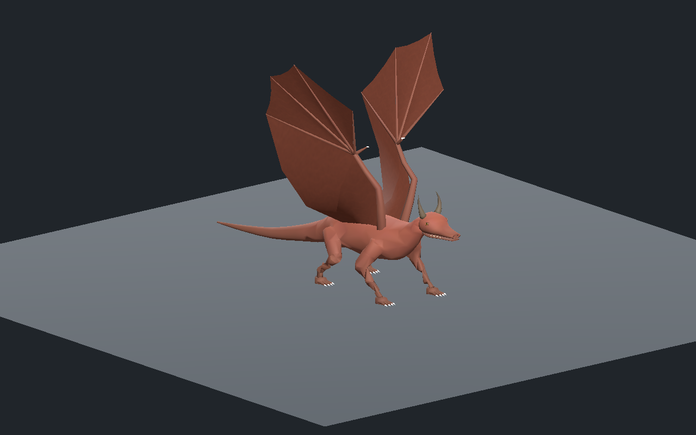
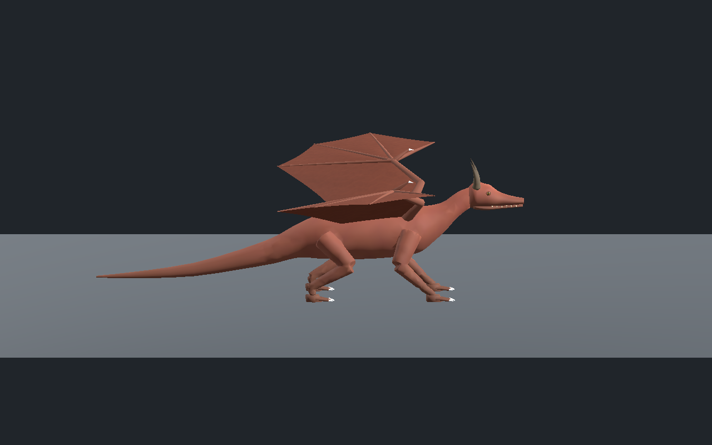

# Dragon — ailes articulées et déploiement au sol

**Version 0.1.0 : construction de revue, finition encore stylisée.** Le [corps précédent](../../dragon-body-original/v0.1.0/README.md) et sa marche sont conservés exactement ; les ailes ajoutent leurs propres chaînes articulées.

[Recette JSON](recipe.json) · [Conception et budgets](design-profile.json) · [Validation](validation.json) · [Mesures de déformation](deformation-measurements.json) · [Provenance](provenance.json) · [Galerie](../../GALERIE.md)

Deux ailes originales comportent chacune épaule, coude, poignet, pouce griffu et quatre doigts à deux segments. Le rig passe de 33 à **57 os**. Les membranes, partagées entre trois LOD, comprennent des panneaux interdigitaux et un raccord au flanc. Le corps, les doigts des pieds, les attributs de surface, les indices, les 33 binds initiaux et toutes les pistes de marche précédentes restent strictement identiques. Les nouveaux éléments utilisent la palette du corps.

| Déploiement vu du dessus | Marche, ailes relevées |
| --- | --- |
|  |  |

Budget réel : **13 188 / 8 052 / 4 764 triangles**, **sept maillages et sept matériaux par LOD**, quatre influences maximum. Les deux ailes partagent seulement **trois images originales de 256/128/128 pixels**, soit **524 284 octets** estimés en RGBA8 avec toutes les mipmaps. Les veines et le grain sont calculés mathématiquement ; ce ne sont pas des scans photographiques. Le chiffre n’inclut pas la géométrie ni toute la mémoire GPU et ne constitue pas une mesure de FPS.

Le premier repli tournait autour d’un axe vertical et pinçait le raccord fixe au flanc. Le coude a été déplacé pour supprimer les triangles presque alignés, puis l’axe du relèvement a été placé sur la vraie ligne épaule/flanc. Les seuils de contrôle restent inchangés : ratio d’arête entre 0.5 et 1.5 pour les membranes, aire relative supérieure à 0.25 et alignement de normale supérieur à 0.10. La variante reconstruite passe avec une anisotropie UV maximale au repos de **1.161**. Les métriques complètes de chaque animation et chaque variante sont conservées.

Trois animations sont inspectables : marche avec ailes relevées à55°, déploiement symétrique au sol, et mouvement de l’aile gauche avec l’aile droite immobile. Le relèvement ne constitue pas un repli anatomique complet. Sur 601 poses par animation et par LOD, aucun triangle de membrane retourné selon le contrôle des normales ; les quatre pieds restent plantés pendant les deux inspections, et la marche conserve au moins trois appuis ainsi qu’une levée supérieure à 64 mm.

| Inspection d’une seule aile | Ailes relevées, vue du dessus |
| --- | --- |
|  |  |

Le lien central de l’éditeur propose trois animations, lecture/pause/reprise, déplacement temporel, trois LOD, rotation/zoom, vues de profil/dessus/pieds/membrane, rig, topologie et microrelief. Les téléchargements de recette et GLB ont été vérifiés par empreinte. La recette effectivement téléchargée porte l’amplitude de 12 à  **13°** ; sa reconstruction conserve exactement maillages de liaison, matériaux, squelette et images. Seule l’animation correspondante change.

Godot Compatibility et Forward+ ont chacun testé les deux variantes, avec **241 poses par animation et par LOD sur les vrais points de paume**. Un défaut de transition a été corrigé dans l’actor de revue : les poses osseuses sont réinitialisées avant de changer de clip, car certaines pistes constantes importées ne remplaçaient pas la pose précédente. Lecture après la fin et conservation du transform de l’entité sont vérifiées séparément.

| Déploiement intermédiaire | Déploiement lointain |
| --- | --- |
|  |  |

| Marche intermédiaire | Marche lointaine |
| --- | --- |
|  |  |

Les onze vues montrent la reconstruction `766ad981b754f548f5f61d9cde8fdfbf53b87c20c86207211aaddc9b89798e2d` dans Godot Forward+, sans retouche. La recette dépend des générateurs originaux locaux ; les modèles GLB, sources privées et images de texture ne sont pas publiés. Aucune statistique, autorité ou association de créature serveur n’est modifiée.

Copie originale de revue encore stylisée. Marche sur sol plat et déploiement au sol seulement. Ailes relevées de 55 degrés pendant la marche, sans repli complet contre le corps. Pas de vol, forces, collisions exhaustives, terrain, monde principal, serveur/réseau/VR, FPS ou finition photoréaliste qualifiés.
