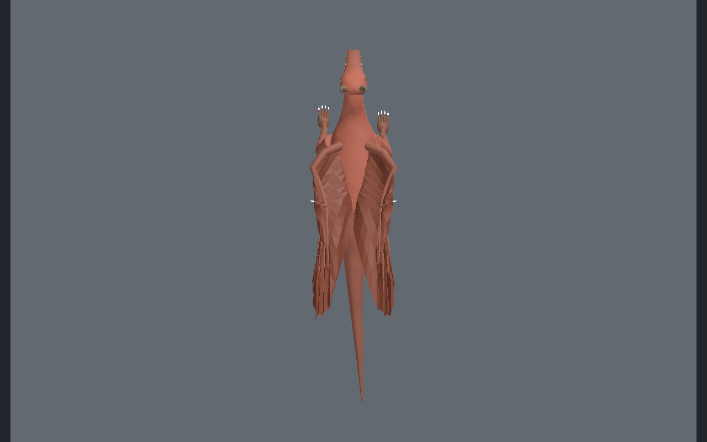
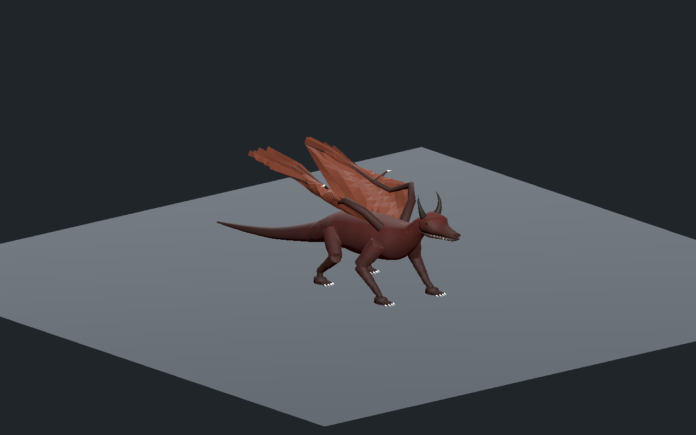
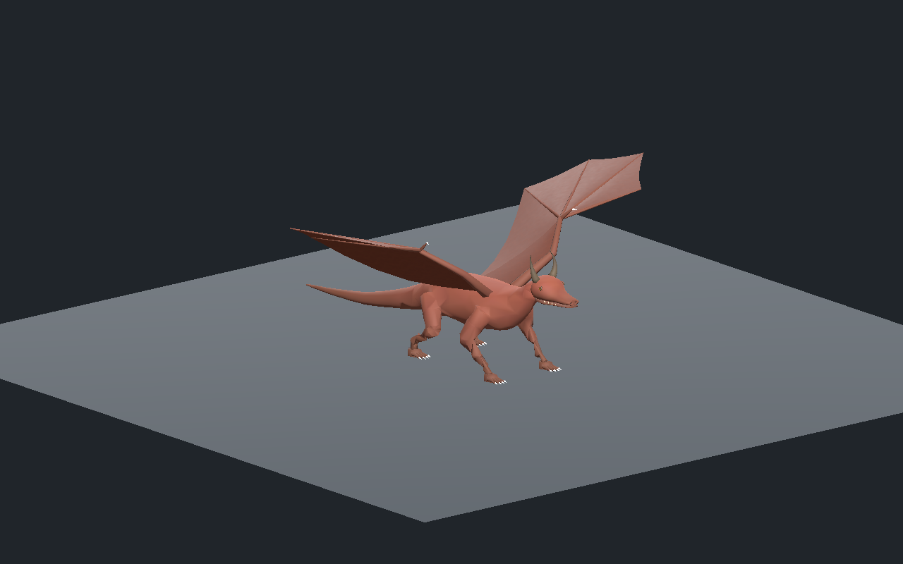
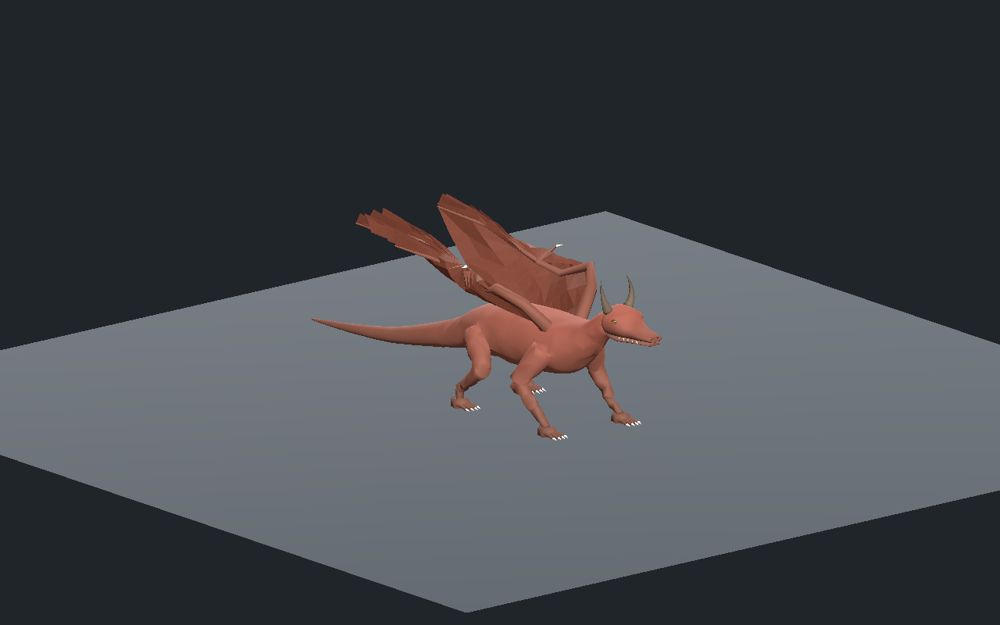
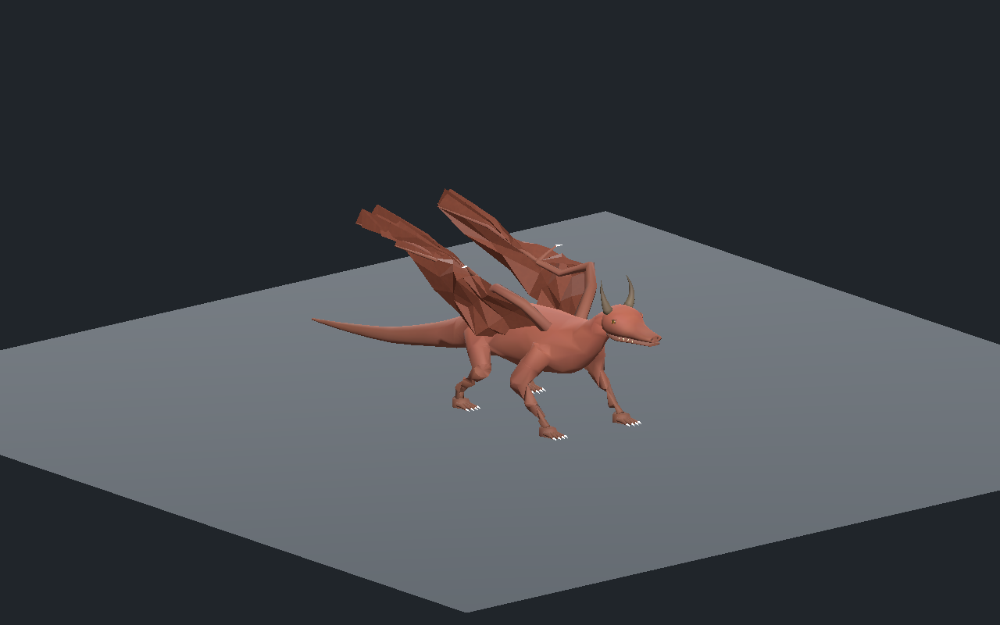
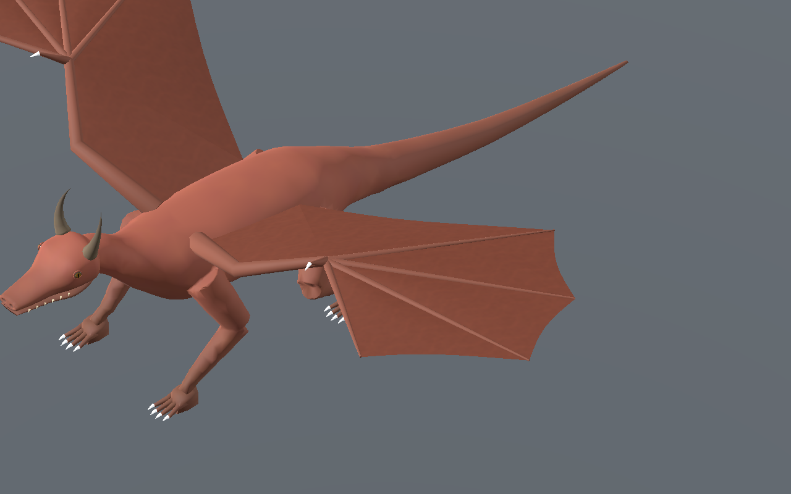
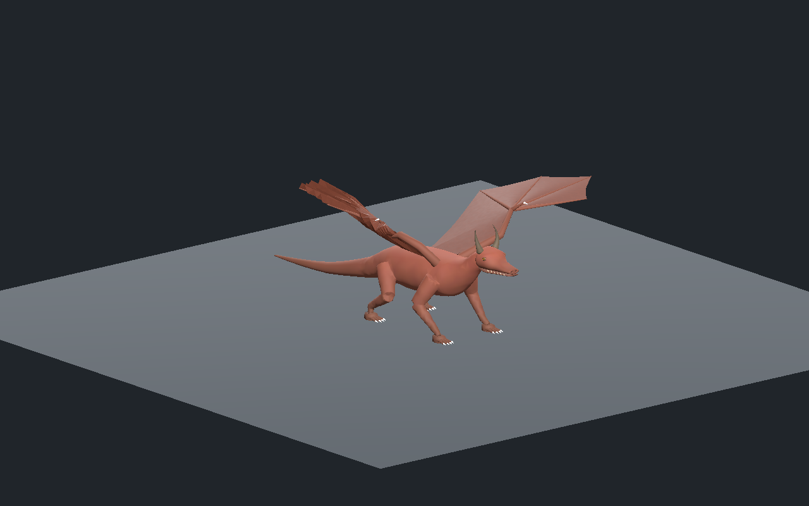
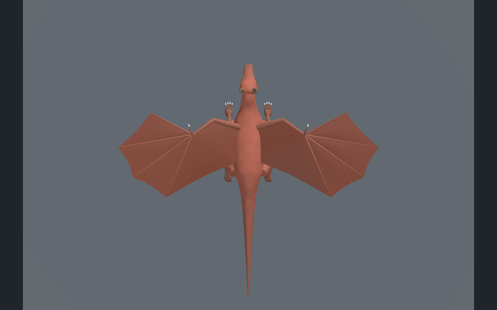
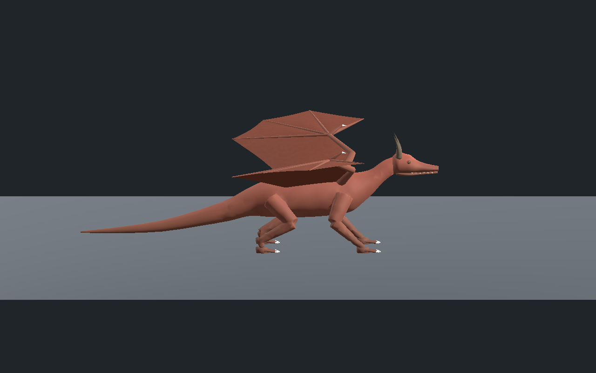

# Dragon — ailes repliables et marche de revue

**Version 0.2.0 : repli compact corrigé, finition encore stylisée.** Les [ailes déployables précédentes](../v0.1.0/README.md) et le [corps original](../../dragon-body-original/v0.1.0/README.md) restent conservés.

[Recette JSON](recipe.json) · [Conception et budgets](design-profile.json) · [Validation](validation.json) · [Déformations mesurées](deformation-measurements.json) · [Provenance](provenance.json) · [Galerie](../../GALERIE.md)

Les ailes se replient maintenant au coude, au poignet et dans l’éventail des doigts. Les membranes forment des plis pilotés par l’animation. Le corps, les pieds, les matériaux, les images et toutes les pistes des 33 premiers os restent identiques ; le rig complet conserve **57 os**. La forme est une créature fantastique de revue, pas une anatomie ou un tissu final approuvé.

| Repli compact vu du dessus | Déploiement au sol |
| --- | --- |
|  |  |

Budget mesuré : **13 478 / 8 262 / 4 894 triangles**, sept maillages et sept matériaux par LOD, quatre influences maximum. Trois images originales partagées de **256/128/128 pixels** restent identiques. Leur estimation RGBA8 avec mipmaps reste **524 284 octets**. Les corrections des plis ajoutent **3 136 320 octets de deltas POSITION/NORMAL float32** pour les trois LOD, avec trente cibles par maillage de membrane. Les sommets sont séparés sur les plis pour préserver les normales. Ces chiffres n’incluent pas toute la mémoire GPU et ne mesurent pas les FPS.

Le prototype initial gardait la marche mais retournait ou aplatissait certaines faces de membrane. Les subdivisions radiales passent à **8/6/4**, avec une rangée exactement au milieu du bras et des doigts. Les panneaux partageant la couture du flanc sont résolus ensemble. Une énergie de déformation par triangle protège les angles et l’aire, puis une contrainte de continuité empêche les plis de changer de branche entre deux poses. Le gradient de l’objectif a été vérifié par différences finies sur des configurations normales, perturbées et retournées.

Les normales sont calculées pour respecter les faces voisines ; la moyenne pondérée par l’aire faisait dominer certaines grandes faces et éclairait mal les petites faces du pli. Les seuils de qualification ne sont pas abaissés : arêtes de membrane entre 0.5 et 1.5, aire relative supérieure à 0.25, alignement des normales supérieur à 0.10 et anisotropie UV animée inférieure à 2.0.

| Prototype refusé | Repli corrigé, mêmes paramètres et caméra |
| --- | --- |
|  |  |

La version sélectionnée 06 est mesurée sur **601 poses par animation et par LOD** : largeur totale des ailes repliées au plus **1.175 m**, au moins trois appuis pendant la marche, quatre pendant les inspections et levée supérieure à **64.73 mm**. Son anisotropie UV maximale sur les trois animations est **1.813**, contre plus de 4.23 dans un essai précédent. Les trois animations conservent la marche, le déploiement symétrique au sol et l’inspection indépendante de l’aile gauche.

L’éditeur central donne accès aux trois animations et aux trois LOD, lecture/pause/reprise, contrôle du temps, rotation/zoom, vues, rig, topologie, microrelief et activation des plis. Le contrôle des plis modifie effectivement les pixels et revient à l’état initial. Les téléchargements réels de recette et GLB sont vérifiés par empreinte. La recette téléchargée passe l’amplitude de 12 à **13 degrés** et précise le profil `elbow-ring-pleated-v3-continuous-bend` ; sa reconstruction07 conserve exactement les maillages de liaison, les cibles de pli, les matériaux, le squelette et les images. Seuls les mouvements concernés changent.

Godot Compatibility et Forward+ contrôlent les deux variantes, avec **241 poses par animation/LOD sur les vraies paumes** et treize instantanés des morphs par animation/LOD comparés aux points CPU. Le changement de clip réinitialise les poses osseuses et les corrections de forme, puis applique la nouvelle animation. Lecture après la fin et conservation du transform de l’entité sont vérifiées. Ce sont des scènes de revue isolées du client.

| Déploiement intermédiaire | Déploiement lointain |
| --- | --- |
|  |  |

| Marche intermédiaire | Marche lointaine |
| --- | --- |
|  |  |

Onze captures montrent la reconstruction `38beba522bb06a9c53b4157edc674cfd77db9d34d886ea79ce9ec907e326120d` dans Godot Forward+, sans retouche. Deux captures supplémentaires comparent les essais04/06 dans Compatibility, avec caméra, éclairage, temps de marche0.5s et paramètres identiques. La recette exige les dépendances originales locales : aucun modèle GLB, générateur privé ou bitmap source n’est publié. Aucune statistique ni autorité serveur n’est modifiée.

Revue locale encore stylisée : repli compact et déploiement au sol, sans simulation de tissu ou de vol. Finition photoréaliste, anatomie finale, collisions exhaustives corps/ailes, forces, terrain, monde principal, serveur/réseau/VR et FPS restent non qualifiés.
