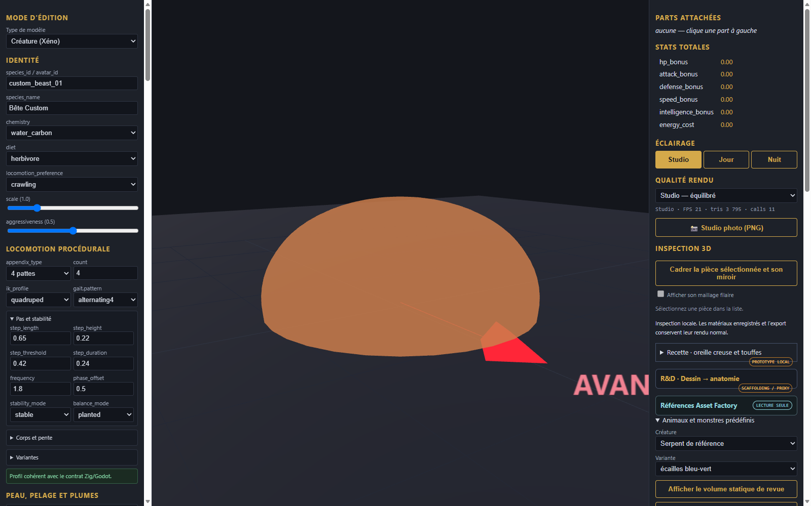
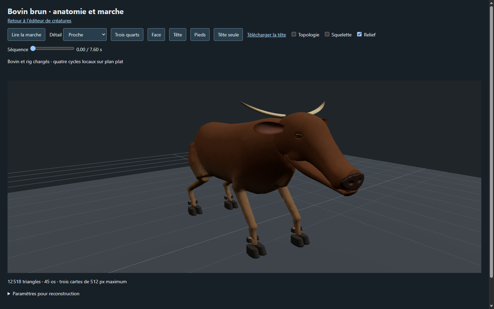
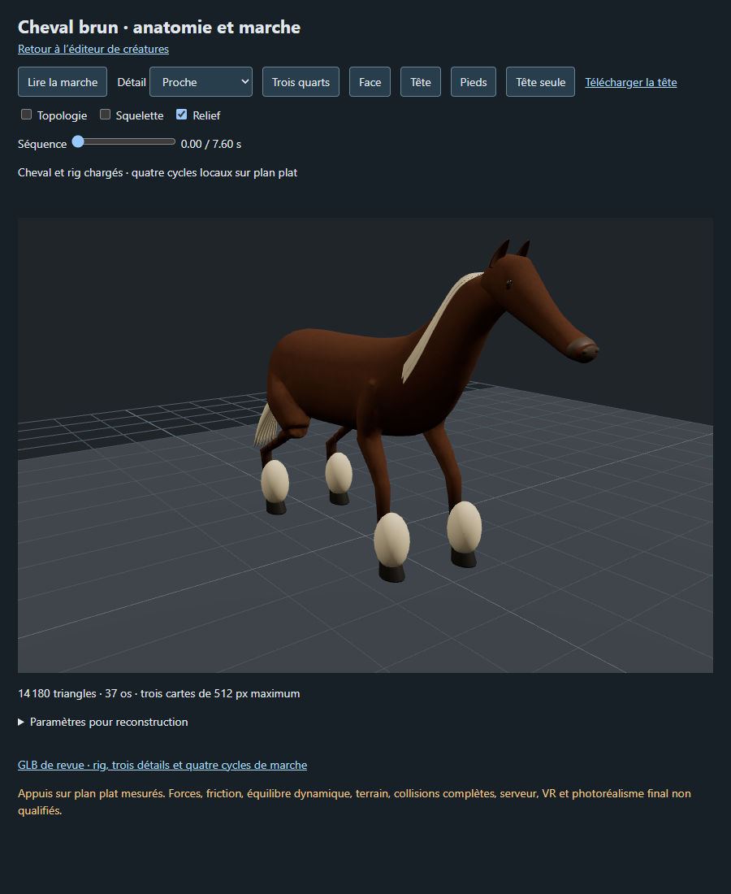

# Études de créatures d’après références — travail en cours

Quatre prototypes documentaires de revue, capturés dans l’éditeur local. Les modèles et générateurs ne sont pas distribués ici ; les recettes seules ne permettent pas leur reconstruction. Les images de référence de l’utilisateur ne sont pas incluses.

## Gelée bleue

[Recette de réglage de revue](gelee/recipe.json). Le volume statique utilise une déformation visuelle locale et globale réglable. L’import et le téléchargement de la recette ont été contrôlés dans le navigateur. Aucune physique de matière molle, collision ou intégration au jeu n’est attestée ; le résultat est très simplifié.

## Taureau — candidat 2

[Recette documentaire de revue](taureau/recipe.json). Le générateur bovin a été adapté en copie isolée : pis retiré, corps et membres élargis et cornes plus latérales. La capture correspond à une pose statique chargée par redirection locale dans l’atelier bovin ; elle ne prouve pas un branchement permanent. La tête et le corps restent stylisés et ne correspondent pas encore à la référence. Marche, collisions, jeu et VR non vérifiés.

## Serpent — candidat 2

[Recette documentaire de revue](serpent/recipe.json). Serpent enroulé statique, ventre clair, mâchoires, crochets et langue. L’éditeur charge le GLB et vérifie son empreinte. Les mâchoires restent visiblement séparées, les écailles ne sont pas sculptées ; aucun rig, animation, collision ou intégration jeu n’est attesté.

Ces études ne sont ni des entrées strict-v1 ni des créations achevées. Rat, mouton, crabe et lama restent hors de cette proposition.

## Cheval de trait — candidat de revue

[Recette documentaire de revue](cheval/recipe.json). Candidat issu du générateur équin, au corps et aux membres élargis et à la crinière claire. Les fanons sont des volumes provisoires lisses, le harnachement manque et la silhouette reste éloignée de la référence. La capture est une pose statique chargée par redirection locale dans l’atelier ; marche, collisions, jeu et VR ne sont pas validés.
