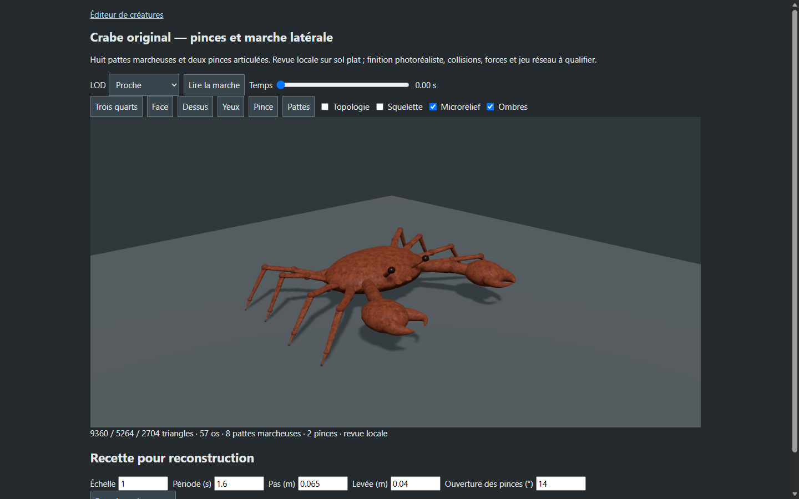
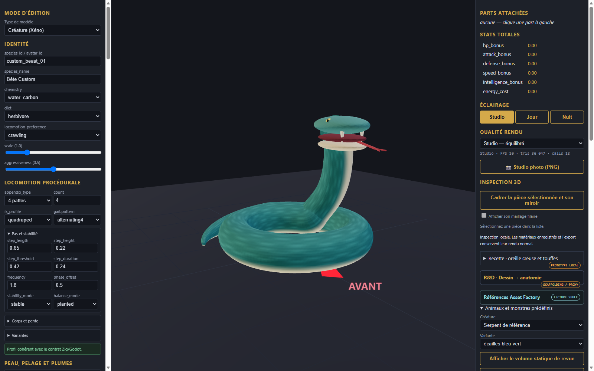
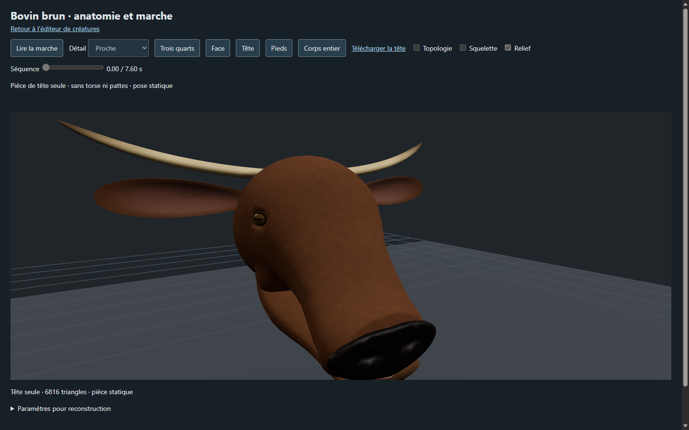
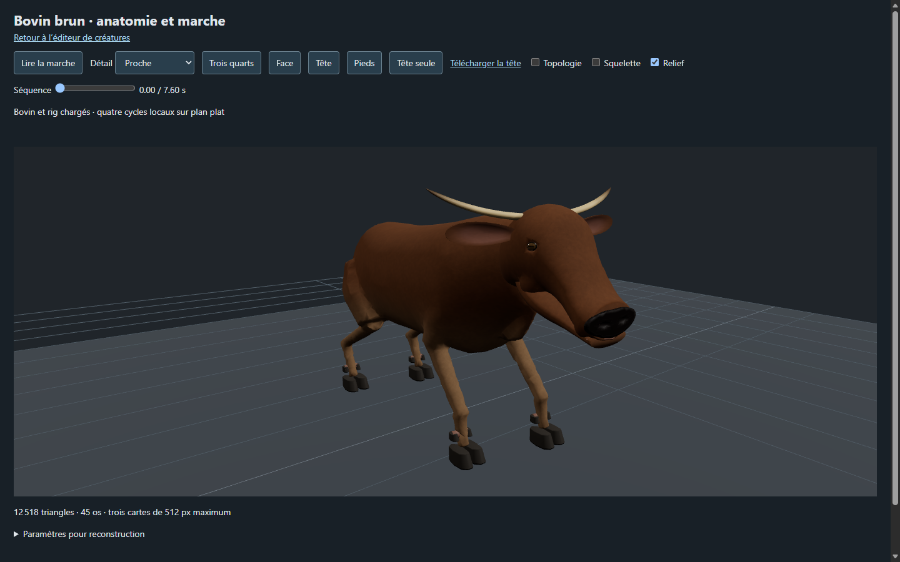

# Études de créatures d’après références — travail en cours

Cinq prototypes documentaires de revue, capturés dans l’éditeur local. Les modèles et générateurs ne sont pas distribués ici ; les recettes seules ne permettent pas leur reconstruction. Les images de référence de l’utilisateur ne sont pas incluses.

## Gelée bleue

[Recette de réglage de revue](gelee/recipe.json). Le volume statique utilise une déformation visuelle locale et globale réglable. L’import et le téléchargement de la recette ont été contrôlés dans le navigateur. Aucune physique de matière molle, collision ou intégration au jeu n’est attestée ; le résultat est très simplifié.

## Taureau — candidat 2

[Recette documentaire de revue](taureau/recipe.json). Le générateur bovin a été adapté en copie isolée : pis retiré, corps et membres élargis et cornes plus latérales. La capture correspond à une pose statique chargée par redirection locale dans l’atelier bovin ; elle ne prouve pas un branchement permanent. La tête et le corps restent stylisés et ne correspondent pas encore à la référence. Marche, collisions, jeu et VR non vérifiés.

## Serpent — candidat 2

[Recette documentaire de revue](serpent/recipe.json). Serpent enroulé statique, ventre clair, mâchoires, crochets et langue. L’éditeur charge le GLB et vérifie son empreinte. Les mâchoires restent visiblement séparées, les écailles ne sont pas sculptées ; aucun rig, animation, collision ou intégration jeu n’est attesté.

Ces études ne sont ni des entrées strict-v1 ni des créations achevées. Rat, mouton et lama restent hors de cette proposition.

## Cheval de trait — candidat de revue

[Recette documentaire de revue](cheval/recipe.json). Candidat issu du générateur équin, au corps et aux membres élargis et à la crinière claire. Les fanons sont des volumes provisoires lisses, le harnachement manque et la silhouette reste éloignée de la référence. La capture est une pose statique chargée par redirection locale dans l’atelier ; marche, collisions, jeu et VR ne sont pas validés.

## Crabe — candidat de revue

[Recette documentaire de revue](crabe/recipe.json). Candidat à pinces élargies et teinte rouge-orangée, issu du générateur original en copie isolée. L’atelier a chargé le modèle par redirection locale : 57 os, huit pattes, pose initiale et échantillon à 0,4 seconde sans erreur de rendu constatée. La carapace n’a pas les pointes et le relief de la référence ; l’animation complète, les collisions, le jeu et la VR ne sont pas qualifiés.

## Taureau — étude tête et membres

[Recette documentaire de revue](taureau-pieces/recipe.json). Tête élargie et raccourcie, deux membres gauches statiques extraits avec pivots de hanche. L’assemblage complet et la tête isolée ont été chargés par redirection locale dans l’atelier ; les membres extraits n’ont pas encore été réassemblés dans l’éditeur. **Les bases des cornes apparaissent décollées du crâne.** La qualité artistique, les attaches, la marche et l’intégration jeu restent à corriger et vérifier.

## Serpent — peau et mâchoire extraites

[Recette documentaire des pièces](serpent-pieces/recipe.json). La peau enroulée et un ensemble de mâchoire sont extraits du modèle de revue. Leur repositionnement aux origines indiquées reproduit les limites géométriques de chaque composant à moins de 0,000001 m. La capture ci-dessous montre l’assemblage statique de la peau et de la mâchoire par l’éditeur, avec les yeux repris du modèle source. Les empreintes des fichiers sont contrôlées ; une pièce corrompue a été refusée sans remplacer la scène. Les mâchoires présentent toujours des espaces ; raccords, rig et intégration jeu non qualifiés.

## Taureau — recalage des cornes

[Recette documentaire de revue](taureau-cornes/recipe.json). Les cornes ont été rapprochées du crâne : distance minimale entre sommets passée d’environ 37 mm à 5–7 mm ; sur cette vue, les bases paraissent en contact. Les surfaces restent distinctes ; aucune soudure ni qualification exhaustive des intersections n’est attestée. Tête et assemblage ont été affichés en pose statique dans l’atelier par redirection locale. L’animation et le jeu restent non qualifiés.

## Nouvelles études d’assemblage

- [Taureau : torse et quatre membres séparés](bull-separated/README.md), assemblés avant import dans l’éditeur. Les raccords restent à souder et à vérifier.
- [Serpent : variante avec raccords de mâchoire](serpent-jaw-fit/README.md), affichée dans l’éditeur. Ses pièces séparées ne sont pas encore réassemblées dans l’éditeur.
