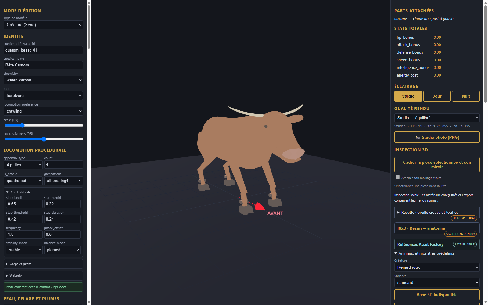

# Taureau — assemblage statique pour revue

Le torse, la tête et la queue sont réunis dans `body.glb` ; quatre membres séparés sont placés aux pivots indiqués dans `recipe.json`. `bull-assembled.glb` est leur assemblage préalable importé dans l’éditeur pour obtenir la capture. Les éléments ne sont pas des pièces éditables indépendantes dans cet import.

Les pièces se chevauchent sans fusion de surface ; continuité des raccords, fidélité à la référence, squelette, animation et intégration au jeu ne sont pas qualifiés. Ce candidat stylisé est réservé à la revue.
