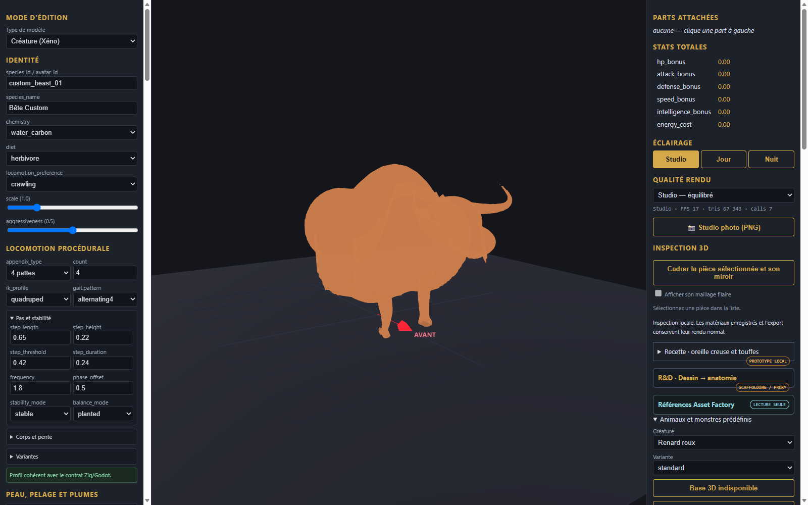
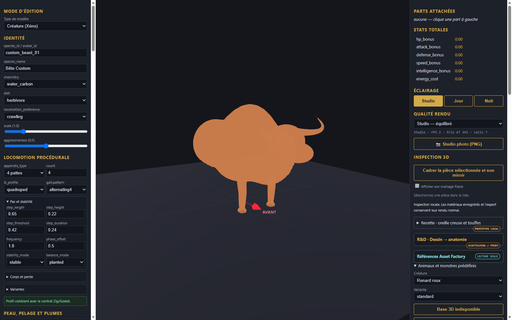

# Taureau - maillage continu, squelette et marche

Modele continu aux jonctions soudees (0 arete non-manifold) dote d un squelette de 18 os et d une animation de marche quadrupede (BovineWalk, 54 pistes).

[Modele rigge et anime (GLB)](bull_rigged_walk.glb) | [Modele soude statique](bull_welded.glb) | [Recette](recipe.json)

- **Squelette articule** : bassin, colonne vertebro-lombaire, garrot rehausse, encolure, crane et machoire, plus 4 chaines de membres completes (hanche, genou, jarret, sabot).
- **Animation de marche** : cycle de marche a 4 temps avec dephasage alternatif, balancement du garrot et de la tete.
- **Deformation verifiee** : teste dans l editeur Three.js via AnimationMixer avec deplacement effectif des sommets du maillage skinné.
