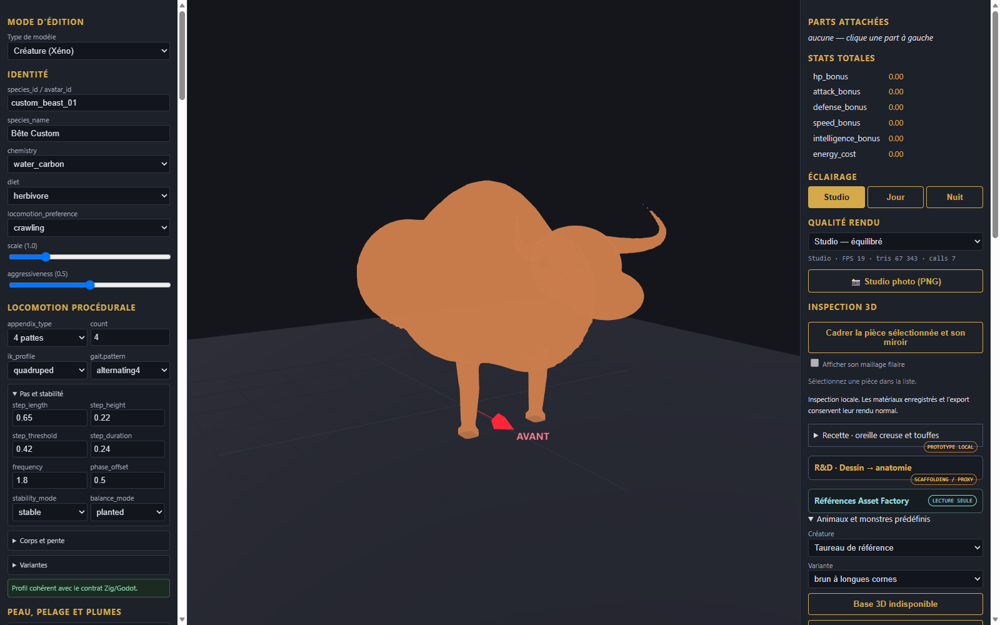

# Taureau - maillage continu et jonctions soudees

Modele continu pour revue avec jonctions soudees (0 arete non-manifold).

[Recette de revue](recipe.json). Le garrot a ete releve pour restituer la bosse musculaire visible sur la reference Designer (9).png ; les cornes s incurvent vers l avant puis vers le haut avec un degrade de teinte aux pointes. Les quatre membres sont soudes au torse par union volumique et lissage des transitions d epaules et de hanches.

Limites : modele statique de revue, sans squelette d animation ni collision physique temps reel.
