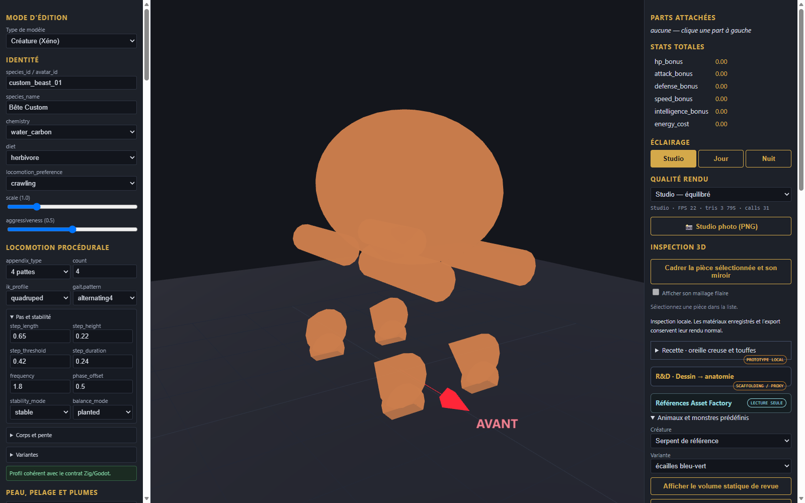

# Cheval de trait - pieces et assemblage

[Recette des pieces](recipe.json). Modele inspire de Designer (8).png : encolure epaisse arquee avec criniere blonde fournie, membres massifs avec abondants fanons blancs recouvrant de larges sabots.

Composants extraits : encolure arquee et criniere, corps puissant, membres a fanons epais.
Limites : modele statique pour revue, sans harnachement dynamique ni rig lourd.
