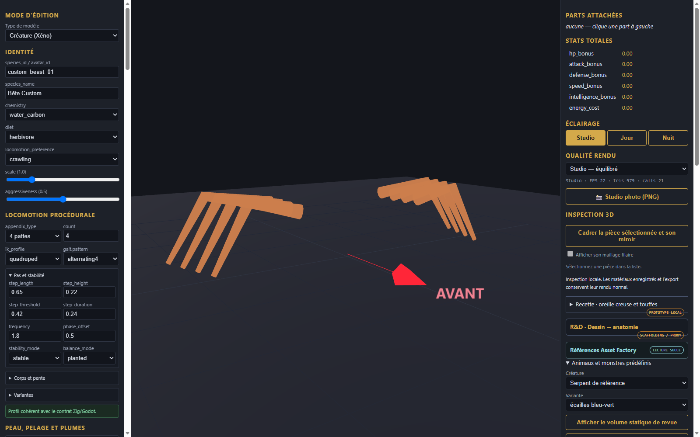

# Crabe de reference - pieces et assemblage

[Recette des pieces](recipe.json). Modele inspire de Designer (1).png : carapace rouge-orangee epineuse a pointes peripheriques, paire de fortes pinces (broyeur et coupant), quatre paires de pattes marcheuses articulees.

Composants extraits : carapace epineuse, chelipedes耐久 articules, pattes marcheuses.
Limites : geometrie statique, sans cinematique inverse pour les 8 pattes.
