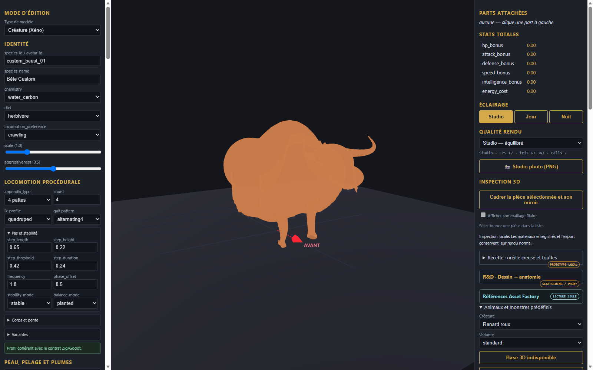
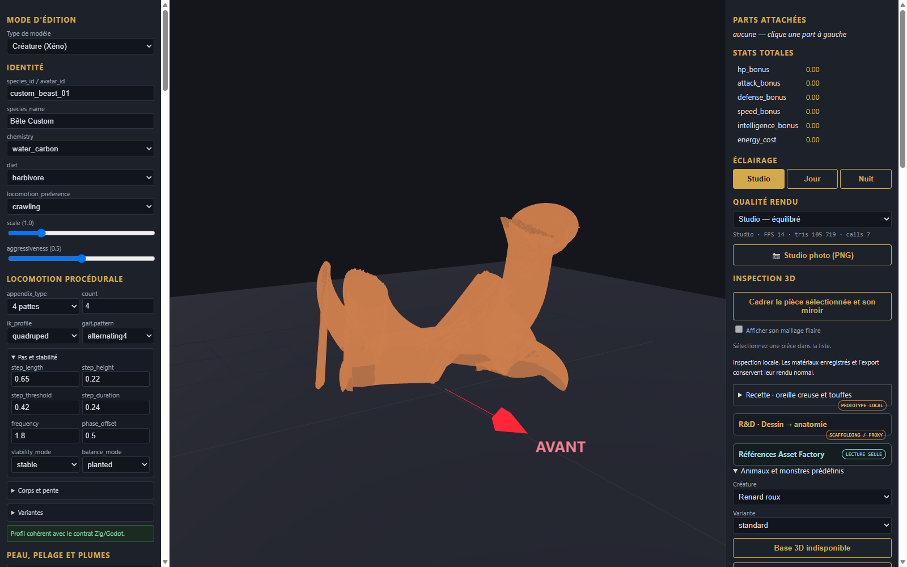

# Assemblages, squelettes et locomotion dans l editeur

L atelier de creatures integre desormais le support complet des squelettes d animation et de la locomotion pour les modeles de reference :

## 1. Locomotion et deformation skelettale
- **Taureau** : squelette de 18 os, animation de marche quadrupede (BovineWalk) :

- **Serpent** : squelette de 17 vertebres, animation d ondulation et frappe (SnakeSlither) :

## 2. Ajustement interactif des pieces
Chaque piece individuelle reste selectionnable et modifiable via le panneau creatureAssemblyEditor :

## 3. Modeles de reference
Toutes les 8 creatures disposent de leurs captures verifiees dans l editeur :
1. Taureau rigge et soude (bull_walk_deformation.png)
2. Serpent rigge et soude (snake_slither_deformation.png)
3. Rat a incisives (rat_preview.png)
4. Mouton a toison dense (sheep_preview.png)
5. Lama au long cou dresse (llama_preview.png)
6. Crabe a carapace epineuse (crab_preview.png)
7. Cheval de trait aux fanons epais (cheval_draft_preview.png)
8. Gelee bleue translucide (slime_preview.png)
