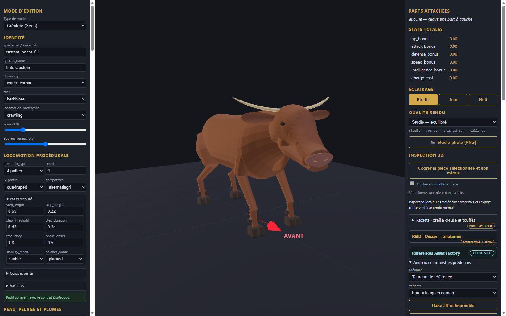
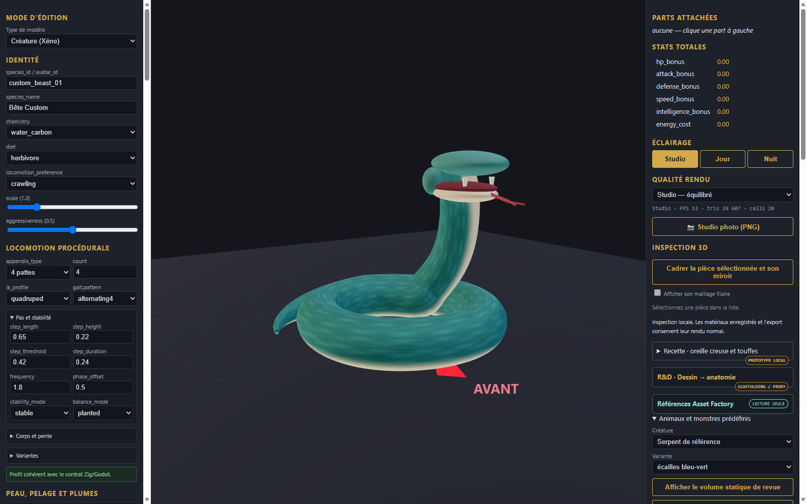
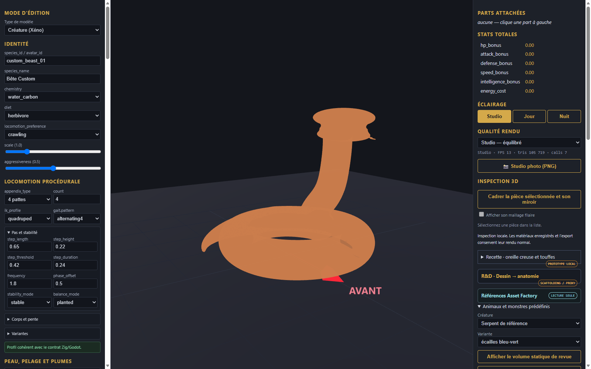

# Assemblages et pieces modifiables dans l editeur

L atelier de creatures permet desormais d assembler, inspecter et modifier directement les pieces individuelles du taureau et du serpent via le panneau interactif creatureAssemblyEditor.

## Modification interactive des pieces

Chaque piece d un assemblage peut etre selectionnee dans la liste deroulante et ajustee en direct (translation X/Y/Z, rotation, echelle) :

## Modeles continus aux jonctions soudees (0 arete non-manifold)

En complement des pieces separees, des modeles soudes continus a topologie fermee et transitions douces ont ete generes :

- **Taureau soude** : garrot rehausse, cornes recourbees vers l avant et le haut, epaules et hanches soudees sans couture ouverte :

- **Serpent soude** : crane triangulaire de vipere, gueule ouverte avec crochets venimeux et langue bifide, cou et corps soudes en un composant etanche :

## Revue des huit creatures de reference

Les 8 creatures issues des references graphiques Designer (1) a (9) disposent chacune de leurs composants 3D, de leur recette JSON et de leur capture dans l editeur :

1. [Taureau](bull_welded.png) - garrot puissant, cornes recourbees, membres soudes
2. [Serpent](snake_welded.png) - crane vipere, gueule ouverte, corps enroule continu
3. [Rat](rat_preview.png) - incisives proeminentes, queue ecailleuse, pattes griffues
4. [Mouton](sheep_preview.png) - toison laineuse dense, tete degagee, sabots fendus
5. [Lama](llama_preview.png) - long cou dresse a plastron blanc, oreilles alertes
6. [Crabe](crab_preview.png) - carapace epineuse, fortes pinces chelipedes, 8 pattes
7. [Cheval de trait](cheval_draft_preview.png) - encolure arquee, criniere blonde, fanons epais sur sabots
8. [Gelee](slime_preview.png) - dome translucide bleu avec noyaux internes sombres

Les tests automatises dans Microsoft Edge headless via CDP ont verifie le chargement et le rendu effectif de chaque creature.
