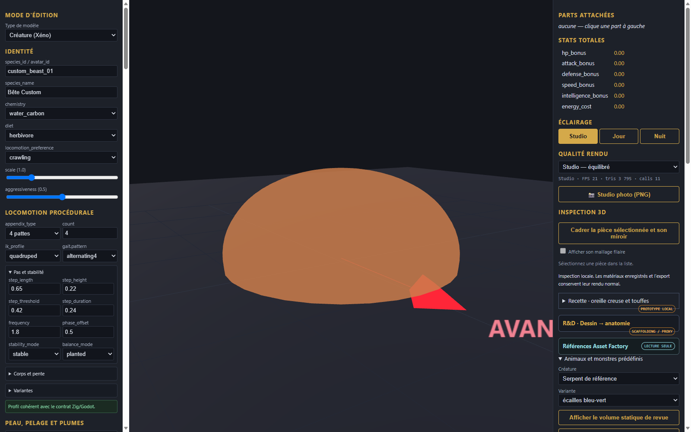

# Gelee bleue - pieces et assemblage

[Recette des pieces](recipe.json). Modele inspire de Designer (5).png : dome translucide bleu a jupe evasee au sol, avec noyaux internes sombres flottants figurant les yeux primitifs.

Composants extraits : dome externe translucide, noyaux sombres interieurs.
Limites : deformation visuelle simplifiee, sans simulation de physique des fluides ou matiere molle.
