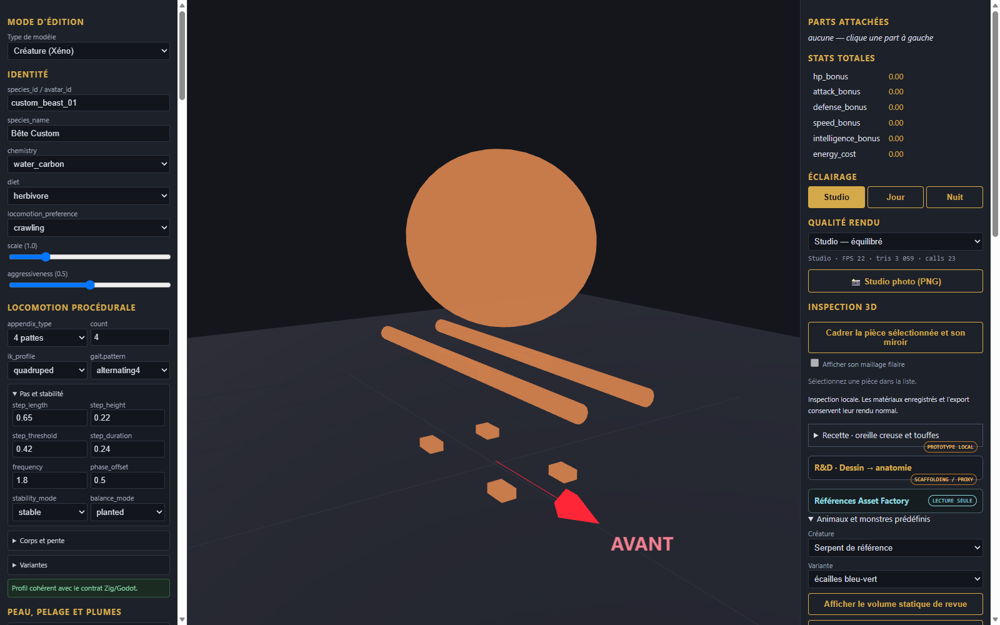

# Lama de reference - pieces et assemblage

[Recette des pieces](recipe.json). Modele inspire de Designer (4).png : long cou dresse avec plastron laineux blanc, oreilles dressees allongees, corps a toison brune, membres fins et pieds a deux doigts.

Composants extraits : long cou avec plastron, tete aux oreilles alertes, corps avec couverture brune, membres fins.
Limites : modele statique, sans cinematique de marche ni deformation de cou.
