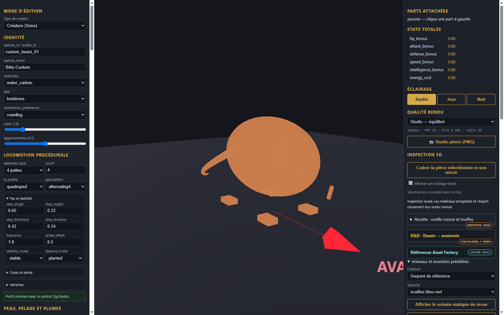

# Rat de reference - pieces et assemblage

[Recette des pieces](recipe.json). Modele inspire de Designer (2).png : crane avec grandes incisives recourbees visibles et oreilles arrondies, dos courbe, queue longue et ecailleuse annelee, quatre pattes griffues.

Composants extraits : tete avec incisives, corps courbe, queue annelee, pattes griffues.
Limites : pieces statiques pour revue, sans squelette ni animation de trot.
