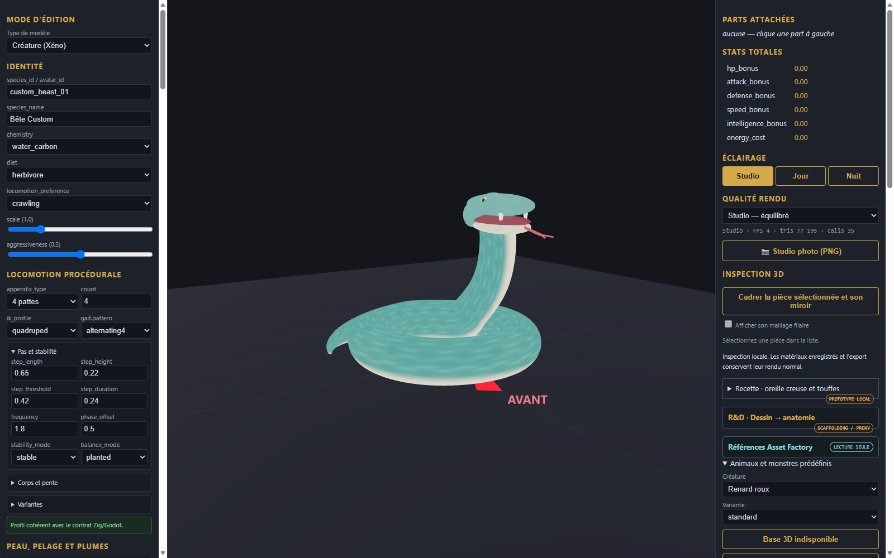

# Serpent — raccord de mâchoire pour revue

Une variante rapproche la mâchoire inférieure et ajoute deux volumes de raccord à l’arrière. La capture montre le modèle complet importé dans l’éditeur ; les pièces séparées n’ont pas été réassemblées dans l’éditeur pour cette variante.

`serpent-parts.recipe.json` décrit la peau et l’ensemble de mâchoire extraits ainsi que leurs empreintes et pivots. Les raccords sont des volumes superposés, sans soudure topologique ; leur qualité sous tous les angles, l’animation, le rig et l’intégration au jeu restent à vérifier. Le rendu est stylisé et ne constitue pas une validation de fidélité à la référence.
