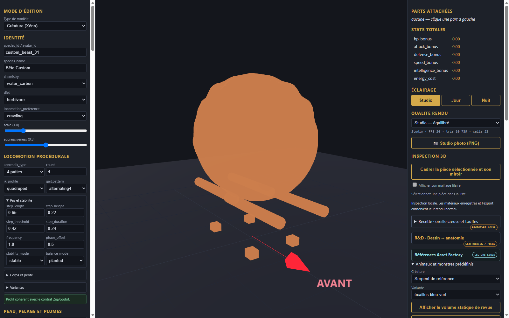

# Mouton de reference - pieces et assemblage

[Recette des pieces](recipe.json). Modele inspire de Designer (6).png : toison laineuse volumineuse couvrant le corps et les epaules, tete douce avec chanfrein degage et yeux horizontaux, quatre membres a sabots fendus.

Composants extraits : toison frisee, tete et museau ovins, membres a sabots fendus.
Limites : volume de toison statique, rendu sans fur cards dynamiques ni rig.
