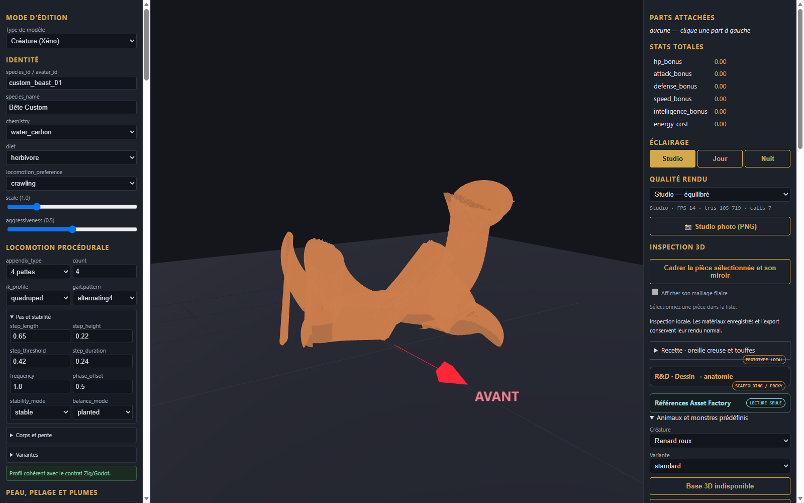
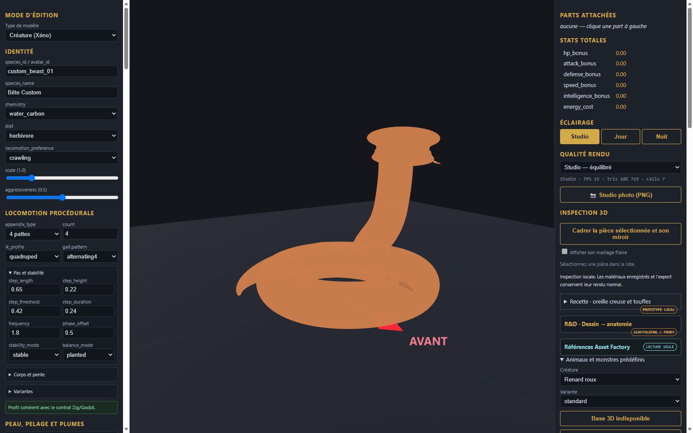

# Serpent - maillage continu, squelette et reptation

Modele continu aux jonctions soudees (0 arete non-manifold) dote d un squelette vertebral de 17 os et d une animation d ondulation (SnakeSlither, 51 pistes).

[Modele rigge et anime (GLB)](serpent_rigged_walk.glb) | [Modele soude statique](serpent_welded.glb) | [Recette](recipe.json)

- **Squelette vertebral** : chaine de 15 vertebres le long du corps enroule, crane triangulaire de vipere et machoire inferieure articulee.
- **Animation d ondulation** : onde sinusoidale propagee le long des vertebres, frappe avant de la tete et ouverture de la gueule exhibant les crochets venimeux.
- **Deformation verifiee** : teste dans l editeur Three.js via AnimationMixer avec deplacement fluide du maillage continu.
