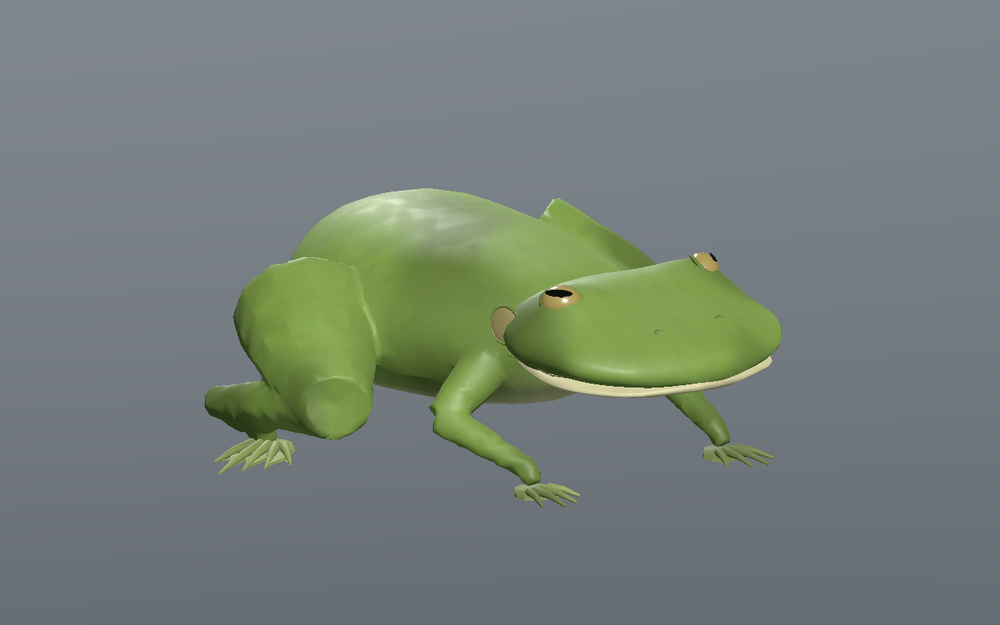
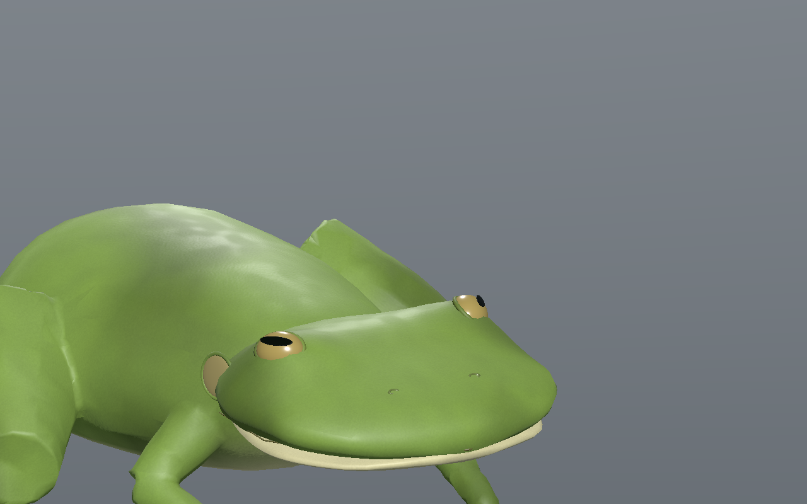
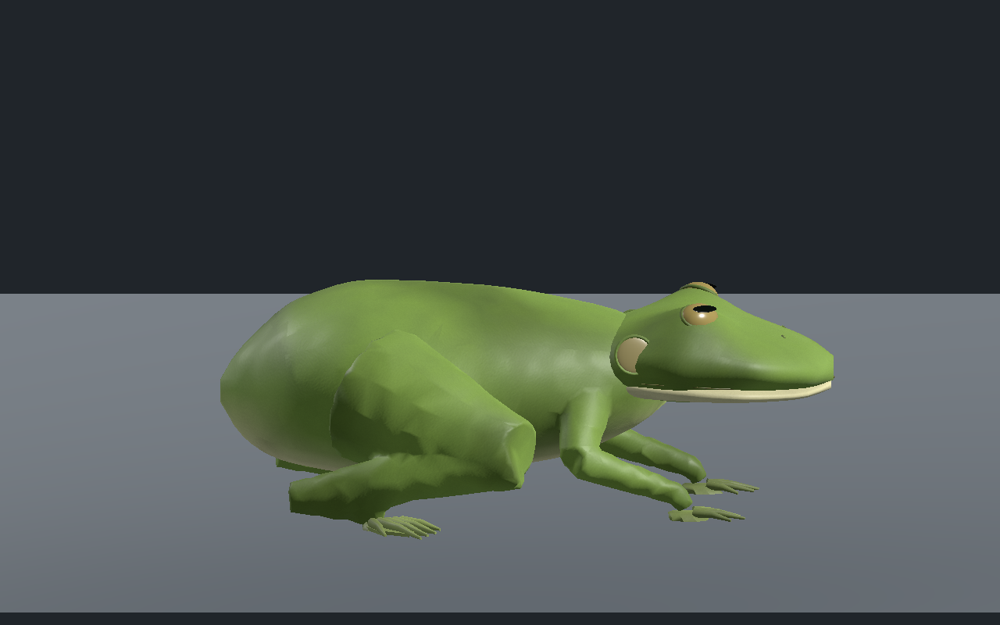
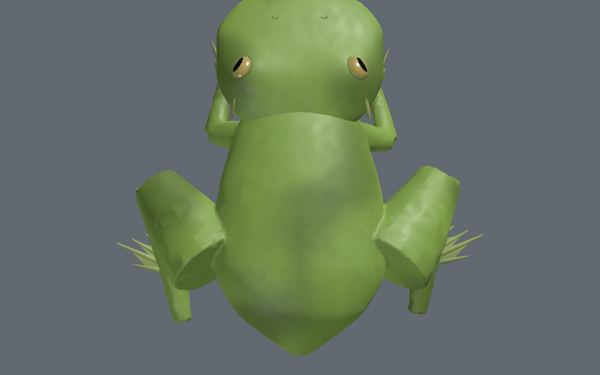
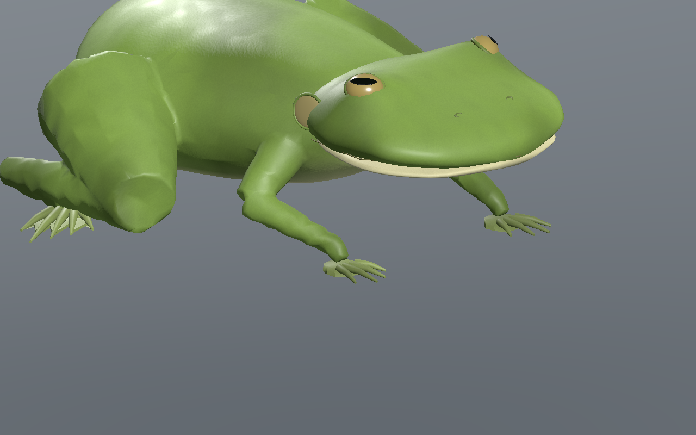
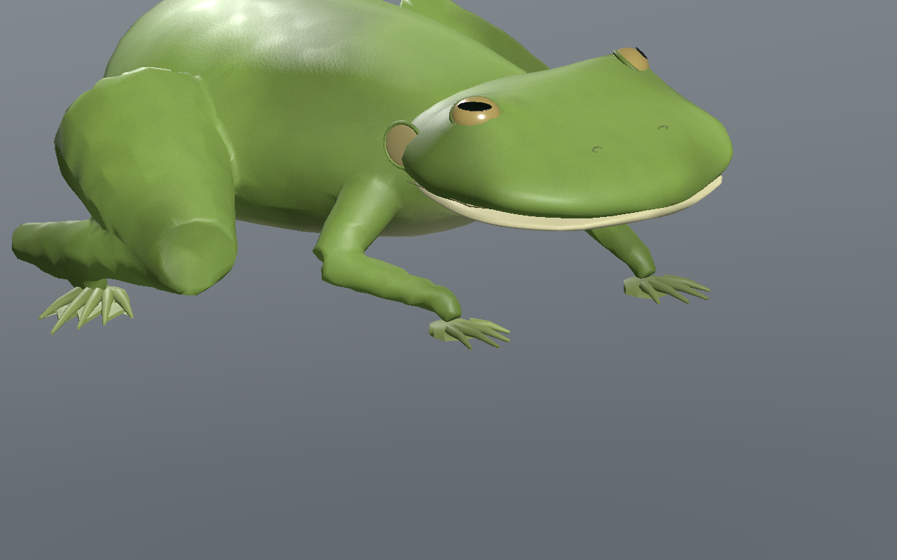
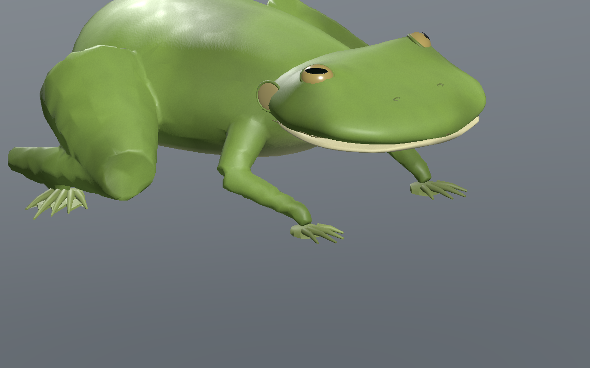
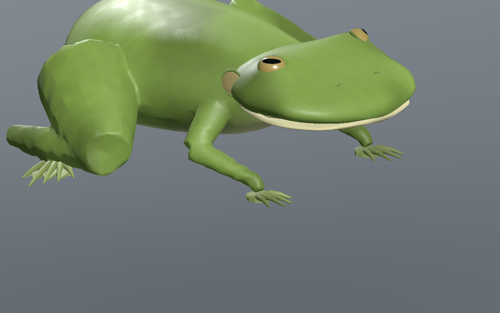
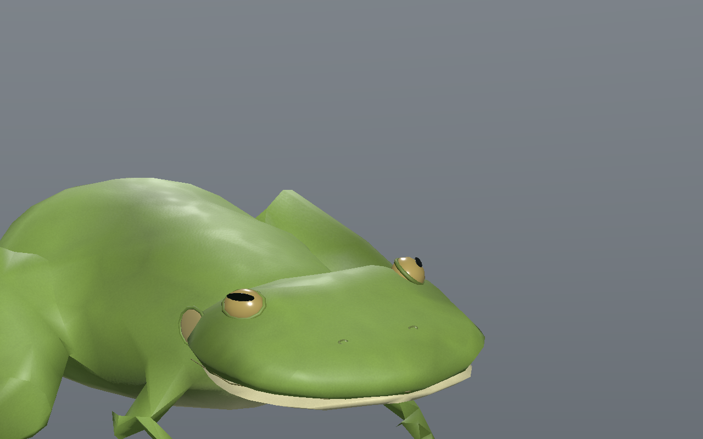

# Grenouille géante — peau, doigts palmés et déplacement lent

**Version 0.1.0, encore stylisée.** Le photoréalisme final et l’intégration en jeu restent ouverts.

[Recette JSON](recipe.json) · [Conception](design-profile.json) · [UV et pigment](uv-measurements.json) · [Validation](validation.json) · [Provenance](provenance.json) · [Galerie](../../GALERIE.md)

La tête originale est dédiée, sans torse : yeux dorsaux à pupille horizontale, deux tympans visibles et deux petits creux nasaux. Les pattes avant ont quatre doigts libres ; les pattes arrière ont cinq doigts et une membrane, avec le quatrième doigt plus long dégagé. Les pieds arrière sont orientés de 60° vers l’extérieur pour dégager les doigts de la cuisse repliée. Aucun pavillon d’oreille, aucune griffe et aucune queue adulte.

Le torse et les douze segments de membres forment une surface fermée connectée. La tête, la mâchoire, les doigts et les membranes restent des composants séparés en recouvrement. Les trois détails du composant de tête conservent les mêmes positions, normales, UV et couleurs que la tête du corps entier.

| Profil | Dessus |
| --- | --- |
|  |  |

Budget mesuré : **11 302 / 6 440 / 3 552 triangles**, **23 os**, quatre influences maximum, cinq matériaux par LOD. Les trois images originales font **512 / 256 / 256 pixels** ; estimation RGBA8 et mipmaps complètes : **2 097 148 octets**. Ce coût ne mesure ni la VRAM totale ni les FPS du jeu.

Les grandes taches d’une première variante rendaient les coutures UV triangulaires trop visibles. Le pigment principal est maintenant cuit dans les couleurs des sommets à partir d’une fonction 3D originale continue ; les textures portent un microalbédo neutre, les microgranules et la rugosité. L’égalité du pigment est vérifiée aux sommets coïncidents des coutures dans chaque pièce ; les petites coutures des cartes directionnelles restent présentes.

Sur **601 poses par LOD**, au moins **trois appuis**, dérive maximale **0.0002 mm**, hauteur absolue d’appui **0.200 mm** et levée minimale **34.95 mm**. Ratio maximal d’arête **1.260**, aire relative minimale **0.541** et alignement minimal des normales **0.665**.

Le véritable éditeur contrôle lecture/pause/reprise, les trois LOD, la tête seule et l’effet visible de la topologie, du squelette et du microrelief. Sa recette téléchargée porte le pas de 0,055 à **0,06 m**. La sélection et cette reconstruction passent Godot Forward+ et Compatibility sur **241 poses par LOD**.

| Phase 15 % | Phase 40 % |
| --- | --- |
|  |  |

| Phase 65 % | Phase 90 % |
| --- | --- |
|  |  |

Les neuf images sont des captures natives non retouchées du modèle reconstruit `68432b85b030dff5340977412154ff2c8d07cbfce8551410e0079dd12515e5b9`. Recette SHA-256 : `178938c4881e1ce116f02db3204f753ebbf811a112777d93b5eef0b7411e803c`.

La recette seule nécessite les dépendances originales locales ; les GLB, générateurs privés et bitmaps sources restent locaux. Les identités candidates et statistiques serveur sont conservées sans association automatique. Première revue locale encore stylisée : déplacement lent sur sol plat dans l’éditeur et Godot isolés. Sculpture, iris, raccords de composants et silhouette du LOD2 restent à affiner. Centre de masse, forces, bonds, nage, terrain, collisions exhaustives, monde principal, réseau, VR et photoréalisme final non qualifiés.
