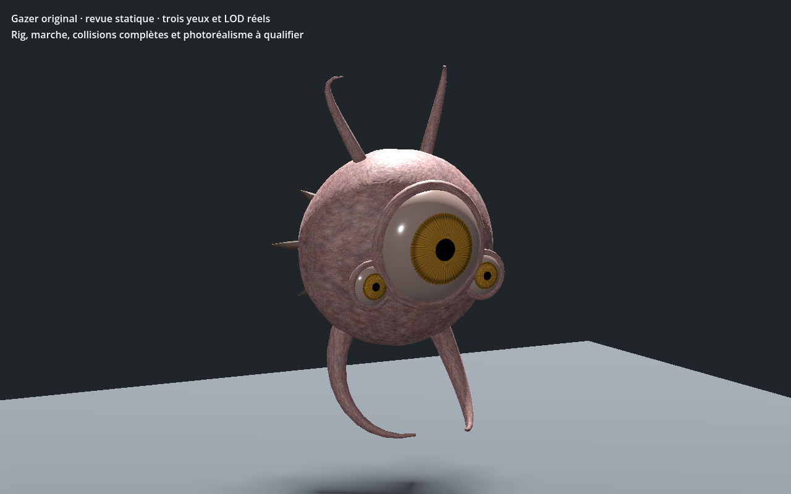

# Gazer original — recette 0.1.0

[Recette JSON exportée](recipe.json) — version documentaire **0.1.0**, `review_only`.

La recette utilise `uo.gazer-original/v1` et la source SHA-256 `e298159e7613a08260f5e1cdb5a6b75ab3132bebad405a961f3a551dc1603c0a`. Le générateur et le modèle source ne sont pas distribués ici : ce JSON seul ne suffit pas à reconstruire le modèle. Cette entrée n’est pas un génome Xeno natif ni une entrée strict-v1 du catalogue.

La capture provient du contrôle Godot de la variante reconstruite avec cette recette ; SHA-256 du GLB reconstruit : `8db1d67b25c8d8003b4ffb7246281fd9bfecc9c01c16f7ef6436aa519a88dcda`. Le contrôle historique `PASS_GAZER_STATIC_LODS_AND_POSES` s’est terminé avec le code 0. La géométrie et les matières de ce lot sont documentées comme originales ou procédurales ; aucune référence historique EA/Origin n’est incluse.

La capture et la preuve locale ne valident pas les collisions complètes, l’intégration au serveur ou à la VR, ni la qualité artistique finale.

SHA-256 de la recette : `6a168a98fc6ae5e3cc434ec8c76083550319030e7da397943aa7b426d68811d5` ; de la capture : `c782216723cae28ba3d9263170a25ef97a9c94e87bd5fce86f1168bafbda8b1e`.
