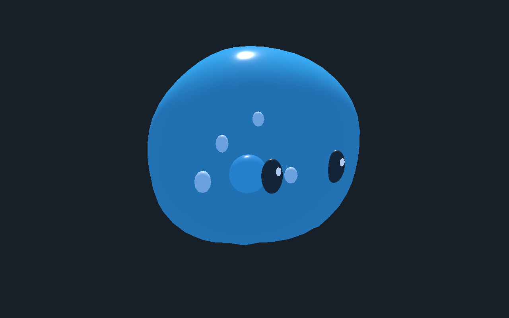

# Gelée bleue — yeux et éléments internes entraînés

[Recette de revue](recipe.json) · [Éditeur](editor.png) · [Début](pose-0.png) · [Demi-cycle](pose-60.png) · [Trois quarts](pose-90.png) · [Étude précédente](../gelee-bleue-revue-20261107/README.md)

La coque, les yeux, les reflets, le cœur et les bulles partagent le même champ de déformation locale. Dans le vrai éditeur, les neuf éléments compatibles suivent la coque ; les réglages hérités de locomotion à pattes sont masqués pendant cette revue et réapparaissent au remplacement du volume.

Godot Compatibility et Forward+ contrôlent chacun 121 poses avec la recette (souplesse 0,20, fréquence 1,3 Hz), puis 61 poses à chacune des souplesses 0, 0,12 et 0,25. La hauteur minimale de la coque est 0 m. Sur une paire de sommets de contrôle œil/coque par œil, la variation maximale de distance est inférieure à 0,34 mm pour ces essais. Ces paires ne constituent pas une détection exhaustive des intersections.

Budget inchangé : 2 720 triangles, dix maillages, aucune image de texture. La recette dépend des ressources locales non distribuées. L’animation de revue est calculée localement dans chaque environnement ; collision, locomotion en jeu, serveur, performances et finition artistique restent à qualifier.
