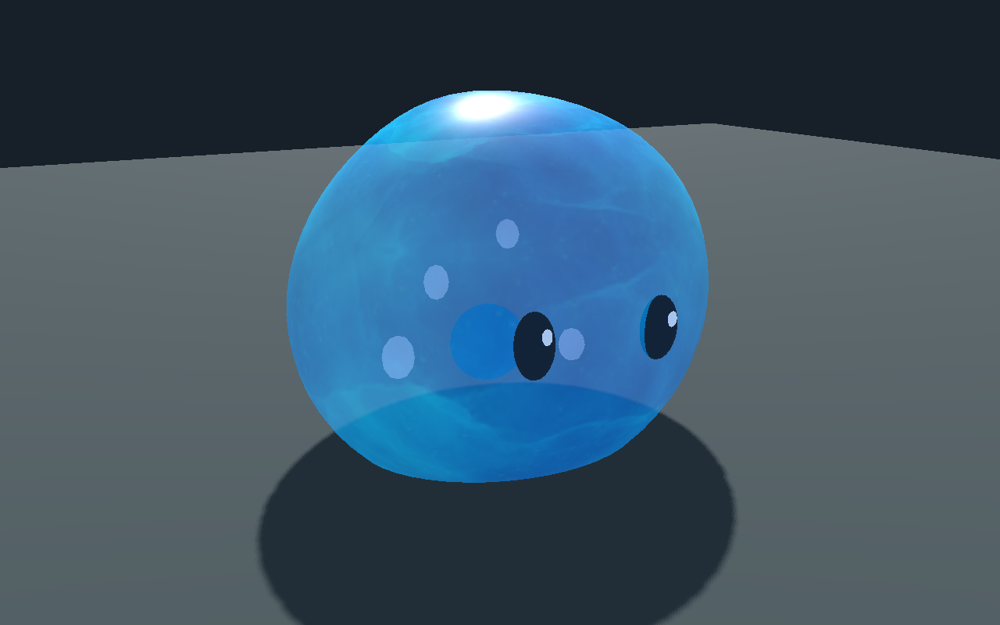

# Gelée bleue — matière et animation par morphes

[Recette de revue](recipe.json) · [Mesures et limites](validation.json) · [Éditeur](editor.png) · [Début](pose-0.png) · [Demi-cycle](pose-60.png) · [Trois quarts](pose-90.png) · [Étude précédente](../gelee-bleue-attaches-20261107/README.md)

Une coque fermée à base plane et une matière originale bleue remplacent la surface précédente. Les yeux, reflets, cœur et bulles suivent deux morphes calculés à partir du même champ que l’aperçu de l’éditeur. La carte UV de la coque n’a aucun triangle écrasé dans le contrôle statique ; l’anisotropie maximale mesurée est 1,77 (précédent atlas expérimental : 5,41). Les normales interpolées restent une approximation.

Budget de cette étude : 3 744 triangles, dix maillages, deux morphes par maillage et trois images 512², 256² et 256² ; estimation RGBA8 avec mipmaps complètes : 2 097 148 octets pour les images seules. Cela ne mesure ni le coût total GPU ni les performances en foule.

Le véritable éditeur charge et anime le modèle, exporte la recette liée à son empreinte et rétablit la pose au repos. Godot 4.8 beta2, Compatibility et Forward+, importe la même recette, refuse une empreinte incorrecte et contrôle 244 combinaisons de phase et de souplesse sur les sommets importés. Les 45 paires de composants et les auto-croisements ont été examinés sur 93 poses : les seuls croisements entre pièces observés correspondent aux yeux insérés dans la coque et aux reflets dans les yeux ; les sommets du cœur et des bulles restent à l’intérieur aux poses échantillonnées. Ces contrôles ne prouvent pas une absence continue d’intersection.

Dans un seul essai Godot sur ce modèle, l’appel de préparation côté CPU était de 2 137 µs médian pour la reconstruction des surfaces et 7 µs pour la mise à jour des poids de morphes. Cette comparaison exclut le rendu différé, le GPU et le temps de frame ; elle ne démontre aucun gain de FPS.

Étude locale de revue : rendu final, collisions et physique, trajectoire de jeu, autorité serveur, LOD, performances en foule et VR restent à qualifier. La recette dépend du modèle local ; le GLB, le générateur et l’image source privée ne sont pas distribués.
