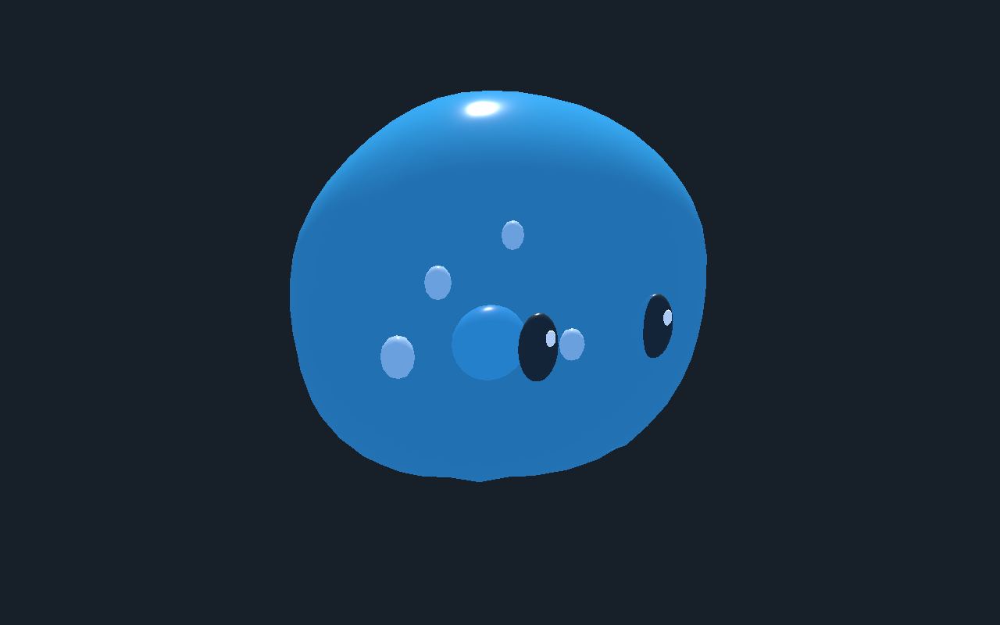

# Gelée bleue — étude de revue

[Recette de revue](recipe.json) · [Éditeur](editor.png) · [Début](pose-0.png) · [Demi-cycle](pose-60.png) · [Trois quarts](pose-90.png)

Étude procédurale de gelée translucide : enveloppe lissée, yeux, reflets, cœur et bulles. 2 720 triangles, dix maillages, aucune image de texture. La recette règle la souplesse à 0,20 et la fréquence à 1,3 Hz et dépend du GLB local identifié par son empreinte ; le GLB et le générateur ne sont pas distribués ici.

Le véritable éditeur charge ce modèle, déforme sa surface, exporte la recette et restaure la forme initiale à l’arrêt. Dans Godot 4.8 beta2, les rendus Compatibility et Forward+ importent le même modèle ; 121 poses sur un cycle et une lecture continue locale ont été exercées avec les paramètres de la recette. La hauteur minimale mesurée du corps est 0 m. Les captures proviennent de l’éditeur et de Godot Forward+.

Ceci est une revue visuelle : aucun déplacement en jeu, collision, synchronisation serveur, qualification de performances ou validation artistique finale. La finition photoréaliste et la transparence restent à améliorer ; les rendus et l’éclairage diffèrent entre les moteurs.
