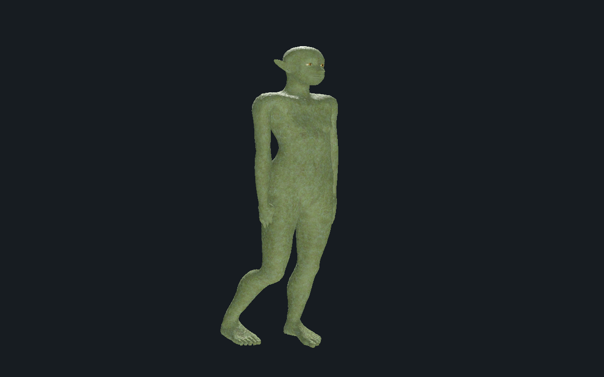

# Gobelin des forêts — revue locale

[Recette JSON](recipe.json) · [Tête](head.png) · [Appuis](feet.png)

Sculpture sur corps natif, peau originale et marche bipède sur sol plat. 15 626 triangles, 64 os et trois images 1024², 512² et 512².

Les appuis passent sur 481 poses CPU et 241 poses dans l’éditeur et chacun des rendus Godot Compatibility et Forward+. Dérive maximale en appui environ 0,201 mm. Captures issues de Godot Forward+.

Copie de revue : déformations locales, collisions exhaustives, niveaux de détail, terrain, virages, gameplay et finition artistique restent à qualifier. La recette dépend des ressources privées locales ; celles-ci ne sont pas distribuées ici.
