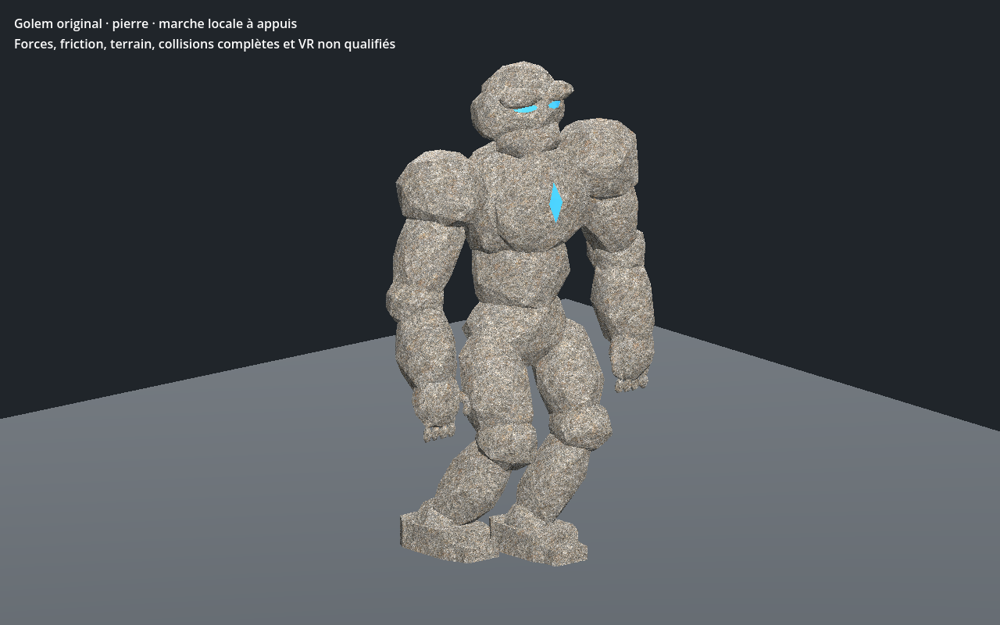

# Golem original — recette 0.1.0

[Recette JSON exportée](recipe.json) — version documentaire **0.1.0**, `review_only`.

La recette utilise `uo.golem-original/v1` et la source SHA-256 `615d5457cdb17b95090e84b9fe148dc8009458c7d8bd6d20d730d9ae48d64d3e`. Le générateur et le modèle source ne sont pas distribués ici : ce JSON seul ne suffit pas à reconstruire le modèle. Cette entrée n’est pas un génome Xeno natif ni une entrée strict-v1 du catalogue.

La capture provient du contrôle Godot de la variante reconstruite avec cette recette ; SHA-256 du GLB reconstruit : `5231bcfd158aa77207c279dc5d19689a9a376df8b953f2c24beec6cd22d6ff01`. Le contrôle historique `PASS_GOLEM_NATIVE_RIGID_SKIN_AND_SOLE_ANCHORS` s’est terminé avec le code 0. La géométrie et les matières de ce lot sont documentées comme originales ou procédurales ; aucune référence historique EA/Origin n’est incluse.

La capture et la preuve locale ne valident pas les collisions complètes, l’intégration au serveur ou à la VR, ni la qualité artistique finale.

SHA-256 de la recette : `0857fa962ef559245c11bb5ba387fccd9335c20d30fd0e45a0a7af4fe1e683a1` ; de la capture : `84840bae68f37a5397b55d6533c52a83ebe41973006b2eda4f1cf5818561a5cb`.
